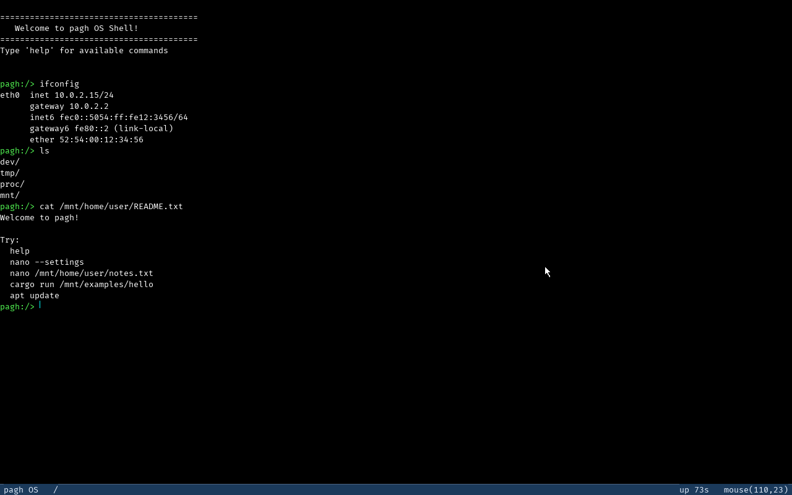
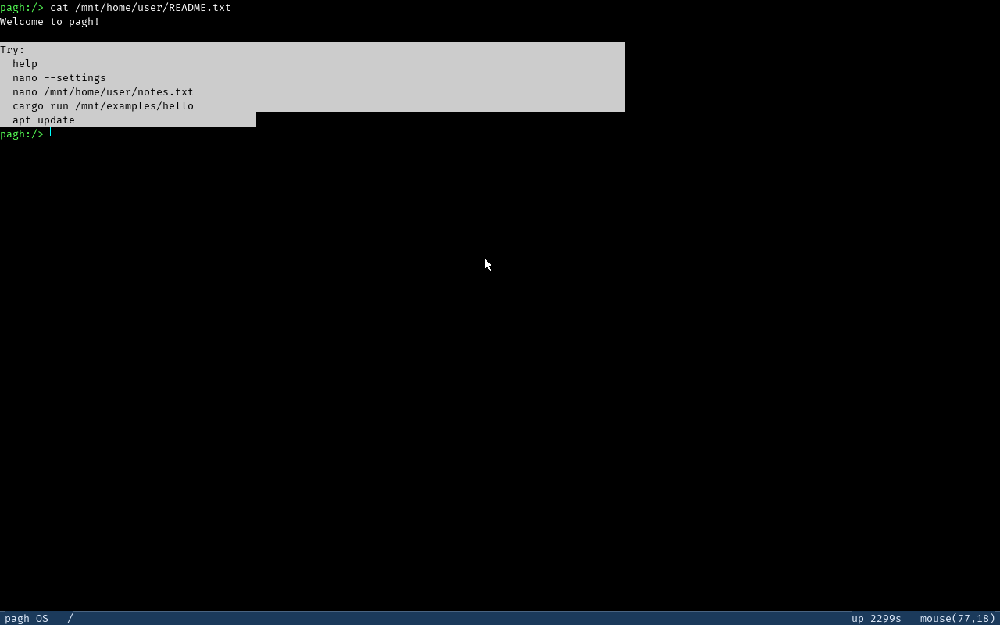
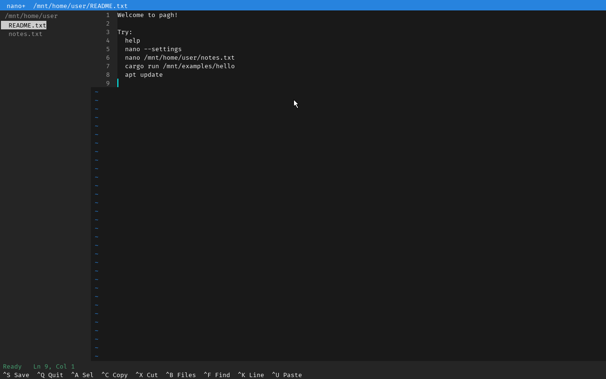
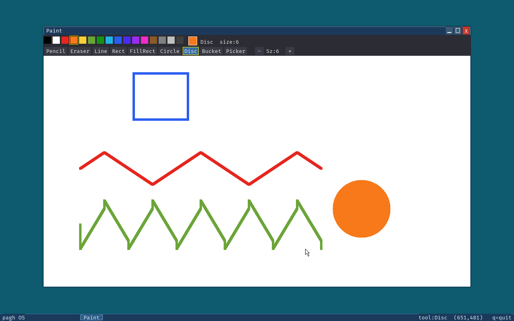
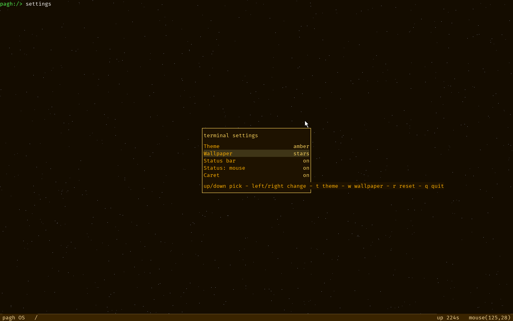
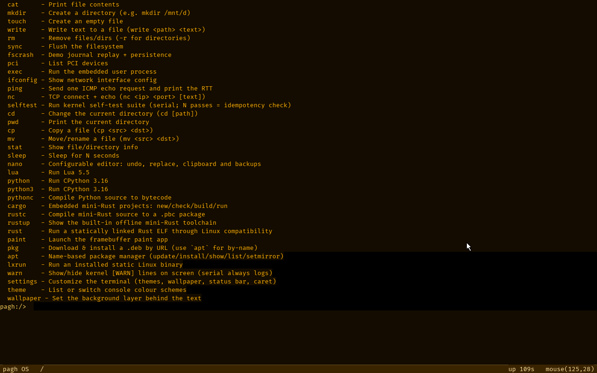
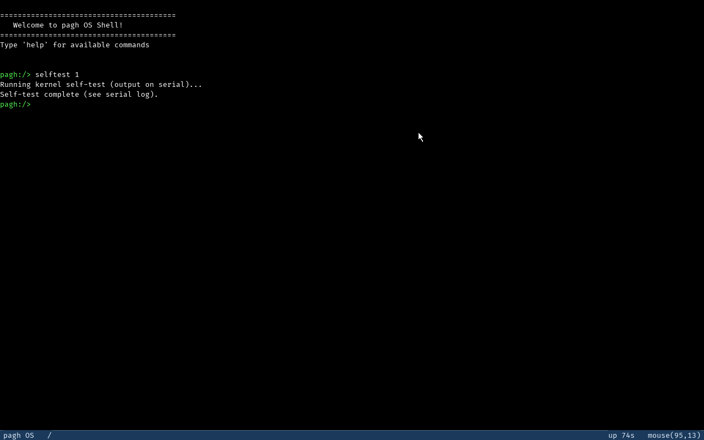
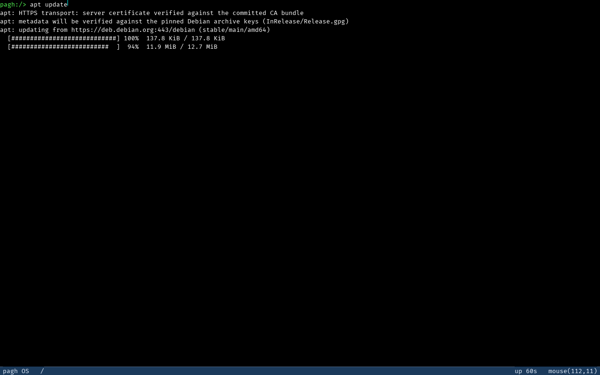

<h1 align="center">pagh</h1>

<p align="center">
  Небольшое 64-битное ядро ОС на Rust — ext2 + WAL-журналирование, стек TCP/IP,
  framebuffer-GUI и управляемый мышью paint-редактор, загружается на реальном UEFI через Limine.
</p>

<p align="center">
  
  
  
  
  
  <a href="https://github.com/ccclosed/Pagh-OS/releases/tag/2.18.12-demo"></a>
</p>

<p align="center">
  <a href="docs/demo.mp4"></a>
  <br>
  <sub><i>24 с реальной загрузки QEMU/OVMF, записанные с framebuffer — boot, shell, paint, nano+, темы. <a href="docs/demo.mp4">MP4</a></i></sub>
</p>

<p align="center">
  <b>Попробовать одной командой — тулчейн Rust не нужен:</b><br>
  <code>tar xzf pagh-demo-x86_64.tar.gz &amp;&amp; cd pagh-demo-x86_64 &amp;&amp; ./run.sh</code><br>
  <sub>скачайте загрузочный образ из <a href="https://github.com/ccclosed/Pagh-OS/releases/tag/2.18.12-demo">релиза demo bundle</a> · нужны <code>qemu-system-x86_64</code> + OVMF · <code>Ctrl+Alt+G</code> отпускает мышь, затем <code>quit</code></sub>
</p>

### Что уже работает

- **Загрузка:** Limine/UEFI → консоль framebuffer 1280×800 с цветным prompt'ом и статус-строкой.
- **Shell:** редактирование строки, история, tab completion, прокрутка консоли (колесо мыши / PageUp / PageDown), `ls`/`ls -l`/`tree`/`chmod`/`chown`/`df`/`free`/`date`/`head`/`tail`/`wc`/`grep`/`ifconfig`/`ps`, файловые операции ext2, `selftest`.
- **GUI-приложения:** управляемый мышью `paint` (инструменты фигур, 16-цветная палитра, размеры кисти, undo, сохранение в ext2), полноэкранный редактор `nano+` и `settings` с живыми цветовыми темами и обоями.
- **Хранилище:** ext2-совместимая read/write файловая система с журналом write-ahead-log, на реальном virtio-blk или NVMe-диске (или RAM-диске с загрузочного носителя).
- **Сеть:** стек TCP/IP поверх e1000 или USB-RNDIS (USB-тетеринг телефона): DHCP/ARP/TCP/UDP; `ifconfig` показывает живой lease.
- **Процессы:** вытесняющий планировщик ~1 кГц, ring-3 пользовательские процессы, `SYSCALL`/`int 0x80`.

*Не показано в демо выше (реализовано, но не задействовано в этой записи):* `apt`-подобный
менеджер пакетов Debian по HTTPS/TLS с проверенными через OpenPGP метаданными, слой
совместимости с Linux-x86_64-бинарниками и CPython 3.16, а также восстановление после
краша ext2 WAL (`fscrash`). См. глубокие доки ниже.

**Сборка и запуск из исходников** (Rust nightly с `rust-src`, QEMU + OVMF; Limine
скачивается автоматически):

```sh
git clone https://github.com/ccclosed/Pagh-OS && cd Pagh-OS
./run.sh --release
```

**Глубокие доки:** [Быстрый старт](#быстрый-старт) · [Вывод загрузки](#вывод-загрузки) ·
[Команды shell](#команды-shell) · [Графика и paint](#графика-и-приложение-paint) ·
[Архитектура](#архитектура) · [Корректность и тесты](#свойства-корректности-и-тестирование) ·
[Linux-бинарники и пакеты](#linux-бинарники-и-пакеты-debian) · [Модель безопасности](SECURITY.md) ·
[Участие в проекте](CONTRIBUTING.md)

---

Небольшое 64-битное ядро операционной системы на Rust (`#![no_std]`), загружаемое по
протоколу [Limine](https://github.com/limine-bootloader/limine) на x86_64 и работающее
под QEMU/OVMF.

`pagh` поднимает serial, GDT/IDT, битмапный менеджер физической памяти, 4-уровневый
пейджинг, кучу, APIC (LAPIC-таймер + I/O APIC), PS/2-клавиатуру и мышь, framebuffer-консоль
с 2D-примитивами и программным курсором, виртуальную файловую систему, загрузчик ELF64,
вытесняющий round-robin планировщик, интерфейс `SYSCALL`/`int 0x80`, перечисление PCI с
драйверами virtio, сетевой стек TCP/IP, журналируемую ext2-файловую систему на реальном
диске и дружественный интерактивный shell с редактированием строки, историей, tab
completion и цветным выводом. Он умеет загружать и исполнять встроенную тестовую программу
в ring 3 и поставляет оконное, управляемое мышью приложение `paint` (перемещаемое окно с
minimize/maximize/close и кнопкой на панели задач). Он также исполняет **Linux x86_64
ELF-бинарники — статически слинкованные или динамически слинкованные против glibc (вплоть
до CPython 3.16) —** в ring 3 через слой совместимости с Linux-сисколлами (`fork`/`clone` +
потоки, `epoll`/`eventfd`, unix-сокеты и VT100-совместимый терминал с raw-mode `termios`),
включает **`apt`-подобный менеджер пакетов**, который скачивает и ставит Debian-пакеты
`.deb` по имени через HTTP/HTTPS, и умеет **устанавливать базовый glibc + Python userland**
на свой ext2-диск по запросу из shell (`ppkg update` + `ppkg install python3`) — сама
загрузка никогда не останавливается, чтобы что-то спросить.

> Хобби/учебное ядро — **не граница безопасности.** Ring 3 изолирован от ядра
> пейджингом (бит U/S, W^X/NX-листы, MMIO устройств никогда не доступен пользователю), а
> буферы сисколлов проверяются на диапазон против пользовательских маппингов. **Модель
> учётных данных процессов** теперь существует: `CompatState` несёт реальные
> `uid`/`gid`/`euid`/`egid`/`suid`/`sgid`, семейство `set*id` меняет их по правилам Linux,
> а слой сисколлов применяет POSIX-биты owner/group/other (со стандартным обходом
> чтения/записи для root и правилом «для исполнения всё равно нужен x-бит») на `open`,
> `execve`, мутациях каталогов, `chmod`/`chown`, `kill` и `access`, опираясь на ext2
> `i_mode`/`i_uid`/`i_gid` (создание проставляет ids и mode вызывающего; `stat` их
> сообщает). SMEP включается, когда CPUID о нём сообщает. Чего **всё ещё нет**: учётных
> записей и логина (shell и каждый порождённый ядром процесс по умолчанию root, поэтому
> модель ограничивает только процессы, которые намеренно сбрасывают привилегии), повышения
> через setuid-бинарники на `execve`, дополнительных групп, ACL или `fsuid`, наборов
> capabilities, seccomp или LSM, audit trail, ASLR/KASLR, KPTI, SMAP и namespaces
> адресного пространства/монтирования. Цепочка TLS + OpenPGP + digest ниже аутентифицирует
> **пакеты** против враждебного зеркала; она не сдерживает враждебный локальный код. Не
> запускайте недоверенные бинарники и не выставляйте это ядро в сеть, которую не
> контролируете. Подробности — в `SECURITY.md` и `docs/security-model.md`.

> **Сетевое поведение по умолчанию:** исходящие операции с пакетами **включены** в обычных
> сборках (`default = ["network_packages"]` в `Cargo.toml`). Две независимые половины
> аутентифицируют репозиторий: HTTPS проверяет сертификат сервера fail-closed против четырёх
> запиненных корней, а пакетный конвейер проверяет подписанные метаданные end-to-end —
> `InRelease`/`Release.gpg` против keyring'а Debian, запиненного по отпечатку, затем SHA-256
> **и** размер `Packages` и каждого `.deb` (issue #32). Зеркало, не отдающее подпись,
> отвергается; флага-обхода нет. Plain-HTTP-зеркала проходят проверку целостности по этой
> цепочке, хотя их транспорт не аутентифицирован. Оставшиеся пробелы (распространение
> отзыва, replay целой старой тройки на suite'ах без `Valid-Until`, команда `pkg` без
> индекса) перечислены в `SECURITY.md`. Для fail-closed сборки используйте
> `cargo build --no-default-features`. См. `HARDENING.md`.

---

## Скриншоты

Каждое изображение ниже — сырой QEMU-снимок framebuffer 1280×800: эти пиксели рисует само
ядро (консоль блитит битмап-ассет Fira Code, курсор — программный оверлей, `paint` — canvas
в окне), поэтому здесь нет ни хостового рендеринга шрифтов, ни композитинга скриншотов.

### Интерактивный shell

Framebuffer-консоль с цветным prompt'ом `pagh:/>`, мигающей кареткой на логическом
курсоре, живой статус-строкой (имя ОС, текущий каталог, uptime, позиция мыши) и
программным курсором. Редактирование строки, история, tab completion, `Shift`/`CapsLock`,
выделение мышью и `Ctrl+A`/`Ctrl+X`/`Ctrl+Y` работают на этом экране; простаивающий shell
спит, а не перерисовывает поверхность на каждом тике таймера.



### Выделение текста консоли мышью

Перетаскивание левой кнопкой выделяет ячейки консоли (подсветка — инвертированная *модель*
консоли, а не копия битмапа); отпускание копирует текст в клипборд сессии, а `Ctrl+X`,
`Ctrl+Y`/`Ctrl+V` вырезают и вставляют его в редактируемую строку.



### Редактор `nano+`

Полноэкранный редактор с боковой панелью файлового дерева (`^B`), undo/redo, поиском и
заменой, построчным клипбордом, per-file бэкапами и защитой от выхода двойным нажатием.
Сохранение усекает файл, поэтому более короткий документ действительно заменяет старый, а
не оставляет его хвост.



### Приложение `paint`

Оконное, управляемое мышью приложение для рисования: title bar с minimize/maximize/close,
16-цветная палитра, инструменты pencil/eraser/line/rect/filled-rect/circle/disc/bucket/picker,
размеры кисти 1–64, undo и пункт «Paint» на панели задач. Canvas — это `Vec<u32>`, который
блитится через тот же shadow-buffer, что и консоль.



### `settings`: темы, обои, статус-строка, каретка

`settings` открывает модальную панель, которая вживую переключает цветовые схемы (classic,
amber, green, paper, synth) и обои (plain, gradient, scanlines, stars, grid) — каждое
изменение перерисовывает реальный framebuffer, поэтому панель и есть превью.



Тема и обои, применённые к работающей консоли; палитра также перекрашивает статус-строку и
prompt.



### In-QEMU self-test

`selftest` прогоняет собственный property/regression набор ядра против живого состояния
ядра (PMM, VMM, ext2, VFS, планировщик, сигналы, парсеры TLS/apt, чистая логика shell …) и
печатает машинно-проверяемый вердикт на serial (`SELFTEST SUMMARY`, плюс строку `SELFTEST
IDEMPOTENCY`, когда прогонов больше одного); экран сообщает, что прогон начался и
закончился.



### `ppkg update` по HTTPS

Менеджер пакетов по имени скачивает индекс Debian `Packages` по TLS 1.3, проверив цепочку
сертификата сервера, hostname и срок действия до того, как прочитан хоть байт индекса.



---

## Возможности вкратце

- **Ядро:** безопасный слой привилегированных инструкций (SSE включён для ring 3; само ядро
  собрано soft-float), GDT/IDT/TSS/IST, битмапный PMM, 4-уровневый VMM с `map_mmio`, куча
  `good_memory_allocator` (galloc), ACPI (MADT), LAPIC + I/O APIC.
- **Задачи:** вытесняющий ~1 кГц round-robin планировщик, потоки ядра, ring-3
  пользовательские процессы, `int 0x80`-сисколлы (`SYS_WRITE`/`EXIT`/`YIELD`).
- **Ввод и графика:** PS/2-клавиатура (IRQ1) и мышь (IRQ12), framebuffer-консоль, которая
  рисует через RAM shadow buffer и выталкивает его в устройство один раз на изменённый
  кадр (поэтому простаивающий shell действительно спит), 2D-примитивы (линии,
  прямоугольники, окружности, заливки, blit), нижняя статус-строка и программный курсор
  без шлейфа, рисуемый в составе того же кадра. Редактор `nano+` тоже принимает мышь (клик
  ставит каретку, drag выделяет, клик по строке сайдбара переключает файл) и помечает файл
  изменённым, только пока его текст действительно отличается от сохранённого. Гарнитура
  консоли — Fira Code в ячейке 8×18, растеризованная офлайн в `assets/font8x18.bin`
  генератором `tools/gen_font.py` — ядро смешивает 8-битное покрытие на пиксель, поэтому
  края глифов антиалиасятся, а парсера TrueType оно не несёт.
- **USB-ввод (xHCI + HID).** Встроенный драйвер xHCI без прерываний
  (`drivers/xhci.rs`) перечисляет устройства на корневых портах, а
  `drivers/usb_hid.rs` переводит их отчёты ровно в тот поток PS/2-сканкодов и
  пакетов, который даёт путь 8042, поэтому shell, boot-меню, `^C`/`^Z` и stdin
  `lxrun` работают без изменений. Каждый boot-интерфейс HID переводится в
  **boot protocol** (SET_PROTOCOL 0, не report protocol), все boot-клавиатуры и
  мыши композитного устройства привязываются и опрашиваются, interrupt-IN буфер
  имеет размер `wMaxPacketSize` (поэтому длинный отчёт не вызывает babble), а
  остановленный эндпоинт восстанавливается xHCI **Reset Endpoint** (ограниченное
  число попыток), а не отключением ввода до перезагрузки. Подъём корневых портов
  следует `hub.c`/`xhci-hub.c` в чистой политике с host-тестами
  (`drivers/xhci_hub.rs`): каждая запись PORTSC идёт через neutral-маску (так
  подтверждение reset больше не пишет `PED=1` и не отключает порт), подключение
  должно быть неизменным 100 мс до reset (шаг 25 мс, бюджет 2 с), reset ждётся
  как `hub_port_wait_reset` (опрос 10 мс, затем 200 мс, 800 мс на запись, до
  пяти записей, затем `PED`), включение должно продержаться 200 мс до адресации,
  потеря включения даёт паузу ≥1 с и новый debounce вместо reset каждые ~100 мс,
  а PP power-cycle отсутствует вовсе (PP только поднимается, читается обратно и
  повторяется). Ограничения честно названы: хабы не поддерживаются (устройство
  за хабом невидимо); устройства только-report-protocol — best effort
  (предполагается boot-раскладка клавиатуры, мышь поддерживает 7-байтную
  16-битную E-Signal или 8-битные оси); wheel/pan декодируются, но не
  доставляются; LED output report (`SET_REPORT`) не реализован. Проверено в
  QEMU (`tools/e2e.py usb`, host-свойства, `selftest`); на реальном железе не
  проверялось.
- **USB-тетеринг (RNDIS).** Когда Ethernet-кабеля нет, сеть можно поднять через
  телефон в режиме USB-модема: `drivers/usb_rndis.rs` находит пару интерфейсов
  RNDIS на том же xHCI-контроллере, поднимает устройство (INITIALIZE, MAC,
  packet filter), гоняет Ethernet-кадры через bulk-пару и отдаёт их тому же
  стеку TCP/IP. Выбор канала — `net::link` (`e1000` имеет приоритет, иначе
  RNDIS); если телефон перечислился уже после загрузки, сетевой поток
  подхватывает его без перезагрузки. DHCP работает поверх RNDIS, а если
  телефон не ответил — применяется статический `192.168.42.21/24`, gw
  `192.168.42.129`. `max_transfer`, MAC и состояние канала печатаются строкой
  `usb-rndis: iface=... mac=... link=up`. Проверено в QEMU без e1000 на
  `usb-net` (`tools/e2e.py rndis`): MAC, DHCP `10.0.2.15`, ping `10.0.2.2`,
  HTTP GET; реальное железо (Xiaomi 2717:ff88) проверяет пользователь.
  Ограничения: хабы, hot-unplug и interrupt-IN уведомления RNDIS не
  обрабатываются; onboard Realtek RTL8125 не поддерживается — это отдельный
  драйвер, не e1000.
- **Хранилище:** перечисление PCI, блочные устройства virtio-blk и NVMe, **поддержка
  разделов GPT/MBR** (каждый раздел становится отдельным блочным устройством, поэтому pagh
  может владеть одним разделом, а не всем диском) и ext2-совместимая read/write файловая
  система с несколькими группами блоков, монтируемая в `/mnt` (тома масштаба GiB),
  защищённая журналом write-ahead-log (WAL) для консистентности после краша — большие
  записи коммитятся ограниченными порциями на транзакцию. При загрузке **disk-меню** листит,
  что хранит каждый раздел (собственный том pagh, пустая область, чужая файловая система), и
  это единственное место, где раздел можно форматировать: `Enter` монтирует, `F`
  форматирует после ввода имени устройства обратно, случайная клавиша ничего не стирает, а
  20-секундный таймаут выбирает неразрушающий путь. Меню показывается только когда выбор
  действительно неоднозначен (пустой/чужой носитель, первая провизия): если на машине уже
  есть том pagh (WAL-маркер), загрузка молча монтирует его и идёт дальше — повторной
  «первой загрузки» с выбором диска нет. Том считается своим для pagh тогда и
  только тогда, когда несёт WAL-superblock pagh; ext3/ext4 распознаются как чужие и
  отвергаются. Образ на диске можно смонтировать на хосте (`mount -t ext2 -o loop disk.img`).
- **Сеть:** собственная dual-stack реализация TCP/IP (без внешнего сетевого крейта) поверх
  собственного драйвера Intel e1000 или USB-RNDIS (канал выбирается в `net::link`):
  IPv4 (ARP, фрагментация/сборка, ICMP echo + `ping`, DHCPv4) и
  IPv6 (NDP neighbor discovery, Router Solicitation/Advertisement SLAAC,
  ICMPv6 echo + `ping <ipv6>`, link-local + глобальные адреса); TCP с window
  scaling (RFC 7323), SACK (RFC 2013/2883 — и отправляемые блоки, и scoreboard
  ретрансмиссий), согласование MSS, оценка RTO Jacobson/Karels, Reno congestion
  control; UDP-сокеты, DNS-резолвинг A+AAAA и UDP/TCP echo-сервисы. Linux-сокеты
  AF_INET6 (с v4-mapped адресами) доступны Linux-бинарникам.
- **Shell:** редактирование строки (стрелки/Home/End/Delete/insert), история команд, tab
  completion, `cd`/`pwd` с относительными путями, файловые операции (`cp`/`mv`/`stat`),
  цветные prompt/ошибки, подсказки опечаток, реестровый `help`, выделение текста мышью с
  клипбордом сессии, полноэкранный редактор `nano+`, приложение `paint` и панель `settings`
  с живыми цветовыми темами и обоями.
- **Linux-бинарники:** слой Linux x86_64-сисколлов (`int 0x80` + `syscall`) и ELF-загрузчик
  для статических `ET_EXEC`, static-PIE и glibc-dynamic (`PT_INTERP`) образов запускают
  Linux-программы в ring 3 (`lxrun`) — включая REPL CPython 3.16 (GNU readline работает
  через `select`/`pselect6`). `fork`/`clone` + потоки, `epoll`/`eventfd`, unix-сокеты и
  raw-mode `termios` (с kernel-side echo) реализованы; доставка POSIX-сигналов работает в
  точке возврата из сисколла (настоящие `rt_sigaction`/`rt_sigprocmask`/`sigaltstack`/
  `rt_sigreturn`, `^C` → SIGINT с пробуждениями `EINTR` в блокирующих ожиданиях);
  синтетический `procfs` отдаёт
  `/proc/{cpuinfo,meminfo,uptime,stat,version,filesystems,loadavg,mounts}`, read-only
  заглушки `/proc/sys/kernel/{ostype,osrelease,hostname}`, `/proc/self/*` и per-pid дерево
  `/proc/<pid>/{cmdline,stat,status,maps,cgroup,mountinfo,limits}`, плюс
  `/proc/<pid>/{fd,fdinfo}/<n>` и per-thread представление `/proc/<pid>/task/<tid>/` (с
  `/proc/self/task`); `/proc/<pid>/fdinfo/<n>` сообщает реальные `pos`/`flags`/`mnt_id`/`ino`
  дескриптора.
- **Пакеты:** `apt` по имени (`update`/`install`/`show`/`list`/`setmirror`), который
  скачивает Debian-индекс `Packages` по HTTP/HTTPS, потоково разжимает gzip/xz/zstd в
  компактный in-RAM arena-индекс, разрешает зависимости и ставит `.deb` на ext2 `/mnt`
  (tar-симлинки/hardlink'и создаются настоящими ссылками на ext2).
- **Провижининг:** идемпотентный first-boot flow засеивает `/mnt`; userland glibc + CPython
  ставится через `apt` (fallback декодирования индекса gz→xz, честная диагностика
  декодирования, прогресс на serial) по запросу из shell (`ppkg update` + `ppkg install
  python3`). Загрузка больше не останавливается, чтобы спросить: консольный вопрос без
  таймаута — не то, что загрузка может себе позволить.

---

## Быстрый старт

### Предварительные требования

- **Rust nightly** с компонентом `rust-src` (для `build-std`):
  ```sh
  rustup toolchain install nightly
  rustup component add rust-src --toolchain nightly
  ```
  `rust-lld` поставляется с тулчейном и используется как линкер.
- **QEMU** (`qemu-system-x86_64`) в вашем `PATH`. `qemu-img` используется для создания
  образа диска при первом запуске.
- Два предоставляемых разработчиком блоба в корне проекта (они git-ignored — см. ниже):
  - `OVMF.fd` — прошивка UEFI для QEMU.
  - Загрузчик Limine (`BOOTX64.EFI`). Версия не запинена: скрипты принимают любое локальное
    дерево `limine*/` (или `LIMINE_EFI`/`LIMINE_DIR`), а `tools/limine.py` автоматически
    скачивает последний бинарный релиз Limine в `limine/`, когда ничего не найдено.

### Сборка и запуск

#### Linux / Bash

Установите QEMU/OVMF и запиненный тулчейн Rust. `BOOTX64.EFI` Limine находится
автоматически (любое дерево `limine*/`, `LIMINE_EFI`, системные пути) или скачивается
при первой сборке:

```bash
chmod +x setup-linux.sh build.sh run.sh
./setup-linux.sh                 # пакеты хоста Ubuntu/Debian, Fedora или Arch
./build.sh                       # debug-сборка + линковка
./build.sh --release --stage     # release-сборка + staging ESP Limine
./run.sh --release               # собрать, застейджить и загрузить в QEMU
./run.sh --headless              # QEMU только с serial
```

Скрипты автоматически находят типовые системные расположения OVMF. Переопределяйте через
`OVMF=/path/to/OVMF.fd` или `OVMF_CODE` + `OVMF_VARS`. Другие поддерживаемые переменные —
`LIMINE_DIR`, `LIMINE_EFI` и `PAGH_DISK`. QEMU выходит по `Ctrl-A`, затем `X`.

`run.sh` создаёт при первом запуске raw-диск `disk.img` на 1 GiB и загружает QEMU с 1 GiB
RAM. Первая загрузка только засеивает скелет файловой системы; базовый userland `python3`
не ставится из boot-prompt'а (консольный вопрос без таймаута — не то, что загрузка может
себе позволить). Ставьте его из shell, когда захотите: `ppkg update`, затем `ppkg install
python3` (≈50 MB загрузки, прогресс на serial). Удалите `disk.img`, чтобы получить чистую,
заново засеянную систему при следующей загрузке.

> **Безопасность данных при загрузке на реальном железе.** pagh не форматирует диск сам
> при загрузке. Он листит видимые разделы и ждёт; форматирование раздела происходит, только
> когда человек нажимает `F` в этом меню и затем вводит имя раздела обратно — случайный
> Enter монтирует или объясняет, но никогда не стирает — а таймаут меню выбирает
> неразрушающий путь (монтировать собственный том pagh, если он есть, иначе RAM-диск). Том
> считается собственным для pagh, только когда несёт его WAL-superblock (`PAGHJNL\1`),
> который пишет `Ext2Fs::format` и больше никто; файловая система ext2/ext3/ext4
> показывается как `FOREIGN` и остаётся нетронутой (ext3/ext4 дополнительно отвергаются
> при mount по их feature-словам). Единственное устройство, которое автоматический путь
> может форматировать, — **RAM-диск с загрузочного носителя** (`disk.img` рядом с ядром),
> который по определению черновой и исчезает при выключении питания. Shell-овая `disk
> setup` остаётся намеренным маршрутом на всё устройство: явный маркер opt-in (запишите
> `PAGH-FORMAT` в сектор 0 этого устройства: `printf 'PAGH-FORMAT' | sudo dd
> of=/dev/nvme0n1 bs=1 conv=notrunc`) всё ещё авторизует её, и сам маркер разрушителен — он
> перезаписывает первые 11 байт сектора 0, что на разбитом на разделы диске является
> загрузочной областью. Важны две оговорки: проба **останавливается на 1 MiB**, поэтому
> раскладка, держащая все свои метаданные за этой точкой (сигнатура `mkswap` в конце
> устройства, superblock mdadm 1.0, внешние RAID-метаданные), выглядит как свободное
> место — меню помечает её `empty`, и форматирование тогда становится решением человека, а
> не случайностью; а устройство, отвергнутое потому, что его ext2-superblock парсится, но
> mount падает, нельзя спасти маркером — обнулите его начало (`wipefs -a`), и оно станет
> пустым. Подключайте pagh к выделенному пустому разделу или диску — никогда к тому, что
> хранит важные вам данные.

Кроссплатформенные Python-эквиваленты по-прежнему доступны через `tools/build.py` и
`Makefile`.

#### Windows

Скрипт `run.cmd` проводит весь конвейер:

```bat
run.cmd build           :: cargo build + link PAGH.elf only
run.cmd run             :: build + link + boot in QEMU (default)
run.cmd run release     :: release build
```

`run.cmd`:
1. запускает `cargo build`, получая статическую библиотеку `libpagh.a`,
2. линкует её в `PAGH.elf` через `rust-lld` по `linker.ld`,
3. застейдживает `iso_root/` (ядро + `BOOTX64.EFI` + сгенерированный `limine.conf`),
4. создаёт raw-диск `disk.img` на 64 MiB (через `qemu-img`), если его ещё нет,
5. запускает QEMU с OVMF, приводом `virtio-blk-pci`, NIC `e1000` (user networking с
   host-пробросом портов), serial на stdio и логированием прерываний в `qemu_debug.log`.

NIC настроен с host→guest пробросом по TCP/UDP `localhost:5555 → guest :7`, поэтому вы
можете достучаться до эхо-сервисов гостя с хоста.

Вывод serial (включая shell) появляется на консоли. Нажмите `Ctrl-A`, затем `X`, чтобы
выйти из QEMU.

Только сборка статической библиотеки:

```sh
cargo build            # debug
cargo build --release  # release
```

---

## Вывод загрузки

На чистой загрузке вы увидите сжатый уровневый лог, за которым следует shell:

```
[INFO] serial
[INFO] base revision
[INFO] limine responses
[INFO] gdt + idt
[INFO] syscalls
[INFO] pmm
[INFO] vmm
[INFO] heap
[INFO] apic
[INFO] drivers
[INFO] virtio
[INFO] scheduler
[INFO] vfs
[INFO] ext2 mounted at /mnt
[INFO] fs demo: /mnt/bootdemo.txt write+read round-trip PASS (28 bytes)
[INFO] net
[INFO] user test process spawned (pid 3)
Hello from ring3 user process!
[INFO] interrupts enabled
[INFO] net: DHCP lease acquired: 10.0.2.15/24 gw 10.0.2.2
========================================
   Welcome to pagh OS Shell!
========================================
Type 'help' for available commands
pagh:/>
```

Уровень лога по умолчанию — `INFO`; вывод `debug!`/`trace!` отфильтрован. Загрузка идёт
упорядоченной последовательностью fallible-шагов инициализации (`boot::start`); сначала
включается аппаратный SSE (ring-3-программы свободно используют XMM — само ядро собрано
soft-float и никогда не трогает векторные регистры), затем каждый шаг пишет одну сжатую
строку `info!`. Шаг `ext2 mounted at /mnt` также прогоняет одноразовую журналируемую
запись/чтение self-demo. Строку `Hello from ring3 user process!` печатает встроенный ELF,
исполняемый в ring 3 через сисколл `SYS_WRITE`. DHCP-lease асинхронно получает поток
сетевого poll'а после включения прерываний, поэтому он появляется после prompt'а. На
свежем диске загрузка только засеивает скелет файлов (release-метаданные, `/etc`, пример);
userland glibc + `python3` ставится по запросу из shell командами `ppkg update` + `apt
install python3` (прогресс на serial; зеркало лога во framebuffer приостанавливается).
Prompt показывает текущий рабочий каталог и рендерится в цвете на framebuffer (serial
остаётся простым текстом).

### Прокрутка консоли

Консоль держит строки, ушедшие вверх, и показывает их снова при прокрутке:

- **Колесо мыши** — три текстовые строки за щелчок (PS/2-мышь; драйвер согласует
  четырёхбайтный протокол IntelliMouse при загрузке, а serial-лог говорит
  `[PS2MOUSE] wheel: IntelliMouse ...`).
- **PageUp / PageDown** — один экран за нажатие. Это же покрывает USB HID-мышь: в её boot
  protocol нет оси wheel, а байты wheel/pan report-протокола декодируются, но не
  доставляются в PS/2-путь, поэтому там постранично может только клавиатура.
- **Любая другая клавиша или клик** возвращает к живому низу; статус-строка показывает
  `scroll N/M`, пока вы в истории. `clear` забывает историю.
- При активных обоях вид истории рисуется непрозрачным (строка истории должна заменить то,
  что было на экране); возврат к низу перерисовывает обои.

История ограничена (512 строк, ~256 KiB) и выделяется по мере прокрутки вывода.

### Команды shell

| Команда              | Описание                                                        |
|----------------------|-----------------------------------------------------------------|
| `help [cmd]`         | Список команд или usage/описание одной команды                  |
| `clear`              | Очистить экран framebuffer                                      |
| `echo …`             | Эхо аргументов                                                  |
| `uptime`             | Показать тики планировщика (~1000 Hz)                           |
| `date`               | Показать настенные часы RTC в UTC (ISO-дата, время, Unix-секунды) |
| `pwd`                | Напечатать текущий рабочий каталог                              |
| `cd [path]`          | Сменить каталог (относительный или абсолютный; без аргумента → `/`) |
| `ls [-l] [path]`     | Листинг каталога; `-l` добавляет mode, links, owner/group и размер |
| `tree [-L N] [path]` | Рекурсивный листинг с ограничением глубины (по умолчанию 4) и счётчиками в конце |
| `cat path`           | Напечатать содержимое файла                                     |
| `head [-n N] path`   | Напечатать первые N строк файла (по умолчанию 10)               |
| `tail [-n N] path`   | Напечатать последние N строк файла (по умолчанию 10)            |
| `wc [-l\|-w\|-c] path` | Посчитать строки, слова и байты в файле                       |
| `grep [-i] [-n] [-c] [-v] pattern path` | Напечатать строки файла, содержащие pattern |
| `cp src dst`         | Скопировать файл                                                |
| `mv src dst`         | Переместить/переименовать файл                                  |
| `stat path`          | Показать информацию о файле/каталоге                            |
| `chmod MODE path…`   | Сменить биты прав (восьмерично, например `chmod 644 file`)      |
| `chown UID[:GID] path…` | Сменить owner/group (числовые ids; `chown 1000:1000 file`)   |
| `mkdir path`         | Создать каталог                                                 |
| `touch path`         | Создать пустой файл                                             |
| `write path text`    | Записать текст в файл (журналируемо)                            |
| `rm [-r] path…`      | Удалить файлы; `-r` рекурсивно удаляет каталоги                 |
| `sync`               | Сбросить смонтированную файловую систему                        |
| `fscrash`            | Демо replay журнала + персистентность (запись → remount → проверка) |
| `sleep <seconds>`    | Спать N секунд                                                  |
| `nano <path>`        | Полноэкранный редактор: undo/redo, поиск/замена, goto, клипборд  |
| `rust <path> [...]`  | Запустить `.rs`/`.pbc` через mini-Rust или любой ELF через Linux-слой |
| `rustc <file.rs>`    | Скомпилировать Rust-исходник в `.pbc` (реальный `/mnt/usr/bin/rustc`, если установлен, иначе встроенный mini-Rust) |
| `cargo …`            | Реальный `/mnt/usr/bin/cargo`, если установлен, иначе встроенный mini-Rust |
| `rustup …`           | Посмотреть встроенный офлайн-тулчейн mini-Rust                  |
| `lua [file\|-e code]` | Запустить Lua 5.5 (ставится через apt)                        |
| `python [file\|-c code]` | Запустить установленный CPython 3.16 (glibc) через Linux-слой |
| `python3 [file\|-c code]` | Алиас `python`                                             |
| `pythonc <file.py>`  | Скомпилировать Python-исходник в байткод                        |
| `paint`              | Запустить оконное управляемое мышью framebuffer-приложение paint |
| `pci`                | Список перечисленных PCI-устройств (virtio помечены)            |
| `usb`                | Состояние xHCI-контроллера и статус каждого порта (диагностика) |
| `disk [list\|setup\|mount <n>\|format <n> [--force]\|cancel]` | Список блочных устройств; форматировать одно как ext2 и смонтировать в `/mnt` |
| `ifconfig`           | Показать сетевой интерфейс (IP, gateway, MAC)                   |
| `ping <ip>`          | Отправить один ICMP echo и напечатать RTT                       |
| `df [-h]`            | Смонтированные файловые системы: blocks/size, used, available, use%, mount point |
| `free [-h]`          | RAM и куча ядра: total/used/free в KiB, `-h` — человеческие единицы |
| `ps`                 | Процессы: PID, PPID, STAT, COMMAND — compat-процессы из `/proc/<pid>/*`, потоки ядра как `[shell]`/`[net]`/`[usb]` |
| `nc <ip> <port> [text]` | Открыть TCP-соединение и отправить строку                    |
| `jobs` / `fg` / `bg` | Таблица jobs shell; возобновить последнюю остановленную job на переднем/фоновом плане |
| `lxrun <path> […]`   | Загрузить и запустить Linux x86_64 ELF (статический или glibc) в ring 3 |
| `pkg <host> <path> [port]` | Скачать `.deb` по HTTP(S) и установить в /mnt            |
| `ppkg <subcmd> …`     | Менеджер пакетов: `update`/`install`/`show`/`list`/`setmirror`  |
| `warn <on\|off>`     | Показывать/скрывать строки `[WARN]` ядра на экране (serial логирует всегда) |
| `settings` / `theme` / `wallpaper` | Настроить терминал: темы, обои, статус-строка, каретка |
| `exec`               | Запустить встроенный ring-3 тестовый процесс                    |
| `selftest [passes]`  | Прогнать in-kernel набор self-test (serial; N проходов добавляют проверку идемпотентности) |

**Редактирование строки и UX.** Shell поддерживает перемещаемую каретку (Left/Right/Home/End),
вставку/Backspace/Delete в середине строки, историю команд (Up/Down) и Tab completion для имён
команд и VFS-путей. Неизвестные команды получают подсказку ближайшего совпадения «did you
mean …?». Пути резолвятся относительно текущего рабочего каталога (поддерживаются `.`/`..`),
а prompt/ошибки/успех кодируются цветом на framebuffer.

> Замечание о консоли: framebuffer-консоль поддерживает только деструктивный backspace и
> не имеет недеструктивного позиционирования курсора, поэтому при редактировании в
> середине строки видимая каретка стоит в конце строки, а логический курсор расположен
> правильно — содержимое буфера всегда рендерится точно.

### Графика и приложение `paint`

Драйвер framebuffer — не просто текстовая консоль: он предоставляет 2D-примитивы (пиксели,
заполненные/контурные прямоугольники, линии и толстые линии, окружности и диски, а также
`blit`) плюс нижнюю статус-строку. PS/2-мышь (IRQ12) подаёт абсолютную, прижатую к экрану
позицию курсора и состояние кнопок, рисуемую программным стрелочным курсором без шлейфа
(`drivers::cursor`), который сохраняет и восстанавливает пиксели под собой.

`paint` связывает это в оконное приложение для рисования, запускаемое из shell:

- **Окно:** рисуется как desktop-окно с title bar (drag для перемещения) и кнопками
  minimize / maximize / close, плюс кнопка «Paint» на панели задач, переключающая minimize;
  maximize растягивает его на весь экран.
- **Инструменты:** Pencil, Eraser, Line, Rectangle, Filled Rectangle, Circle, Disc, Bucket
  fill и Color Picker — инструменты фигур показывают живое резиновое превью при
  перетаскивании.
- **Цвет:** палитра из 16 элементов (свотчи на панели или цифровые клавиши `1`–`0`); левая
  кнопка рисует, правая быстро стирает в белый.
- **Редактирование:** горячие клавиши инструментов, размер кисти (`[`/`]`), undo/redo (`u`),
  clear (`x`), maximize (`m`) и сохранение/загрузка canvas в `/mnt/paint.img` (`s`/`g`)
  через ext2 FS.
- **Выход:** кнопка close, `Esc` или `q` возвращает в shell.

### Проверка сети с хоста

При загруженном госте (DHCP-lease `10.0.2.15`):

```sh
# TCP echo (host forward 5555 → guest 7)
printf 'hello pagh' | nc 127.0.0.1 5555

# UDP echo (host forward 5555 → guest 7)
printf 'hello pagh' | nc -u 127.0.0.1 5555
```

Изнутри гостевого shell также можно управлять TCP-клиентом: `nc 10.0.2.2 <port> text`.

---

## Rust-приложения и nano+

### Встроенный mini-Rust

pagh включает офлайн-тулчейн в стиле Rust, рассчитанный на исходники, написанные прямо в
`nano+`. Он намеренно меньше upstream rustc, Cargo и rustup, но использует привычные
команды и не требует сети или хостового компилятора.

```text
cargo new /mnt/hello
nano /mnt/hello/src/main.rs
cargo run /mnt/hello

nano /mnt/test.rs
rust /mnt/test.rs
rustc /mnt/test.rs -o /mnt/test.pbc
rust /mnt/test.pbc

rustup show
rustup target list
```

Поддерживаемый синтаксис mini-Rust включает `fn main()`, целочисленные переменные и
арифметику, целочисленные массивы, `.iter().sum()`, `println!`/`print!`, присваивания и
целочисленные диапазоны `for`. Cargo поддерживает `new`, `check`, `build` и `run`. Файлы
`.pbc` — портативные пакеты исходников, интерпретируемые встроенным runtime, а не
нативные ELF.

### Нативный Rust-userland

pagh также может запускать однопоточные статически слинкованные Rust-программы, собранные
под `x86_64-unknown-linux-musl`. Соберите включённый пример на хосте:

```bash
tools/build-rust-app.sh rust-apps/hello
```

Скопируйте `rust-apps/out/pagh-rust-hello` на ext2-диск и запустите в pagh:

```text
rust /mnt/pagh-rust-hello one two
```

Для `.rs` и `.pbc` команда `rust` выбирает встроенный интерпретатор. Для остальных файлов
она выбирает ring-3 Linux ELF-загрузчик — статический или glibc-dynamic, однопоточный или
многопоточный. GUI-библиотеки для нативных бинарников по-прежнему не поддерживаются.

### Редактор nano+

Откройте или создайте файл через `nano /mnt/file.rs`. Редактор предоставляет:

- номера строк и горизонтальную/вертикальную прокрутку;
- `Ctrl-S` — сохранение и защита от выхода при несохранённых изменениях двойным `Ctrl-Q`;
- `Ctrl-Z` — undo и `Ctrl-Y` — redo (32 снимка);
- `Ctrl-F` — поиск, `Ctrl-R` — replace-all и `Ctrl-G` — переход к строке;
- Home/End, Page Up/Page Down, Delete, настраиваемый Tab и auto-indent;
- `Ctrl-C` — копировать строку, `Ctrl-K` — вырезать строку, `Ctrl-U`/`Ctrl-V` — вставить;
- персистентные `nano --settings`, темы, переключатели номеров строк/пробелов, wrapping,
  trimming и `.bak`-бэкапы;
- журналируемое усечение перед перезаписью с явными ошибками сохранения.

## Linux-бинарники и пакеты Debian

`pagh` умеет запускать Linux x86_64-программы — статически слинкованные или glibc-dynamic —
и ставить Debian-пакеты по имени. Базовый userland не ставится при загрузке: установите его
по запросу из shell, и `python` заработает, когда вы об этом попросите.

```text
# run a Linux ELF already on the filesystem
lxrun /mnt/bin/busybox

# point apt at a mirror, refresh the index, then install + run a package
ppkg setmirror http://deb.debian.org /debian
ppkg update
ppkg install busybox-static
lxrun /mnt/bin/busybox

# CPython 3.16 (installed from the shell with `ppkg install python3`)
python
```

- **Статические и динамические.** Работают и статически слинкованные бинарники, и
  glibc-dynamic: загрузчик мапит ELF-интерпретатор (`ld-linux-x86-64.so.2`) из `/mnt` (с
  fallback-путями merged-`/usr`), и CPython 3.16 работает end-to-end. Реализованы
  `fork`/`clone` + потоки, `epoll`/`eventfd`, unix-сокеты, vectored I/O
  (`readv`/`writev`/…), `rename*` и настоящие process groups (`pgid` в `CompatState`,
  `setpgid`/`getpgid`/`getpgrp`/`setsid`; `kill(0)`/`kill(-pgid)` адресуют группу).
  Доставка POSIX-сигналов работает в точке возврата из сисколла и в точке возврата по
  тику таймера: `rt_sigaction` ставит настоящие обработчики, доставленные сигналы строят
  x86_64 `rt_sigframe` на пользовательском стеке, а `rt_sigreturn` восстанавливает
  контекст; `kill(2)` (nr 62) адресует процесс, группу процессов вызывающего, группу
  `-pgid` или каждый процесс (`kill(-1)`); `SIGSTOP`/`SIGCONT` — реальное состояние
  планировщика (остановленная задача сохраняет свой кадр, покидает ротацию и
  возобновляется по `SIGCONT`; `wait4` сообщает `WUNTRACED` и `WCONTINUED`, а `SIGCHLD`
  ставится в очередь на exit/stop/continue ребёнка), и фатальный `tgkill`/`kill` без
  обработчика всё равно чисто завершает процесс (glibc `abort()` → exit 134).
  Консоль — настоящий управляющий терминал: kernel-side foreground process group
  (`tcgetpgrp`/`tcsetpgrp` через `TIOCGPGRP`/`TIOCSPGRP`), который `lxrun` передаёт
  ребёнку и восстанавливает для shell на выходе; `SIGTTIN`, когда фоновая job читает
  терминал, и `SIGTTOU`, когда она пишет при выставленном `TOSTOP` (pagh по умолчанию
  включает `TOSTOP`; `tcsetattr` его снимает); `^Z` останавливает всю foreground-группу
  терминала, а не только последний pid. Shell держит таблицу jobs (`jobs`/`fg`/`bg`).
  Пока нет: сессий/`getsid`, `tcsetattr` из фоновой группы не генерирует `SIGTTOU`, а
  `kill(-pgid)` ставит одну копию лидеру группы, а не по одной на thread group (пути
  stop/continue терминала и shell используют broadcast на thread group).

- **Установка ≠ запуск.** `ppkg install <pkg>` разрешает замыкание зависимостей, скачивает
  каждый `.deb`, распаковывает его файлы в `/mnt` и создаёт tar-симлинки/hardlink'и
  настоящими ссылками (symlink-inode, общие inode для hardlink'ов — issue #18). Консольные
  программы вроде `python3` действительно работают, и полноэкранные TUI тоже: драйвер VT
  эмулирует последовательности CSI/ECMA-48 с `ONLCR`, `TCSETS*` применяет настоящий
  raw-mode (`ICANON`/`ECHO`) с kernel-side echo в raw-режиме, честный `tcgetattr` сообщает
  состояние терминала, а `ioctl(FIONBIO)` покрывает non-blocking путь libuv — `nvim`
  работает и сохраняет свой ShaDa. Синтетический `/proc` (issue #11) отдаёт
  `/proc/cpuinfo`, `/proc/meminfo`, `/proc/uptime`, `/proc/stat`, `/proc/version`,
  `/proc/filesystems`, `/proc/loadavg`, `/proc/mounts`, read-only заглушки
  `/proc/sys/kernel/{ostype,osrelease,hostname}`, `/proc/self/*` и per-pid дерево
  `/proc/<pid>/{cmdline,stat,status,maps,cgroup,mountinfo,limits}` из живого состояния
  ядра (CPUID, счётчики PMM, тиковые часы, счётчики задач планировщика, `CompatState`
  целевого процесса), причём `readlink`/`lstat`/`getdents64` обрабатывают `/proc/self/exe`
  как настоящую symlink. `/proc/<pid>/fd` выставляет таблицу fd как числовые symlink'и, а
  `/proc/<pid>/fdinfo/<n>` сообщает реальное смещение дескриптора, open flags, mount id
  (та же отсортированная таблица mount'ов, что mountinfo) и VFS-inode — без
  placeholder-чисел; stdio/pipes/sockets, у которых нет VFS mount/inode, сообщают
  задокументированный сентинел 0. `/proc/<pid>/limits` рендерит 16 строк Linux rlimit из
  таблицы override цели и значений по умолчанию ядра (стек 8 MiB, nofile 1024/1024,
  остальное `unlimited`). Per-thread представление — `/proc/<pid>/task/` (и
  `/proc/self/task/`): один числовой каталог на живую задачу планировщика thread group
  процесса, по возрастанию tid — каталог потока это тот же VFS-объект, что `/proc/<tid>`,
  поэтому `stat`, `status`, `cmdline` (и остальные pid-файлы) там per-thread. Пока
  отложены: необязательные поля mountinfo/метаданные statfs и per-thread файлы Linux,
  которые это ядро не моделирует (`sched`, `syscall`, per-thread `comm`). Точный контракт —
  `docs/procfs.md`. `/proc/loadavg` сообщает реальные экспоненциально затухающие
  1/5/15-минутные load averages (fixed point 16.16, отображаются с двумя знаками) плюс
  живые счётчики runnable/total и последний выданный pid. `/proc/<pid>/maps` называет файл
  за каждым file-backed регионом (сегменты образа, интерпретатор, `mmap`'ы) с тем же
  устройством `08:00` и inode, что сообщает `stat`, и реальным смещением файла `mmap`;
  `[heap]`/`[stack]`/анонимные маппинги сохраняют честные `00:00 0`. Доставка сигналов
  реальна и в точке возврата из сисколла, и в точке возврата по тику таймера
  (`signal::tick_action`, поэтому задача, вообще не входящая в сисколл, всё равно получает
  сигнал). Точный статус — в `LINUX-USERLAND.md`.
- **Транспорт.** Загрузки идут по HTTP или HTTPS. HTTPS аутентифицирует пира fail-closed:
  цепочка сертификата сервера проверяется против закоммиченного CA-бандла, hostname —
  против SAN-записей листа, применяются окна валидности (с жёстким clock gate — не
  выставленные RTC отказывают в рукопожатии), а подпись `CertificateVerify` проверяется
  против ключа листа. Верификатор нельзя пропустить и опущением: vendored `embedded-tls`
  отвергает серверный `Finished`, которому не предшествовали
  `Certificate`/`CertificateVerify` (RFC 8446 §4.4.2.4), а `net::tls` независимо требует,
  чтобы его счётчик аутентификации продвинулся до того, как сдвинется хоть один байт
  приложения. Доверие ограничено четырьмя запиненными корнями бандла (ISRG Root X1/X2, GTS
  R1/R4), а revocation (CRL/OCSP) не проверяется, поэтому HTTPS-зеркало вне этой выдачи
  отвергается, а не принимается на веру. Поверх этого реализовано доверие к репозиторию:
  `ppkg update` проверяет `InRelease`/`Release.gpg` против закоммиченного, запиненного по
  отпечатку keyring'а Debian (binding подключей, expiry, revocation, clock gate 2025) и
  отвергает неподписанное зеркало сразу; тело `Packages` должно совпасть с подписанным
  `SHA-256` **и** размером до декодирования, а каждый `.deb` — с дайджестом из подписанного
  индекса до распаковки. Plain-HTTP-зеркала (`ppkg setmirror http://…`) проверяются этой
  цепочкой на целостность, хотя их транспорт не аутентифицирован, а живой `ppkg update`
  идёт по HTTPS (issue #19 закрыт). Что осталось открытым: распространение отзыва, replay
  целой старой тройки на suite'ах без `Valid-Until` и негативные MITM/digest E2E-harness'ы
  — см. `SECURITY.md`.

- **Масштаб.** Полный Debian-индекс `main` (~60k пакетов, ~150 MiB в разжатом виде)
  потоково парсится в компактный in-RAM byte-arena индекс (держится только в RAM,
  пересобирается каждую загрузку). End-to-end установка доказана на локальном зеркале;
  живой полный `ppkg update` с `deb.debian.org` работает, но медленный под QEMU user-mode
  networking (slirp) + TCG-эмуляцией.

---

## Архитектура

```
Limine ──hands off──▶ _start (lib.rs) ──▶ boot::start()  (ordered init steps)
                                              │
   ┌───────────────┬───────────────┬─────────┼──────────┬───────────┬───────────┐
   ▼               ▼               ▼          ▼          ▼           ▼           ▼
arch::cpu       gdt/idt         memory      apic      drivers      fs / net    vfs /
(safe priv.   (descriptors,  (pmm/vmm/heap (LAPIC,   (serial,     (ext2+WAL,   scheduler
 instrs, SSE)  TSS, IST)      /layout)      I/O APIC) ps2_kbd/mouse,e1000  (lookup_path,
                                                      cursor,      + own stack)  ELF loader,
                                                      framebuf+gfx,             round-robin)
                                                      pci, virtio)
```

Ядро собирается как `staticlib` (`libpagh.a`) и линкуется в higher-half ELF (адрес
загрузки `0xffffffff80000000`, задаётся `linker.ld`).

### Раскладка исходников

```
src/
├── lib.rs              # crate attrs, Limine request statics, global cells, panic handler, _start
├── boot.rs             # boot orchestrator: ordered, fallible init steps (incl. storage + net)
├── log.rs              # leveled logging facade (error!/warn!/info!/debug!/trace!)
├── provision.rs        # idempotent first-boot seeding (release metadata, /etc, examples)
├── test.rs             # in-kernel test/self-test harness (Properties P1–P29)
├── selftest_lx.rs      # boot-time Linux-compat + apt self-tests (features lx_selftest/lx_livetest/lx_bigindex/lx_tlsbig)
├── shell/              # interactive shell (thin I/O loop over pure-logic modules)
│   ├── mod.rs          #   prompt loop: Decoder + LineEditor + History + completion + dispatch
│   ├── keys.rs         #   KeyEvent + scancode Decoder (0xE0 extended-prefix state machine)
│   ├── editor.rs       #   LineEditor (buffer + char-unit cursor; insert/delete/move)
│   ├── history.rs      #   bounded command-history ring buffer with recall
│   ├── complete.rs     #   command + path tab completion, longest-common-prefix
│   ├── suggest.rs      #   bounded edit distance + nearest-command typo suggestion
│   ├── path.rs         #   CWD state + pure path normalize/resolve (`.`/`..`, clamp at root)
│   ├── registry.rs     #   single CommandSpec table driving dispatch and help
│   ├── render.rs       #   color palette + styled prompt/error/success (serial stays plain)
│   ├── commands.rs     #   command handlers (ls, cd, cat, cp, mv, stat, write, nc, …)
│   ├── nano.rs         #   full-screen text editor with undo/search/goto
│   ├── nano_config.rs  #   persistent nano+ settings (theme, tabs, backups)
│   ├── toolchain.rs    #   embedded cargo/rustc/rustup + mini-Rust runtime
│   └── paint.rs        #   windowed mouse-driven framebuffer paint application
├── arch/
│   ├── cpu.rs          # safe wrappers for privileged instrs (hlt/cli/sti/rd-/wrmsr, SSE)
│   └── x86_64/
│       ├── gdt.rs      # GDT, TSS, IST stacks, segment selectors, RSP0
│       ├── idt.rs      # IDT, exception handlers, IRQ + int 0x80 dispatch
│       ├── apic.rs     # LAPIC timer, I/O APIC, IRQ routing
│       ├── acpi.rs     # MADT parsing via the `acpi` crate (cached)
│       ├── syscall.rs  # SYSCALL/int 0x80 entry + dispatcher (native + Linux dispatch)
│       └── linux/      # Linux x86_64 syscall ABI: errno, io/io_sys (termios, ioctl, rename,
│                        readv/fsync), mem/mem_sys, process/process_sys (clone/fork/wait4),
│                        epoll_sys (epoll/eventfd/timer), unix_sock, misc (job control),
│                        stat, dirent, time, rtc, rand_clock, diag, validate…
├── memory/
│   ├── layout.rs       # single source of truth for fixed virtual regions
│   ├── pmm.rs          # bitmap physical frame allocator (single Spinlock; contiguous alloc)
│   ├── vmm.rs          # 4-level paging, PageTableWalker, map_mmio, VmError
│   └── heap.rs         # global allocator: IRQ-safe wrapper over galloc (O(1)-binned)
├── drivers/
│   ├── mod.rs          # device registry (block/char/console traits, sector_count)
│   ├── serial.rs       # 16550 UART (byte-accurate writes)
│   ├── ps2_kbd.rs      # PS/2 keyboard (IRQ1)
│   ├── ps2_mouse.rs    # PS/2 mouse (IRQ12): packet assembler + absolute cursor state
│   ├── cursor.rs       # trailing-free software arrow cursor (save/restore under-pixels)
│   ├── framebuffer.rs  # framebuffer console + 2D primitives (rect/line/circle/blit) + status bar
│   ├── vt.rs           # ANSI/VT-100 terminal emulator on the framebuffer (CSI, charsets, ONLCR)
│   ├── pci/            # PCI config-space access + bus enumeration
│   └── virtio/         # virtio HAL (DMA frames + bounce buffers) + virtio-blk (write-through cache)
├── fs/
│   ├── mod.rs          # FsError + filesystem plumbing
│   ├── ext2/           # ext2 layer: structs, bitmap alloc, inode map, dir entries, mount/format
│   │   ├── mod.rs      #   Ext2Fs mount/format (capacity-derived sizing), VfsNode impls
│   │   ├── structs.rs  #   on-disk superblock / group descriptor / inode / dirent layouts
│   │   ├── alloc.rs    #   block + inode bitmap allocation
│   │   ├── inode.rs    #   inode read/write + block mapping
│   │   └── dir.rs      #   directory entry iteration / insert / remove
│   └── journal.rs      # write-ahead-log (WAL) journal: begin/log/commit/recover
├── net/
│   ├── mod.rs          # stack state, poll loop, DHCP glue, UDP/TCP echo, nc client, resolve, ping
│   ├── wire.rs         # own wire types: addresses, internet checksum, Eth/ARP/IP/ICMP/UDP/TCP codecs
│   ├── arp.rs          # ARP cache + requests + pending-frame queue
│   ├── ip.rs           # IPv4 routing/fragmentation/reassembly + ICMP echo
│   ├── udp.rs          # UDP socket table + DHCP client state machine
│   ├── tcp.rs          # TCP: full state machine, windows(+scaling), timers, Reno
│   ├── dns.rs          # pure DNS query build + A-record parse (resolver pump in mod.rs)
│   ├── http.rs         # pure HTTP/1.1 GET builder + response-head parser
│   ├── http_fetch.rs   # effectful HTTP fetch pump (Package_Fetcher) over a TCP socket
│   ├── progress.rs     # download/decompress progress reporting (fb-mirror aware)
│   └── tls.rs          # HTTPS via TLS 1.3 (embedded-tls; fail-closed cert verification)
├── pkg/
│   ├── mod.rs          # package-manager plumbing
│   ├── apt.rs          # by-name apt front end: update / install / show / list / setmirror
│   ├── apt_index.rs    # compact byte-arena `Packages` index + streaming builder
│   ├── apt_resolve.rs  # pure dependency resolver (topological install plan)
│   ├── deb.rs          # `.deb`/ar parsing + gzip/xz/zstd (streaming) decompression
│   ├── tar.rs          # pure ustar reader/writer
│   ├── install.rs      # pure install-path normalization + model
│   ├── install_fs.rs   # effectful data.tar → ext2 /mnt installer
│   └── mirror.rs       # `ppkg setmirror` host/scheme/port argument parser
├── sync/
│   └── spinlock.rs     # IRQ-safe spinlock (built on arch::cpu)
├── task/
│   ├── scheduler.rs    # round-robin scheduler, TCB, idle task
│   ├── switch.rs       # context-switch asm, kernel-thread trampoline, timer IRQ stub
│   ├── process.rs      # ring-3 user process creation + embedded test ELF
│   ├── compat.rs       # per-process Linux compat state registry (fds, vm regions)
│   ├── fd.rs           # per-process file-descriptor table (VFS-backed)
│   ├── fd_alloc.rs     # pure fd-number bookkeeping (lowest-free ≥ 3, EBADF)
│   ├── stack.rs        # pure SysV initial-stack / auxv encoder
│   └── stack_map.rs    # effectful user-stack mapping for the SysV image
├── vfs/
│   ├── mod.rs          # VfsNode trait, root, lookup_path, mount_at, /dev/{null,serial}
│   ├── ramfs.rs        # in-memory filesystem backing writable /tmp
│   ├── elf.rs          # ELF64 validation + PT_LOAD loading (native + Linux static/PIE)
│   └── elf_classify.rs # pure ELF classifier + static-PIE load-bias selection
├── security/
│   ├── entropy.rs      # hardware-backed, fail-closed entropy (RDSEED/RDRAND)
│   └── seed.rs         # pure SHA-256 mixer for the AT_RANDOM fallback (issue #16)
└── debug/
    ├── mod.rs          # debug entry points (panic-time helpers)
    └── unwind.rs       # heap-free RBP-chain stack trace for panics
```

### Заметки о дизайне

- **Слой безопасных абстракций.** Привилегированные инструкции проходят через `arch::cpu`;
  ни один модуль вне `arch` не содержит inline `asm!`, кроме неизбежных заглушек
  `task::switch` и перезагрузки сегментов GDT. Глобальное изменяемое состояние
  (GDT/TSS/IDT, MMIO-базы APIC, serial-порт) достигается через raw-указатели
  `SyncUnsafeCell` или атомики, а не через ссылки на `static mut`, поэтому дерево избегает
  опасностей `static_mut_refs`. Оставшийся `unsafe` документирован комментариями
  `// SAFETY:`.
- **Память.** `memory::layout` централизует фиксированные виртуальные регионы. PMM
  резервирует образ ядра, собственные кадры битмапа и всё ниже 1 MB, а также предлагает
  выделение смежных кадров для DMA. `free_frame`/`free_frames_contiguous` отказываются
  возвращать в аллоцируемый пул любой зарезервированный кадр (ниже 1 MB, образ ядра или сам
  битмап), поэтому случайное освобождение не может испортить пул. VMM распространяет
  `USER_ACCESSIBLE` через промежуточные таблицы страниц и предоставляет
  `map`/`map_mmio`/`unmap` плюс COW-хелперы fork (`fork_user_space_cow`/`cow_copy_page`).
  Глобальный аллокатор кучи — IRQ-safe обёртка над galloc (прерывания выключены, пока
  удерживается лок аллокатора), поэтому выделение из контекста прерывания никогда не может
  задеадлочить ядро.
- **Хранилище.** virtio-blk предоставляет `BlockDevice`, который сообщает реальную ёмкость
  через `sector_count`. Слой ext2 выводит размер файловой системы из этой ёмкости на
  нескольких группах по 32768 блоков (с резервными superblock'ами/group descriptor'ами и
  сверкой свободных счётчиков при mount) и проводит каждую мутирующую запись (данные,
  inode, bitmap, dirent) через журнал WAL; большие записи файлов делятся на ограниченные
  порции на транзакцию, чтобы любой размер файла помещался в фиксированную область журнала.
  `recover()` проигрывает закоммиченные транзакции при mount и отбрасывает порванные, давая
  консистентность после краша. Образ — обычный ext2, поэтому его можно inspect'ить на
  хосте.
- **DMA.** Куча ядра мапит один независимо выделенный физический кадр на виртуальную
  страницу, поэтому многостраничный буфер виртуально непрерывен, но физически
  фрагментирован. HAL `virtio` это детектирует и для фрагментированных буферов отдаёт
  устройству физически непрерывный bounce buffer, копируя байты внутрь на `share` и обратно
  на `unshare` в соответствии с направлением передачи; уже непрерывные буферы идут прямым
  путём.
- **Сеть.** Стек написан с нуля: драйвер NIC (e1000 или USB-RNDIS, оба опрашиваемые,
  без IRQ) подаёт Ethernet/ARP, IPv4 (сборка фрагментов на RX, фрагментация на TX), ICMP, UDP+DHCP и полную
  реализацию TCP (state machine, sliding window с RFC 7323 scaling, согласование MSS,
  Jacobson/Karels RTO с ретрансмиссией Karn, Reno congestion control с fast retransmit).
  Выделенный поток ядра крутит poll-цикл; адресация — DHCPv4 со статическим fallback.
  Исходящие загрузки пакетов добавляют чистый DNS-резолвер, чистый HTTP/1.1-клиент и
  HTTPS-путь по TLS 1.3 (`embedded-tls`) — TLS-путь проверяет цепочку сертификата сервера
  против закоммиченного CA-бандла, сопоставляет hostname с SAN-записями, применяет
  валидность с clock gate и проверяет подпись `CertificateVerify` рукопожатия; ошибка
  прерывает рукопожатие. Development-сборка включает транспорт через фичу по умолчанию
  `network_packages`; используйте `--no-default-features` для сборки вообще без исходящего
  пакетного транспорта.
- **Shell.** Интерактивный цикл — единственное место, которое трогает клавиатуру, консоль и
  VFS; вся интересная логика (нормализация путей, модель редактора строки, история,
  completion, декодер сканкодов, edit distance) чистая и покрыта property-тестами. Единый
  реестр `CommandSpec` управляет и диспетчеризацией, и `help`.
- **Планирование.** LAPIC-таймер ~1 кГц вытесняет через `irq32_stub`. Вытесняющий тик,
  кооперативный путь `SYS_YIELD` и только что порождённый поток ядра используют одну
  одинаковую раскладку сохранённого кадра, поэтому задача, приостановленная любым путём,
  корректно возобновляется через любой другой. Потоки ядра и ring-3-задачи делят этот кадр;
  idle-задача (pid 0) явная. Кооперативное переключение сохраняет кадр с выключенными
  прерываниями (совпадая с окном восстановления IF=0 у тиковой заглушки), поэтому контекст
  всегда восстанавливается атомарно по прерываниям и тик таймера никогда не может испортить
  частично восстановленный кадр. Завершающиеся потоки ядра паркуются в цикле `sti; hlt` с
  включёнными прерываниями, пока планировщик их не соберёт, поэтому выход потока никогда не
  может заморозить машину.
- **User mode.** `task::process` загружает ELF в свежий пользовательский PML4, программирует
  `TSS.RSP0` и строит кадр `iret`, который сбрасывает в ring 3. Сисколлы используют
  `int 0x80` (`rax`=номер, `rdi/rsi/rdx`=аргументы).
- **Linux-бинарники.** Слой Linux x86_64-сисколлов (`int 0x80` + `syscall` → единый
  диспетчер) плюс ELF-загрузчик для статических `ET_EXEC`, static-PIE и `PT_INTERP`
  динамических образов, сборщик начального стека/auxv SysV и per-process compat state
  (таблица fd, VM-регионы) позволяют Linux-программам — включая glibc-dynamic, такие как
  CPython 3.16, — работать в ring 3 (`lxrun`). `clone` покрывает и потоки, и fork-пути
  (реальный fork адресного пространства через `fork_linux_process`), `epoll`/`eventfd` и
  unix-сокеты опираются на реальные реализации, а драйвер VT даёт TUI терминал. Доставка
  POSIX-сигналов реализована (`rt_sigaction`/`rt_sigprocmask`/`rt_sigreturn`, `kill(2)` с
  process groups, `SIGSTOP`/`SIGCONT`, `SIGCHLD`, доставка и в возврате из сисколла, и в
  возврате по тику), а `futex` поддерживает блокировки glibc.
- **Пакеты (apt).** `apt` скачивает Debian-индекс `Packages` и парсит его инкрементально из
  потокового gzip/xz/zstd-декомпрессора в **компактный byte-arena индекс** — одна
  растущая байтовая арена плюс ссылки `(offset,len)` и отсортированные таблицы поиска по
  целочисленным ключам вместо сотен тысяч per-field `String` — поэтому полный индекс `main`
  помещается в ограниченную RAM. Сам потоковый парсер станс переиспользует один
  фиксированный слот `String` на поле и `clear()`-ит их между стансами, поэтому **не**
  делает heap alloc/free на каждую стансу; вместе с size-binned глобальным аллокатором
  (`good_memory_allocator`/galloc вместо `linked_list_allocator`) разбор индекса остаётся
  ~O(n), а не деградирует до O(n²) на free-list аллокатора — прежний симптом выглядел как
  зависание и портил кучу. Чистый резолвер строит план «сначала зависимости», затем каждый
  `.deb` скачивается, его `data.tar` распаковывается, а файлы пишутся на ext2 `/mnt`.
- **Ввод и графика.** PS/2-клавиатура (IRQ1) и мышь (IRQ12) маршрутизируются через I/O
  APIC. Драйвер мыши собирает 3-байтные пакеты и поддерживает абсолютную, прижатую к экрану
  позицию. Драйвер framebuffer предлагает 2D-примитивы поверх линейного framebuffer'а
  Limine; программный курсор сохраняет/восстанавливает пиксели под стрелкой, поэтому не
  оставляет шлейфа, а `paint` компонует в in-heap canvas, который умеет читать обратно
  (превью, flood fill, undo, save/load).

---

## Свойства корректности и тестирование

Ядро поставляет in-QEMU harness (`src/test.rs`): `all_tests()` перечисляет десятки рутин,
из которых 29 нумерованных свойств корректности (P1–P29) — ядро; остальные — рутины
регрессии issue (сигналы, job control, USB HID, PRP-списки NVMe, procfs и так далее).
Каждая рутина свойства прогоняет ≥100 рандомизированных итераций против чистой логики или
RAM-mock-устройства (без зависимости от железа). Запускайте их из shell командой
`selftest`; результаты печатаются по serial строками `ok`/`FAIL`.

Для логики, чисто извлекаемой на хост, отдельный, исключённый из workspace крейт
`host-tests/` прогоняет property-тесты на [`proptest`](https://crates.io/crates/proptest)
через `cargo test` (собирается под хост-трипл, а не под bare-metal target). Запуск из этого
каталога:

```sh
cd host-tests && cargo test
```

Host-набор несёт нумерованные модули свойств `p01`–`p56` плюс именованные модули для
областей, добавленных позже (`tty_job`, `kill_target`, `ext2_links`, `link_walk_paths`,
`nvme_io`, `at_random`, `signal_stop`, семейство `procfs_*`, …). Сверх перечисленных ниже
свойств ядра он покрывает добавленную позже логику Linux-compat и пакетов: классификатор
ELF и static-PIE bias, сборщик стека/auxv SysV, учёт fd-номеров, парсинг DNS-запросов/
ответов и HTTP-head, обработку `.deb`/`ar`/`tar`, round-trip'ы декодирования gzip/xz/zstd
и индекс/резолвер `apt` — включая компактный arena-индекс, проверенный на эквивалентность
запросов против reference-модели на `String`.

| #     | Свойство                                                            |
|-------|---------------------------------------------------------------------|
| P1    | Round-trip allocate/free PMM сохраняет число свободных кадров        |
| P2    | PMM никогда не выделяет зарезервированную память (< 1 MB, ядро, bitmap) |
| P3    | Согласованность VMM map → translate → unmap                         |
| P4    | `USER_ACCESSIBLE` распространяется на промежуточные таблицы страниц  |
| P5    | Выделения кучи не перекрываются и выровнены                          |
| P6    | Spinlock восстанавливает флаг прерываний при освобождении           |
| P7    | Раскладка кадра переключения контекста совпадает с порядком восстановления |
| P8    | Загрузчик ELF отвергает malformed-бинарники (без panic/без маппинга) |
| P9    | Монотонность фильтра уровня логирования                             |
| P10   | Replay журнала достигает закоммиченного post-state (атомарный коммит) |
| P11   | Незакоммиченные транзакции оставляют pre-state (атомарность)          |
| P12   | Идемпотентность replay журнала                                      |
| P13   | Целостность записи журнала обнаруживает повреждение                  |
| P14   | Round-trip чтения/записи блока                                      |
| P15   | Выделение смежных кадров не перекрывается и смежно                  |
| P16   | Буферы virtqueue никогда не алиасятся (нет двойного использования)   |
| P17   | Poll NIC сохраняет кадры (нет потерь при ограниченной буферизации)   |
| P18   | Round-trip файловой операции через VFS                              |
| P19   | Round-trip `rec_len`/`name_len` dirent ext2 + тайлинг                |
| P20   | Свежеотформатированный superblock ext2 валиден и самосогласован       |
| P21   | Нормализация путей канонична, идемпотентна и не выходит за root       |
| P22   | Инварианты буфера/курсора редактора строки при произвольных правках  |
| P23   | Round-trip recall истории, ограниченность и дедупликация              |
| P24   | Tab completion использует истинный longest common prefix             |
| P25   | Расширенные сканкоды декодируются в навигационные клавиши, не в символы |
| P26   | Подсказка опечатки выбирает истинно ближайшую команду                |
| P27   | Декодер и редактор никогда не паникуют на произвольном вводе         |
| P28   | Ячейка мигающей каретки отслеживает логический курсор                |
| P29   | Диапазон выделения мышью мапится в индексы строк консоли             |

---

## Ограничения сборки

Они обязательны и сохраняются по всей кодовой базе:

- `#![no_std]`, `panic = "abort"` (dev и release).
- Кастомный target `x86_64-unknown-none.json` с `build-std = [core, compiler_builtins, alloc]`.
- Статики Limine request живут в секции `.requests`.
- Higher-half адрес загрузки `0xffffffff80000000` (`linker.ld`).
- Frame pointers включены принудительно (`-Cforce-frame-pointers=yes`) для panic-стектрейса.
- Ядро собрано **soft-float** (`"rustc-abi": "softfloat"`; SSE/AVX отключены в спецификации
  target): сисколлы, прерывания и переключения контекста никогда не трогают пользовательское
  состояние XMM/MXCSR, которое ABI Linux-сисколлов требует сохранять.

### Ключевые зависимости

- [`acpi`](https://crates.io/crates/acpi) — разбор MADT.
- [`good_memory_allocator`](https://crates.io/crates/good_memory_allocator) — куча ядра (galloc; size-binned, ~O(1) alloc/free).
- [`virtio-drivers`](https://crates.io/crates/virtio-drivers) — хранилище virtio-blk.
- Стек TCP/IP и драйвер e1000 — собственный код ядра (`src/net`, `src/drivers/e1000.rs`).
- [`embedded-tls`](https://crates.io/crates/embedded-tls) — TLS 1.3-клиент для HTTPS (управляется собственным fail-closed верификатором ядра).
- [`miniz_oxide`](https://crates.io/crates/miniz_oxide) / [`xz4rust`](https://crates.io/crates/xz4rust) / [`ruzstd`](https://crates.io/crates/ruzstd) — gzip / xz / zstd-декомпрессия для `.deb` и индекса пакетов.
- [`proptest`](https://crates.io/crates/proptest) — host-side property-тесты (dev-dependency; `host-tests/`).

---

## Гигиена репозитория

Сгенерированные, крупные или специфичные для окружения файлы git-ignored (см. `.gitignore`):
`target/`, `host-tests/target/`, `iso_root/`, `PAGH.elf`, `disk.img`, `OVMF.fd`,
любое дерево загрузчика `limine*/`, runtime-логи QEMU и папки редакторов/IDE (`.vscode/`,
`.kiro/`, `.idea/`).

`OVMF.fd` хранится на диске, но игнорируется — он скачивается локально и требуется
`run.cmd`. Загрузчик Limine автоматически скачивается в `limine/` через `tools/limine.py`,
когда локального дерева нет. `disk.img` создаётся автоматически при первом запуске.

---

## Ветвление и релизы

`main` — стабильная ветка; `dev` — экспериментальная интеграционная ветка и несёт
следующий релиз. Feature- и fix-PR целятся в `dev`. Release candidates тегируются из `dev`
и только как `vX.Y.Z-rc.N` (канала `-pre.N` нет); стабильные релизы тегируются `vX.Y.Z` из
`main`. Hotfix — ограниченный critical/high verified security finding или регрессией,
блокирующей релиз, — ответвляется от `main`, выходит сразу в stable без RC и сливается
обратно в `dev`. Release workflow отвергает тег, срезанный не с той ветки, или тег, чья
базовая версия не совпадает с `Cargo.toml`, и публикует ядро (`pagh-vX.Y.Z.elf`) плюс
архив исходников с контрольной суммой. Модель — в [BRANCHING.md](BRANCHING.md), чек-лист
релиза — в [RELEASING.md](RELEASING.md).

---

## Участие в проекте

Вклад приветствуется. Пожалуйста, прочитайте руководство для контрибьюторов перед
открытием PR — оно покрывает настройку тулчейна, конвейер сборки/запуска, двухуровневую
историю тестов (in-QEMU `selftest` + host `proptest`) и инварианты сборки, которые нужно
сохранять:

- [`CONTRIBUTING.en.md`](CONTRIBUTING.en.md) (English)
- [`CONTRIBUTING.md`](CONTRIBUTING.md) (Русский)

Баг-репорты и запросы фич используют шаблоны issue в
[`.github/ISSUE_TEMPLATE`](.github/ISSUE_TEMPLATE); pull request'ы получают чек-лист из
[`.github/PULL_REQUEST_TEMPLATE.md`](.github/PULL_REQUEST_TEMPLATE.md).

## License

Licensed under the [MIT License](LICENSE).