# pagh-desktop — userspace-композитор Pagh-OS (вариант B)

Отдельный Rust-крейт: desktop-сервер, который владеет экраном в userspace и обслуживает
клиентов по собственному протоколу **PDP/1** поверх `AF_UNIX SOCK_STREAM`. Два
backend'а: headless (PNG для тестов/скриншотов) и **fbdev** (`/dev/fb0` mmap +
`/dev/input/event0` из kernel-ABI 2.24.0, см. `docs/desktop-b.md`).

```text
clients (pagh-desktop-demo, pagh-terminal, pagh-files, …)
      │  PDP/1: hello/create/commit/input/close
      ▼
pagh-desktop server ──► Compositor ──► damage-регионы ──► HeadlessBackend (PNG)
      ▲                      │                         └─► FbdevBackend (/dev/fb0 mmap)
      └──── input/focus ─────┘   окна, z-order, панель 44 px, меню, flyout
```

## Что уже работает (вертикальный срез)

* Протокол PDP/1: `hello`/`welcome`, `create`, `configure`, `commit` (полный кадр
  `XRGB8888`/`RGB565` по сокету), `input`, `focus`, `close`, `damage`, `error`,
  `ping`/`pong`; аккуратная проверка размеров/stride и повреждённых кадров.
* Расширение **`launch` (type 13)**: клиент просит композитор открыть приложение
  (`app` + подсказка `cwd`) — так работают «Открыть терминал…» в Files и меню
  лаунчера. Цели запуска задаются `ServerOptions.launch_targets`/`--launch-target`
  (`{socket}` подставляется). Без цели сервер честно сообщает «приложение не
  настроено» (лог/`ERR_UNSUPPORTED`) и подсказывает `--launch-target`; демо-клиент
  `pagh-desktop-demo` — только тестовый фолбэк под `--spawn-demo`.
  `--autostart APP` открывает приложение из этого реестра сразу после старта.
* Шрифт интерфейса — 8×16 ASCII + **кириллица** и типографские знаки
  (`tools/gen_cyrillic_font.py`), поэтому заголовки русских приложений читаемы.
* Окна: z-order, фокус, заголовок с кнопками `v/^/x`, перетаскивание за заголовок,
  resize за правый нижний угол, maximize/restore, minimize и восстановление с чипа
  панели; клиентские поверхности масштабируются до `configure`, если ещё не прислали
  новый кадр.
* Панель 44 px: часы `23:38` и дата `15.11.2026` (по умолчанию детерминированы,
  `--clock now` берёт UTC), иконка сети левее часов с flyout «Сети» (статус по
  реальному линку и карточка проводного подключения), календарь November 2026 с
  выделенным 15-м, лаунчер и чипы окон. Флайаут показывает настоящие данные ядра
  (`src/netinfo.rs`): `eth0 · 10.0.2.15/24` из `SIOCGIFADDR`/`SIOCGIFNETMASK` и
  `↓N Б/с ↑N Б/с` из дельты счётчиков `/proc/net/dev`; `SIOCGIFFLAGS` даёт
  `IFF_UP`/`IFF_RUNNING` для иконки и статуса. Три состояния честные: данных ещё
  нет (`--net none` или канал не перечислен) — «Нет данных», линк снят —
  «Отключено», линк есть — «Подключено». Кнопки «Отключить» по-прежнему нет:
  `SIOCSIFFLAGS` down/up в ядре не реализован, а нерабочая кнопка хуже её
  отсутствия.
* Рабочий стол: градиентные обои с радиальным свечением, программные тени и
  alpha-смешивание, скруглённые окна, акцент фокуса, контекстное меню рабочего стола и
  окна, курсор. ЛКМ с протяжкой по пустому столу — rubber-band выделение
  (полупрозрачная рамка акцентом, damage-tracked; отпускание фиксирует прямоугольник,
  `selection_rect`/`selection_covers` — основа для desktop-иконок).
* Damage/repaint и 60 Hz: один back buffer, damage-merge/clip, present только
  повреждённых прямоугольников (для 32 bpp — построчный `copy_from_slice`), без
  полного кадра в idle. Кэшируются обои, панель, заголовки/тени окон и глифы;
  текст не перебирает битмап на каждом кадре (`src/glyph.rs`).
* **ShmSurface (PDP/1 types 14–16)**: клиент отдаёт memfd через `SCM_RIGHTS`,
  сервер копирует только damage-прямоугольники в свою тень и не сканирует
  клиентскую память. `welcome.flags` бит 2; legacy frame-upload остаётся
  fallback-путём. Счётчики `presents/bytes_presented/compose_ms/present_ms/
  shm_*` печатаются в логе завершения.
* Тесты: damage-merge/clamp/collapse, каширование слоёв, opacity/alpha equality,
  e2e idle (0 presents), drag (bytes < полэкрана), cursor (маленький rect) и
  ShmSurface (pattern из memfd, reoffer/stale generation, damage-only).
* Демо-клиенты: Terminal, Files, Paint (рисуются тем же холстом, что и композитор),
  `pagh-desktop-demo --scenario` генерирует 9 скриншотов сценария.
* Тесты: 89 unit + 5 integration (AF_UNIX e2e с реальными сокетами, два клиента,
  повреждённый клиент, скриншот-сценарий). Сборка — host и `static-pie` musl.

## Сборка и запуск

Крейт — самостоятельный workspace; родительский `Cargo.toml` репозитория — bare-metal
ядро, поэтому локальный `.cargo/config.toml` переопределяет target на хост и включает
`build-std = ["std"]` (иначе sysroot-std и собранный из исходников core конфликтуют).

```bash
cd rust-apps/pagh-desktop

cargo test                                   # host unit + integration
cargo run --bin pagh-desktop -- --help       # сервер
cargo run --bin pagh-desktop-demo -- --help  # клиент/скриншоты
```

Запуск сервера и клиента в двух терминалах:

```bash
# терминал 1: сервер с реальной целью запуска (обычный путь)
cargo run --bin pagh-desktop -- --socket /tmp/pagh-desktop.sock \
    --launch-target 'files=pagh-files|--socket|{socket}'

# терминал 2: клиент (для ручной проверки подойдёт тестовый pagh-desktop-demo)
cargo run --bin pagh-desktop-demo -- --connect /tmp/pagh-desktop.sock --app files
```

Сервер сам запускает приложение по запросам панели/меню/хоткея и по `launch`:
ищет цель `--launch-target`; если её нет, без `--spawn-demo` пишет в лог
«приложение не настроено» и подсказывает флаг. Демо-клиент
`pagh-desktop-demo` — тестовый фолбэк (см. «Обычный образ» ниже), включается
явно `--spawn-demo` (`--demo-binary PATH` задаёт путь):

```bash
# настоящий терминал: {socket} подставится путём сокета сервера
cargo run --bin pagh-desktop -- --socket /tmp/pagh-desktop.sock \
    --launch-target 'terminal=pagh-terminal|--socket|{socket}'

# ...и он же открыт сразу после старта (MVP-образ: первое окно без клика)
cargo run --bin pagh-desktop -- --socket /tmp/pagh-desktop.sock \
    --launch-target 'terminal=pagh-terminal|--socket|{socket}' \
    --autostart terminal
```

### Обычный образ: рецепт `/mnt/etc/autorun`

Media стартует desktop не флагами QEMU, а файлом `/mnt/etc/autorun` внутри
`disk.img`: kernel shell исполняет его до интерактивного промпта
(`src/shell/mod.rs::run_autorun`, лимит 512 байт). Канонический рецепт лежит в
файле [`desktop-autorun`](desktop-autorun) этого крейта — только реальные
приложения, без демо-флагов:

```text
lxrun /mnt/pd --backend fbdev --input evdev \
  --launch-target files=/mnt/pagh-files|--socket|{socket} \
  --launch-target terminal=/mnt/pagh-terminal|--vt|/dev/vtconsole0|--vt-input|/dev/vtinput|--socket|{socket} \
  --autostart files
```

Установка в образ (правится КОПИЯ `disk.img`, оригинал не меняется):

```bash
python3 tools/mkimage.py --iso dist/pagh.iso --disk demo-disk.img \
    --autorun rust-apps/pagh-desktop/desktop-autorun
```

`--demo-window`/`--spawn-demo`/`--demo-binary` — тестовые (QEMU e2e,
`tools/e2e.py desktop --legacy-demo`) и в обычный рецепт не попадают; демо-бинарник
`pagh-desktop-demo` обычному образу не нужен.

Headless-кадры: `--screenshot-dir DIR` (каждый presented-кадр →
`frame_NNNNN.png`), `--max-frames N` — выйти после N кадров.

Скриншоты без сокета (детерминированный сценарий):

```bash
cargo run --bin pagh-desktop-demo -- --scenario --out screenshots
```

Статические musl-бинарники:

```bash
./build-static.sh
file target/x86_64-unknown-linux-musl/release/pagh-desktop
# ELF 64-bit LSB pie executable, static-pie linked
```

`build-static.sh` запускает cargo из `/tmp` с явным `RUSTUP_TOOLCHAIN`: так не
подхватывается bare-metal `.cargo/config.toml` репозитория (cargo ищет конфиг от
текущего каталога, а не от `--manifest-path`).

## Реальное железо: `/dev/fb0` + `/dev/input/event0`

Сервер умеет работать с kernel-ABI из `docs/desktop-b.md` (Pagh-OS 2.24.0), без
изменений протокола и композитора:

```bash
# backend auto: fbdev, если /dev/fb0 доступен, иначе headless
cargo run --bin pagh-desktop -- --backend auto --input auto
# явно и с трейсом evdev-событий в serial
cargo run --bin pagh-desktop -- --backend fbdev --fbdev /dev/fb0 \
    --input evdev --evdev /dev/input/event0 --input-trace
```

* `FbdevBackend`: `open /dev/fb0` (первый open/mmap включает kernel takeover),
  `FBIOGET_VSCREENINFO`/`FBIOGET_FSCREENINFO`, `mmap(MAP_SHARED)` scanout,
  упаковка пикселей по маскам `var.red/green/blue` (bpp 16/24/32), запись только
  damage-прямоугольников с учётом `fix.line_length`.
* `EvdevInput`: неблокирующий `/dev/input/event0`, 24-байтные `input_event`,
  EV_REL/EV_KEY/EV_SYN, накопление REL_X/REL_Y до SYN, BTN_LEFT/MIDDLE/RIGHT,
  REL_WHEEL → axis, модификаторы для `Input`-сообщений. Устаревшие события,
  накопившиеся до `open` (строка запуска из shell), отбрасываются.
* `--e2e` — короткий тестовый режим для QEMU: `backend=auto`, `input=auto`, одно
  demo-окно вместо AF_UNIX-клиента (только для теста), `--exit-after-ms 15000`,
  selfcheck через 3 с, `--input-trace` и полный кадр на каждый present (иначе
  QEMU screendump может отдать устаревшую surface).
* Runtime выбор: `--backend auto|headless|fbdev`, `--input auto|none|evdev`;
  headless-путь и его PIL/PNG-тесты не меняются.

**Takeover односторонний по kernel-ABI:** после старта композитора kernel-консоль
не перерисовывает экран, но закрытие fd (выход desktop) экран не возвращает —
это документированное поведение `docs/desktop-b.md` §3.1, а не потеря функции.
Shell/serial продолжают работать; после выхода desktop кадр остаётся на экране.

## Frame time: замерочный harness (`--bench`)

Оптимизация рендера начинается с цифры, поэтому в бинарь встроен замер:
`--bench` прогоняет четыре сценария нагрузки **тем же** путём, что и сервер
(`Compositor::render` → `Backend::present`), и печатает frame time в serial.

```bash
# хост (fbdev нет — тот же blit в память через FbLayout):
pagh-desktop --bench --bench-frames 120 --bench-json .cache/frametime-baseline.json
# гость QEMU (реальный /dev/fb0 и scanout):
rust /mnt/pd --bench --bench-frames 120 --bench-label qemu
```

Сценарии (`--bench-frames N` измеренных кадров каждый + 4 кадра прогрева):

| сценарий | каждый кадр |
|---|---|
| `idle-full` | полная перерисовка статичного рабочего стола |
| `drag` | окно Terminal тянется за заголовок (±20 px) |
| `cursor` | курсор идёт по кругу над обоями и окнами |
| `files-scroll` | новое содержимое окна Files (скролл) |

Метрики — `avg/p50/p95/max` кадра и breakdown стадий (вложенность важна:
`Blend ⊂ Render`, `Copy ⊂ Present`, `Shadow ⊂ Blend` — доли, а не слагаемые):

* `render_ms` — `Compositor::render` целиком (paint_scene);
* `blend_ms` — операции холста (заливки, текст, блиты слоёв);
* `shadow_ms` — попиксельный проход тени окна (отдельная стадия, потому что это
  доминирующая стоимость кадра; измеряется отдельно от `blend`);
* `copy_ms` — `FbLayout::blit_damage` (canvas → scanout);
* `present_ms` — `Backend::present` целиком (включает `copy`);
* `damage_rects`, `opaque_pct` — ректов damage на кадр и доля пикселей, записанных
  непрозрачным путём (кандидат на `memcpy` вместо alpha-blend).

Тайминг — `rdtsc` (`src/timing.rs`), калибровка в наносекунды против
`CLOCK_MONOTONIC` один раз за процесс; счётчики пер-поточные, поэтому
параллельные тесты и серверный поток не смешивают кадры. JSON пишется
`--bench-json PATH` и дополнительно печатается между маркерами
`FRAMETIME_JSON_BEGIN`/`FRAMETIME_JSON_END` (снять из serial без доступа к
гостевой ФС). В живом сервере `--frame-log-every N` печатает ту же сводку
каждые N presented-кадров.

Измеренный baseline (host, release, 1280×800, 120 кадров, i5-12400F):

| сценарий | frame avg | p50 | p95 | render | из него shadow | blend | copy |
|---|---|---|---|---|---|---|---|
| idle-full | 34.60 | 34.01 | 36.66 | 34.16 | 31.24 | 2.90 | 0.43 |
| drag | 27.42 | 27.34 | 28.01 | 27.25 | 24.94 | 2.29 | 0.17 |
| cursor | 20.10 | 17.48 | 23.63 | 20.10 | 18.30 | 1.79 | 0.001 |
| files-scroll | 23.40 | 23.40 | 23.51 | 23.30 | 21.24 | 2.04 | 0.10 |

Вывод baseline: ~91 % времени кадра — попиксельный проход тени окна
(`paint_window_cached`), который не режется damage-отсечением (при крошечном
damage курсора он всё равно идёт по всей площади окна), а `copy` в scanout —
0.1–0.4 мс. Корректность рендера держит `tests/render_goldens.rs`: FNV-1a
дайджесты кадра для четырёх состояний сцены, попиксельно.

QEMU-приёмка (сама собирает static musl бинарники, готовит pagh-ext2 диск,
запускает desktop и проверяет framebuffer/serial):

```bash
python3 tools/e2e.py desktop
# быстрый повтор на уже подготовленном диске:
python3 tools/e2e.py desktop --reuse-desktop-disk --skip-build
```

## Скриншоты

| | |
|---|---|
| 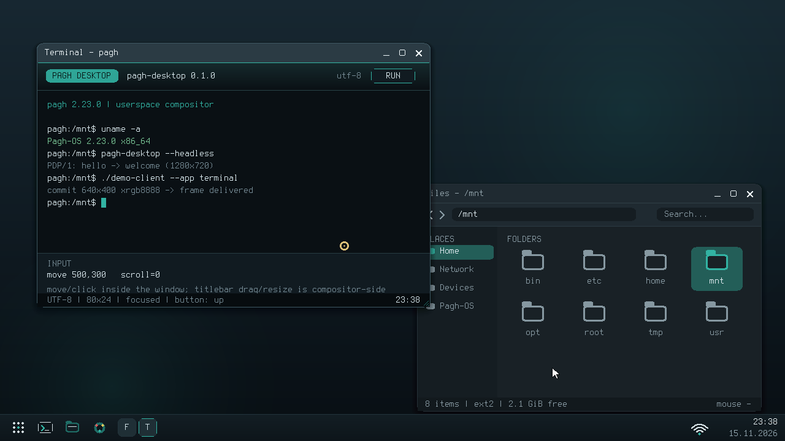 | 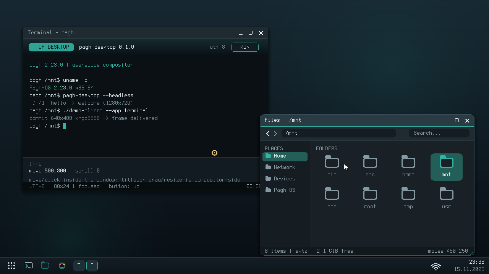 |
| Два окна, фокус на Terminal | Фокус на Files, панель и часы |
| 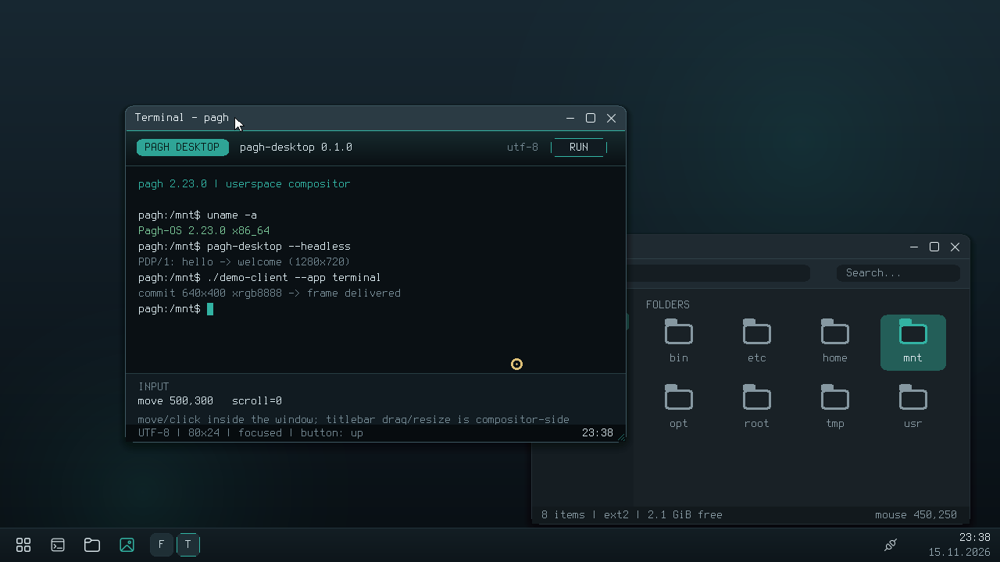 | 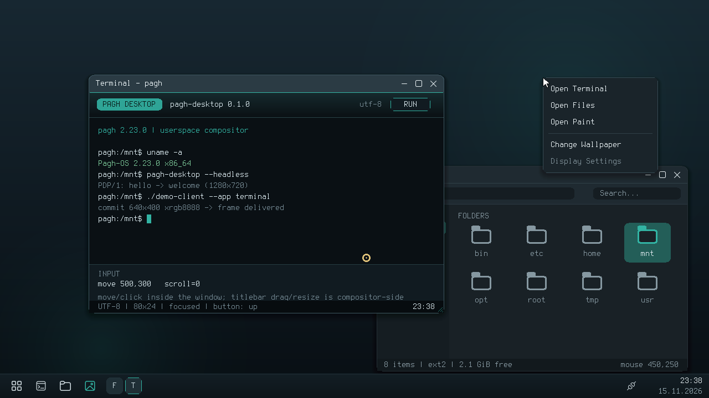 |
| Перетаскивание заголовка | Контекстное меню рабочего стола |
| 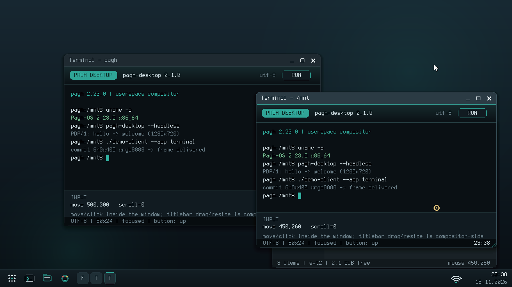 | 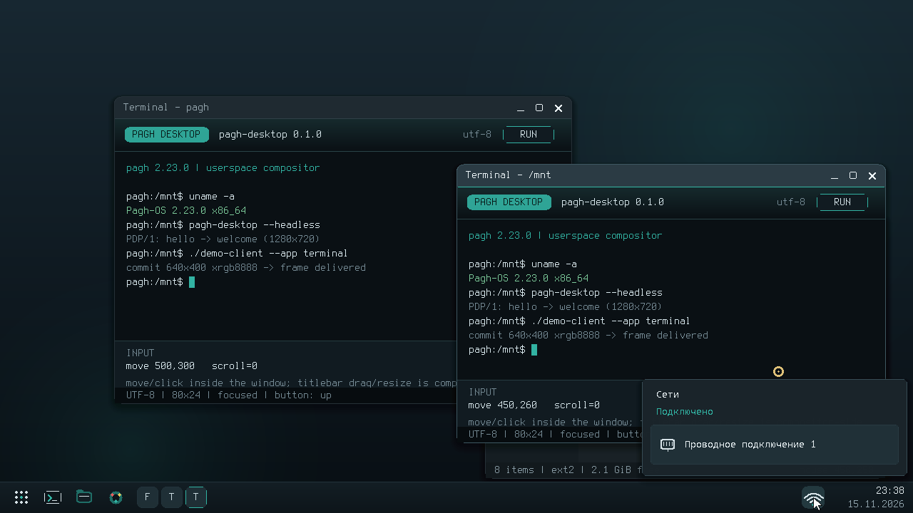 |
| Запуск Terminal из меню | Проводная сеть: flyout «Сети» |
| 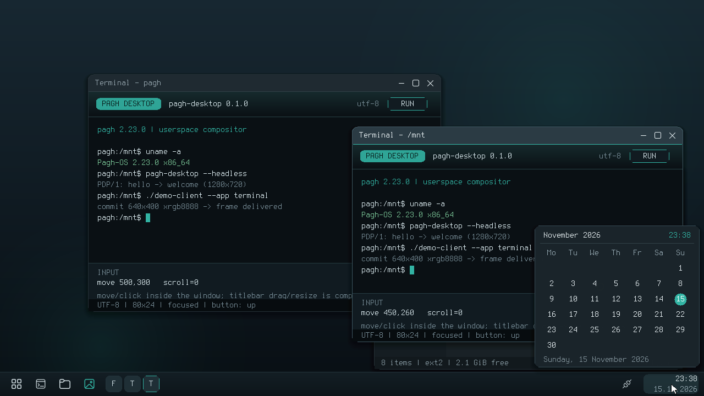 | 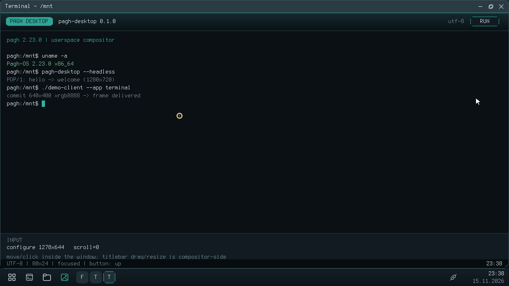 |
| Календарь November 2026 | Maximized с клиентским configure |
| 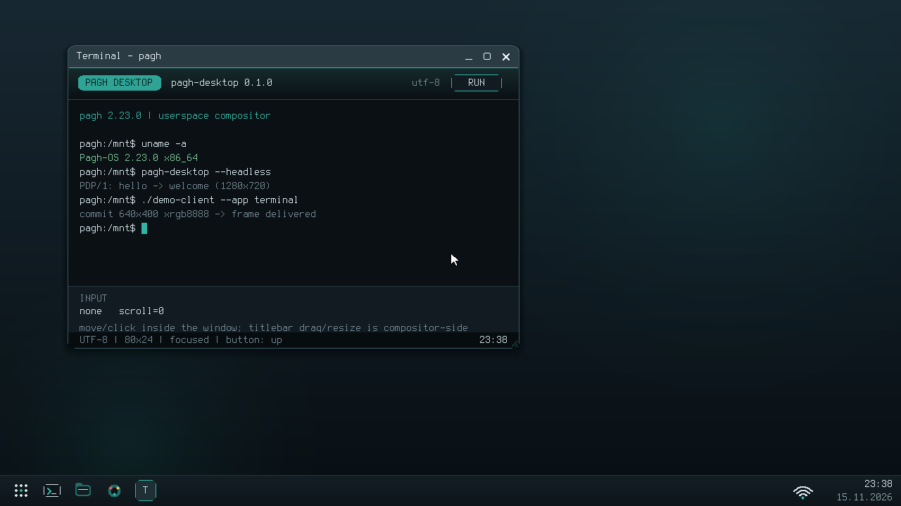 | |
| Живой кадр: отдельный процесс demo-клиента по реальному AF_UNIX-сокету | |
| 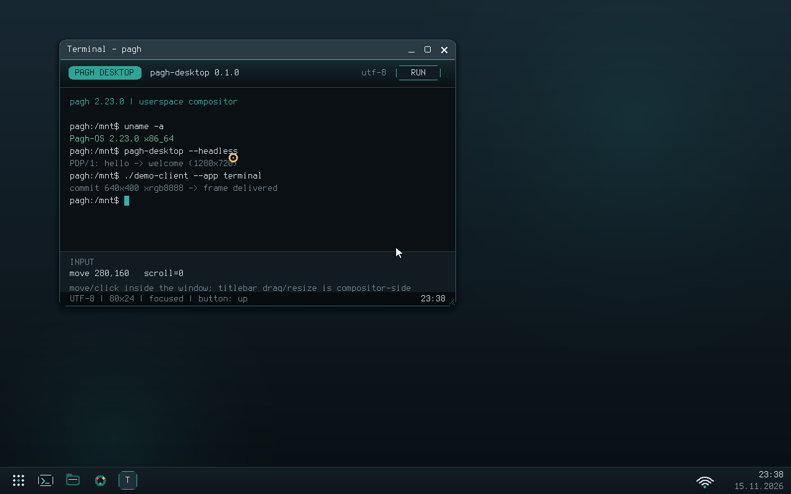 | 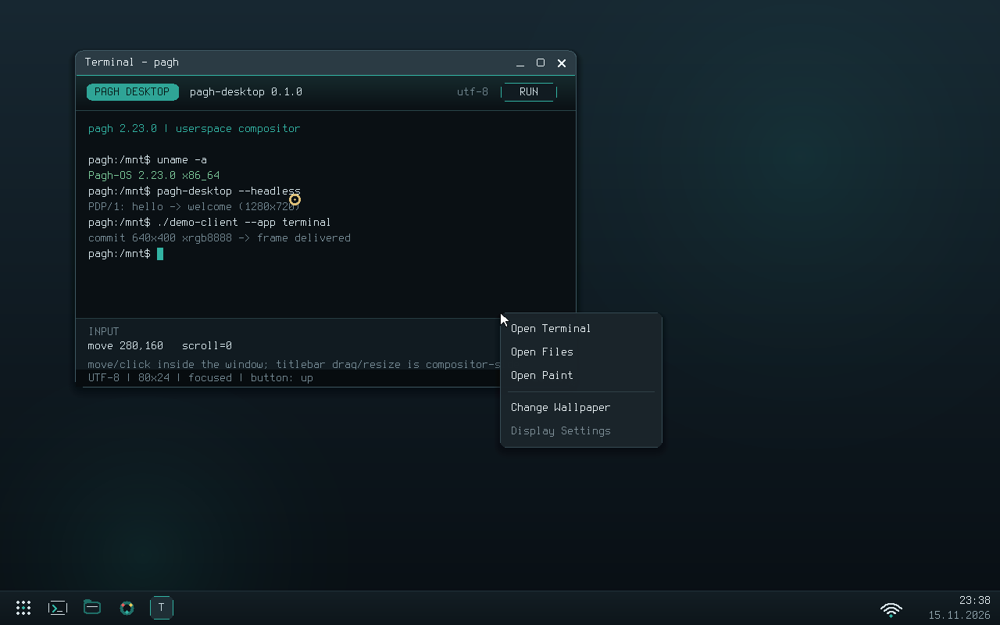 |
| QEMU framebuffer: desktop на `/dev/fb0` (1280×800) | F10-меню на реальном scanout |

`09-restored.png` — возврат окна в прежнюю геометрию; `screenshots/scenario.txt` —
транскрипт шагов.

## Модули

| файл | роль |
|---|---|
| `protocol.rs` | PDP/1: заголовок, сообщения, инкрементальный `Decoder`, лимиты |
| `server.rs` | AF_UNIX-сервер: accept, reader-потоки, маршрутизация, команды, скриншоты |
| `client.rs` | клиентская библиотека (hello/create/commit/input/close) |
| `compositor.rs` | окна, z-order, фокус, drag/resize/maximize, панель, меню, damage |
| `window.rs` | геометрия рамки/заголовка/кнопок, resize-угол |
| `panel.rs` | 44-пиксельная панель, часы/дата, проводная сеть, чипы окон |
| `context_menu.rs` | контекстные меню, hover, clamp к экрану |
| `backend.rs` | trait `Backend`, headless-вывод PNG |
| `canvas.rs` / `png.rs` / `deflate.rs` / `font.rs` | программный холст, примитивы, PNG-энкодер и -декодер со встроенным deflate (энкодер — fixed Huffman + LZ77, декодер понимает stored/fixed/dynamic; без зависимостей), шрифт 8×16 (ASCII + кириллица, генератор `tools/gen_cyrillic_font.py`) |
| `icons.rs` | готовые PNG-иконки Fluent UI (`assets/icons/`): ленивый декод, кэш по `(иконка, размер)`, blit с тинтом RGB при сохранении альфы |
| `surface.rs` | клиентские поверхности, `XRGB8888`/`RGB565`, stride |
| `demo.rs` / `scenario.rs` | демо-контент Terminal/Files/Paint, сценарий скриншотов |
| `src/bin/pagh-desktop.rs` | CLI сервера |
| `src/bin/pagh-desktop-demo.rs` | демо-клиент и генератор скриншотов |

## Документация

* [`PROTOCOL.md`](PROTOCOL.md) — ABI PDP/1: кадр, сообщения, форматы, ошибки, будущее.
* [`docs/desktop-server.md`](../../docs/desktop-server.md) — архитектура, damage-модель,
  граница с kernel-веткой, остаток и ссылки на референсы.

## Ограничения и остаток

* Нет backend `/dev/fb0` и чтения `/dev/input/event0` — они появляются вместе с
  kernel-примитивами (`desktop-kernel`); headless-путь полностью автономен.
* `ShmSurface`/`SCM_RIGHTS`, частичный commit, клиентские popup/курсоры, outputs/scale,
  анимации, PTY/kernel-console bridge — не в этом срезе.
* `--spawn-demo`/`--demo-window` — тестовый фолбэк (демо-клиент/встроенное окно);
  обычный образ задаёт реальные `--launch-target` в `/mnt/etc/autorun`
  ([`desktop-autorun`](desktop-autorun)); реестр приложений/`.desktop`-файлы —
  следующий шаг.
* Скриншоты намеренно детерминированы (часы 23:38 / 15.11.2026), чтобы diff картинок
  был осмысленным.

## Атрибуция

Иконки панели, сетевого флайаута и кнопок окна — Fluent UI System Icons
(MIT, © Microsoft Corporation), regular-глифы 16/20/24/32/48 px в
[`assets/icons/`](assets/icons/); полный текст лицензии — в
[`assets/icons/LICENSE`](assets/icons/LICENSE), соответствие «файл → глиф» —
в [`assets/icons/README.md`](assets/icons/README.md). Байты PNG запечены в
бинарь через `include_bytes!`, поэтому запуск не зависит от файлов на диске.

Растровый шрифт 8×16 в `src/font.rs` растрирован из Terminus 16 (OFL-1.1). Идеи
архитектуры сверялись со Smithay (`desktop::Space`, `input`, `backend`), cosmic-comp
(`state.rs`, `shell`, `wayland`), wlroots (`wlr_scene`, `wlr_output_damage`, `wlr_seat`,
`wlr_compositor`) и UX KDE Plasma 6.7.4/KWin 6.7.4; код — самостоятельный, без
зависимостей и без заимствованных исходников.