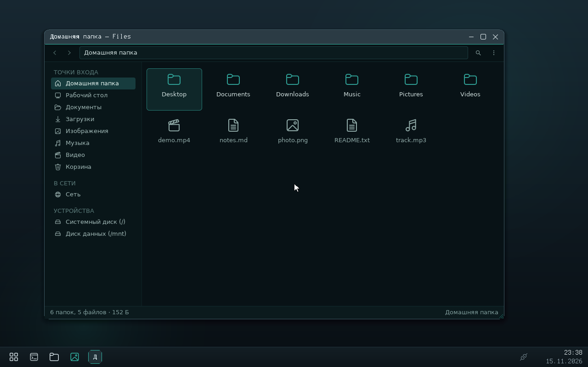

# Files — файловый менеджер Pagh

Приложение рабочего стола Pagh (вариант B: userspace-композитор, клиент —
статически собранный musl-бинарник). Files рисует **только клиентскую область**:
панель инструментов, боковую панель, сетку значков/подробный список и строку
состояния. Заголовок окна, кнопки `v`/`^`/`x`, рамку, панель, размещение, фокус
и drag/resize рисует композитор `pagh-desktop`; связь — по протоколу **PDP/1**
(см. [`../pagh-desktop/PROTOCOL.md`](../pagh-desktop/PROTOCOL.md) и клиентскую
часть в [`../pagh-ui/PROTOCOL.md`](../pagh-ui/PROTOCOL.md)).



Кадр выше снят **самим композитором** (`pagh-desktop`, headless): окно Files
подключилось по PDP/1, а окно `PaghTerm` слева открыто через `launch (type 13)` —
пункт «Открыть терминал в этой папке» (Alt+Shift+F4). Оформление окон — работа
композитора, не приложения.


## Что умеет

- **Боковая панель** с секциями «ТОЧКИ ВХОДА» (Домашняя папка, Рабочий стол,
  Документы, Загрузки, Изображения, Музыка, Видео, Корзина), «В СЕТИ» и
  «УСТРОЙСТВА» (boot, Basic data partition, root). Клик — переход в каталог.
- **Панель инструментов**: назад/вперёд с историей, редактируемое поле пути
  (Enter — переход), поиск по текущей папке (скрывается по Escape), меню-«кебаб».
- **Сетка значков** с центрированными подписями; синяя папка с листом бумаги
  внутри — как в концепте. Есть **подробный список** с колонками «Имя,
  Размер, Тип, Изменён», сортировкой по размеру/дате и прокруткой колесом.
- **Строка состояния** в стиле Dolphin: `24 папки, 4 файла · 76,3 МБ`
  (русские склонения, двоичные единицы) и имя текущей папки справа.
- **Контекстное меню** с подменю «Создать»: Папку…, Текстовый файл…, Пустой
  файл…, Файл HTML…, затем ярлыки — адрес в Интернете (URL), ссылку на
  файл/папку (реальная символическая ссылка), ярлык приложения. Действия
  выполняются: создаются записи с уникальными именами («Новая папка 2»),
  файлы-ярлыки получают шаблонное содержимое.
- **«Свойства»** (Alt+Return) — модальный диалог с именем, типом, размером,
  датой, правами и путём.
- **«Открыть терминал в этой папке»** (Alt+Shift+F4) возвращает
  `Command::LaunchTerminal { path }`; главный цикл отправляет композитору PDP/1
  `launch (type 13)` с `app="terminal"` и `cwd`. Запуском занимается композитор
  (`ServerOptions.launch_targets` / `--launch-target`), приложение не форкает
  процессы само.
- Копирование/вставка (Ctrl+C / Ctrl+V), удаление (Delete), создание копий
  с именами `имя (копия).расширение`, навигация стрелками, F5 — обновить.

Пункта «Просмотр статистики использования дисков» нет — такой функции в этой
версии не существует, и Files не показывает нерабочие пункты. Недоступные в
этой версии действия («Упаковать», «Команды», «Присвоить метки») видны
приглушёнными, как в Dolphin, но выключены.

## Скриншоты

| Сцена | Файл |
|-------|------|
| Files в настоящем `pagh-desktop` (PDP/1 + launch терминала) | `screenshots/files-under-pagh-desktop.png` |
| Главное окно, домашняя папка (демо-рендер клиентской области с заголовком композитора) | `screenshots/files-main.png` |
| Контекстное меню и подменю «Создать» | `screenshots/files-context-menu.png` |
| Свойства файла | `screenshots/files-properties.png` |
| Подробный список | `screenshots/files-list-view.png` |
| Поиск по папке | `screenshots/files-search.png` |
| Пустая папка | `screenshots/files-empty.png` |

Демо-сцены детерминированы: фейковая ФС, встроенный шрифт, целочисленный
рендер. Их проверяют screenshot-тесты (хеш FNV-1a), а PNG пишутся тем же
кодом, что и в демо. В демо-кадрах заголовок окна дорисовывает демо-обвязка
(`pagh_ui::chrome`) как это сделал бы композитор — сам Files его не рисует;
кадр `files-under-pagh-desktop.png` снят настоящим композитором.

## Архитектура

| Модуль | Назначение |
|--------|------------|
| `vfs` | трейт `Vfs` (`read_dir`, `stat`, `mkdir`, `create_file`, `write_file`, `unlink`, `rename`, `copy`, `symlink`), нормализация путей, уникальные имена |
| `fake` | `FakeVfs` — дерево в памяти из концепта: 24 папки, 4 файла, 76,3 МБ; вложенные документы, корзина, `/boot`, `/mnt/basic`, `/network` |
| `host_vfs` | `HostVfs` поверх `std::fs` — работает и на хосте, и на Pagh, где Linux-вызовы обслуживает слой совместимости ядра |
| `format` | русские склонения, двоичные размеры (`76,3 МБ`), даты, права `drwxr-xr-x` |
| `menu_model` | модель контекстного меню и идентификаторы действий |
| `app` | состояние окна, раскладка, отрисовка, обработка событий, `Command` |
| `screenshots` | демо-сцены для PNG и golden-тестов |

События приходят из `pagh_ui::event` (от композитора или из тестов), команды
возвращаются наружу. Главный цикл `pagh-files` подключается к `pagh-desktop`
по PDP/1, создаёт окно (`create`), шлёт кадры (`commit`), обрабатывает
`configure` (resize/maximize/restore), `input`, `focus` и `close` (завершение),
а `Command::LaunchTerminal` переводит в `launch (type 13)`:

```rust
use pagh_files::{Command, FilesApp, FakeVfs};
use pagh_ui::event::{Event, MouseButton};
use pagh_ui::geom::Size;

let mut app = FilesApp::new(Box::new(FakeVfs::concept()), Size::new(1000, 600));
for command in app.handle_event(&Event::MouseDown {
    pos: pagh_ui::Point::new(400, 300),
    button: MouseButton::Right,
}) {
    match command {
        Command::LaunchTerminal { path } => println!("launch terminal в {path}"),
        Command::OpenPath { path } => println!("открыть: {path}"),
        Command::Quit => break,
    }
}
let mut canvas = pagh_ui::Canvas::filled(1060, 640, app.theme.palette.desktop);
app.draw(&mut canvas);
```

## Сборка и запуск

```bash
cd rust-apps/pagh-files

cargo test                         # VFS, меню, приложение, скриншоты
cargo run -- --out screenshots     # перерисовать демо-PNG (headless)
cargo run -- --shot files-main     # только одна сцена
cargo build --release --target x86_64-unknown-linux-musl   # статический бинарник
```

Окно в живом композиторе:

```bash
# терминал 1: композитор (headless, кадры в PNG)
cargo run --manifest-path ../pagh-desktop/Cargo.toml --bin pagh-desktop -- \
    --socket /tmp/pagh-desktop.sock --screenshot-dir /tmp/frames

# терминал 2: Files, клиентская область 1000x600
cargo run -- --connect /tmp/pagh-desktop.sock --path /home/user --size 1000x600
```

Протокол — PDP/1: `hello` → `welcome`, `create`, затем либо `commit` (полный
кадр XRGB8888/RGB565) для legacy-сервера, либо `shm_offer`/`shm_ready` и
`commit` с `flags=SHM`, где по сокету едут только damage-прямоугольники
(пиксели — в memfd). `configure` пересоздаёт shm-поколение (старое уходит
`shm_release`) или меняет RGBA-холст; `input`/`focus`/`close`/`launch` — как в
v1. Приложение перерисовывает кадр только после событий, а
`damage::DamageTracker` сравнивает тайлы и отправляет лишь изменившиеся
области.

Сквозные тесты: `tests/pdp_e2e.rs` поднимает настоящий `pagh-desktop` (как
библиотеку), запускает настоящий бинарник `pagh-files`, шлёт ввод, проверяет
`launch` (заглушка или настоящий `pagh-terminal` через `PAGH_TERMINAL_BIN`),
закрывает окно композитором и проверяет завершение клиента;
`tests/shm_e2e.rs` проверяет shm-путь против сервера с `SCM_RIGHTS` (offer,
damage-only commit, resize поколения, отсутствие пикселей в сокете).
С `PAGH_E2E_SHOTS=DIR` кадры композитора сохраняются для отчёта/PR.

## Ограничения

- «Открыть терминал» работает через `launch` композитора; двойной клик по файлу
  пока только печатает `OpenPath` — протокола запуска конкретного файла нет.
- Буфер обмена локальный (путь элемента внутри Files), системного буфера нет.
- Нет drag-and-drop, переименования на месте, вкладок, предпросмотра.
- Сетка и список прокручиваются колесом/клавишами; полосу прокрутки можно
  тянуть только программно (виджета scrollbar пока нет).
- Ввод текста — US-раскладка (PDP/1 передаёт evdev-коды без текста); кириллицу
  в поля ввода набрать нельзя.
- `HostVfs` не делает chroot и не различает точки монтирования — список
  «УСТРОЙСТВА» статический.
- Оформление окна полностью на композиторе: собственного заголовка у Files нет,
  поэтому в headless-демо он дорисовывается демо-обвязкой.