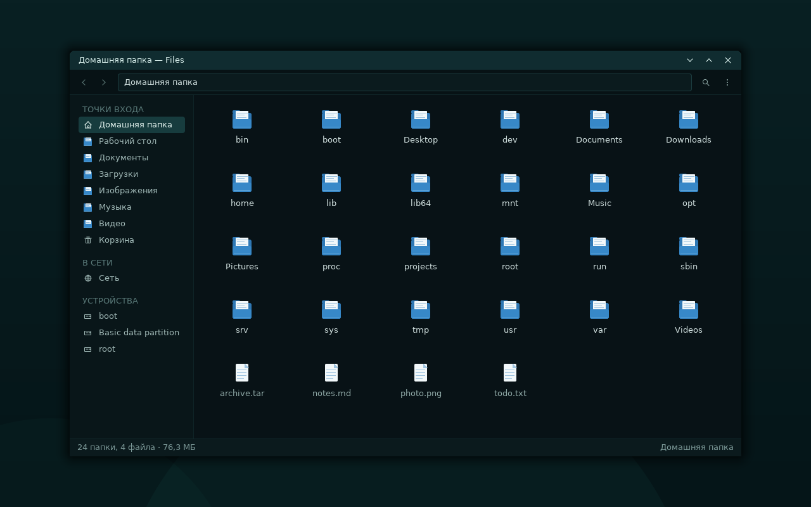

# Files — файловый менеджер Pagh

Приложение рабочего стола Pagh (вариант B: userspace-композитор, клиент —
статически собранный musl-бинарник). Окно рисуется целиком внутри приложения:
заголовок с кнопками `v`/`^`/`x`, панель инструментов, боковая панель, сетка
значков или подробный список, строка состояния. Композитору остаётся только
скомпоновать готовый кадр.



## Что умеет

- **Боковая панель** с секциями «ТОЧКИ ВХОДА» (Домашняя папка, Рабочий стол,
  Документы, Загрузки, Изображения, Музыка, Видео, Корзина), «В СЕТИ» и
  «УСТРОЙСТВА» (boot, Basic data partition, root). Клик — переход в каталог.
- **Панель инструментов**: назад/вперёд с историей, редактируемое поле пути
  (Enter — переход), поиск по текущей папке (скрывается по Escape), меню-«кебаб».
- **Сетка значков** с центрированными подписями; синяя папка с листом бумаги
  внутри — как в концепте. Есть **подробный список** с колонками «Имя,
  Размер, Тип, Изменён», сортировкой по размеру/дате и прокруткой колесом.
- **Строка состояния** в стиле Dolphin: `24 папки, 4 файла · 76,3 МБ`
  (русские склонения, двоичные единицы) и имя текущей папки справа.
- **Контекстное меню** с подменю «Создать»: Папку…, Текстовый файл…, Пустой
  файл…, Файл HTML…, затем ярлыки — адрес в Интернете (URL), ссылку на
  файл/папку (реальная символическая ссылка), ярлык приложения. Действия
  выполняются: создаются записи с уникальными именами («Новая папка 2»),
  файлы-ярлыки получают шаблонное содержимое.
- **«Свойства»** (Alt+Return) — модальный диалог с именем, типом, размером,
  датой, правами и путём.
- **«Открыть терминал в этой папке»** (Alt+Shift+F4) возвращает
  `Command::OpenTerminal { path }` — запуском терминала занимается композитор/
  лаунчер, приложение не форкает процессы само.
- Копирование/вставка (Ctrl+C / Ctrl+V), удаление (Delete), создание копий
  с именами `имя (копия).расширение`, навигация стрелками, F5 — обновить.

Пункта «Просмотр статистики использования дисков» нет — такой функции в этой
версии не существует, и Files не показывает нерабочие пункты. Недоступные в
этой версии действия («Упаковать», «Команды», «Присвоить метки») видны
приглушёнными, как в Dolphin, но выключены.

## Скриншоты

| Сцена | Файл |
|-------|------|
| Главное окно, домашняя папка | `screenshots/files-main.png` |
| Контекстное меню и подменю «Создать» | `screenshots/files-context-menu.png` |
| Свойства файла | `screenshots/files-properties.png` |
| Подробный список | `screenshots/files-list-view.png` |
| Поиск по папке | `screenshots/files-search.png` |
| Пустая папка | `screenshots/files-empty.png` |

Все сцены детерминированы: фейковая ФС, встроенный шрифт, целочисленный
рендер. Их проверяют screenshot-тесты (хеш FNV-1a), а PNG пишутся тем же
кодом, что и в демо.

## Архитектура

| Модуль | Назначение |
|--------|------------|
| `vfs` | трейт `Vfs` (`read_dir`, `stat`, `mkdir`, `create_file`, `write_file`, `unlink`, `rename`, `copy`, `symlink`), нормализация путей, уникальные имена |
| `fake` | `FakeVfs` — дерево в памяти из концепта: 24 папки, 4 файла, 76,3 МБ; вложенные документы, корзина, `/boot`, `/mnt/basic`, `/network` |
| `host_vfs` | `HostVfs` поверх `std::fs` — работает и на хосте, и на Pagh, где Linux-вызовы обслуживает слой совместимости ядра |
| `format` | русские склонения, двоичные размеры (`76,3 МБ`), даты, права `drwxr-xr-x` |
| `menu_model` | модель контекстного меню и идентификаторы действий |
| `app` | состояние окна, раскладка, отрисовка, обработка событий, `Command` |
| `screenshots` | демо-сцены для PNG и golden-тестов |

События приходят из `pagh_ui::event` (от композитора или из тестов), команды
возвращаются наружу:

```rust
use pagh_files::{Command, FilesApp, FakeVfs};
use pagh_ui::event::{Event, MouseButton};
use pagh_ui::geom::Size;

let mut app = FilesApp::new(Box::new(FakeVfs::concept()), Size::new(1060, 640));
for command in app.handle_event(&Event::MouseDown {
    pos: pagh_ui::Point::new(400, 300),
    button: MouseButton::Right,
}) {
    match command {
        Command::OpenTerminal { path } => println!("терминал: {path}"),
        Command::OpenPath { path } => println!("открыть: {path}"),
        Command::Quit => break,
        Command::Minimize | Command::Maximize => {}
    }
}
let mut canvas = pagh_ui::Canvas::filled(1060, 640, app.theme.palette.desktop);
app.draw(&mut canvas);
```

## Сборка и запуск

```bash
cd rust-apps/pagh-files

cargo test                         # VFS, меню, приложение, скриншоты
cargo run -- --out screenshots     # перерисовать демо-PNG (headless)
cargo run -- --shot files-main     # только одна сцена
cargo build --release --target x86_64-unknown-linux-musl   # статический бинарник
```

Окно в живом композиторе (когда композитор из `rust-apps/pagh-desktop` готов):

```text
pagh-files --connect /run/pagh-desktop.sock --path /home/user
```

Кадр отправляется по протоколу PGUI v1 (`pagh_ui::protocol`, описание —
[`../pagh-ui/PROTOCOL.md`](../pagh-ui/PROTOCOL.md)): `hello` → `welcome`,
`create_window`, `commit_frame`, `input`. Приложение перерисовывает окно
только после событий.

## Ограничения

- Композитора ещё нет в дереве: headless-демо и тесты полные, канал
  `--connect` компилируется и покрыт unit-тестом транспорта в `pagh-ui`, но
  против настоящего сервера не проверялся.
- «Открыть терминал» и двойной клик по файлу — только команды наружу; запуск
  приложений появится вместе с протоколом запуска у композитора.
- Буфер обмена локальный (путь элемента внутри Files), системного буфера нет.
- Нет drag-and-drop, переименования на месте, вкладок, предпросмотра.
- Сетка и список прокручиваются колесом/клавишами; полосу прокрутки можно
  тянуть только программно (виджета scrollbar пока нет).
- `HostVfs` не делает chroot и не различает точки монтирования — список
  «УСТРОЙСТВА» статический.