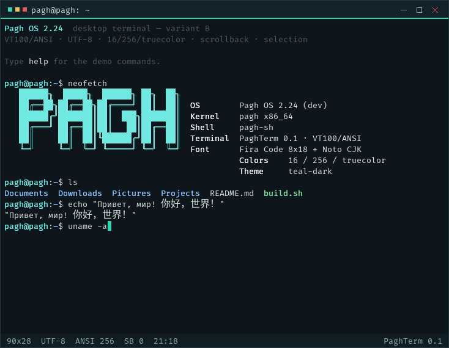
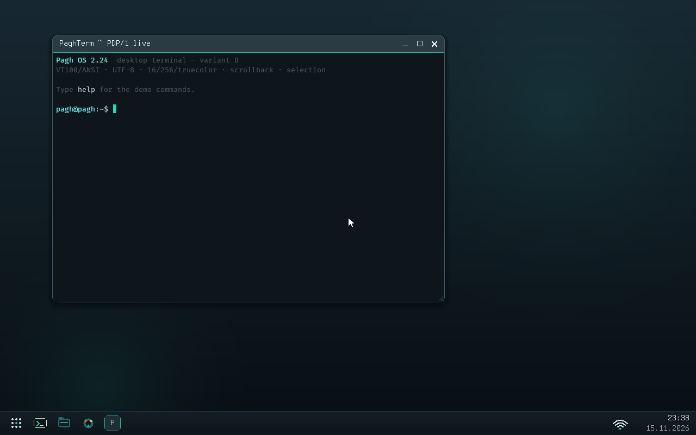

# PaghTerm

Терминал для Pagh desktop B: VT100/ANSI-эмулятор, программный RGBA-рендерер,
headless PNG-скриншоты и клиент PDP/1 (Pagh Desktop Protocol).  Без внешних зависимостей,
собирается статически под `x86_64-unknown-linux-musl`.



E2E с реальным композитором: `pagh-desktop` из dev (PR #101) рисует окно
терминала, полученное по PDP/1 (headless backend, 1280×800).



## Что уже работает

* VT100/ANSI: CSI/OSC/ESC/DCS, курсор, scroll region, alt screen, tabs,
  16/256/truecolor SGR, атрибуты, UTF-8, wide/zero-width, DEC graphics,
  запросы DA/DSR/CPR/DECRQM.
* Рендерер 8×18 (Fira Code) + wide 16×18 (Noto CJK), box drawing/block
  elements, курсор, selection, scrollback/scrollbar, окно для скриншотов.
* PNG-выгрузка (RGBA8) без зависимостей.
* Клиент PDP/1: AF_UNIX, hello/welcome/create/commit/input/configure/focus/
  ping/pong/close, XRGB8888/RGB565, кодирование клавиш и SGR-мыши.
* ABI v1 kernel console shared surface: валидатор, reader, конвертация в
  экран (`/dev/vtconsole0`, `/dev/vtinput`), см. [TERMINAL.md](TERMINAL.md).
* 118 host-тестов, включая эталонные escape-последовательности и скриншоты.

## Сборка и проверки

```sh
cd rust-apps/pagh-terminal

cargo fmt --all -- --check
cargo test                    # host tests
cargo run -- --screenshots screenshots

# статический бинарник для pagh (нужен rustup target x86_64-unknown-linux-musl)
tools/build-static.sh         # результат: rust-apps/out/pagh-terminal
```

`cargo test` использует локальный `.cargo/config.toml`, чтобы нейтрализовать
`build-std` из корневого конфига ядра.  Статическая сборка выполняется через
`tools/build-static.sh` из нейтрального каталога — так cargo не наследует
bare-metal-конфиг ядра (см. комментарий в скрипте).

## Использование

```sh
# скриншот демо
cargo run -- --headless --demo 01-welcome --out /tmp/welcome.png --print

# произвольный вывод терминала
cargo run -- --headless --script session.bin --cols 100 --rows 30 \
  --out /tmp/session.png --print

# живое окно через compositor (task desktop-server)
cargo run -- --socket /tmp/pagh-desktop.sock --size 900x600

# kernel VT shared surface (когда появится /dev/vtconsole0)
cargo run -- --vt /dev/vtconsole0 --vt-input /dev/vtinput \
  --socket /tmp/pagh-desktop.sock
```

Headless-демо: `01-welcome`, `02-colors`, `03-scrollback`, `04-unicode`.
`--select R1,C1:R2,C2 --dump-selection` печатает выделенный текст;
`--print-full` включает scrollback.

## Ограничения

Пока нет реального PTY, `/dev/fb0`/evdev и kernel-side shared surface.
Live-режим подключается к `pagh-desktop` по PDP/1; без VT-устройства
используется demo shell.  Нет reflow при resize,
комбинирующие метки не компонуются, OSC 4/8/52 игнорируются.  Подробно —
[TERMINAL.md](TERMINAL.md).

## Лицензии

Код — MIT (см. корневой `LICENSE`).  Bitmap-шрифты в `assets/` — производные
Fira Code и Noto Sans CJK, распространяются по SIL OFL 1.1; тексты и
атрибуция — в `fonts/LICENSES.md` и `fonts/OFL-1.1.txt`.
