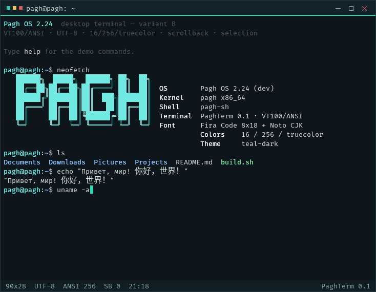
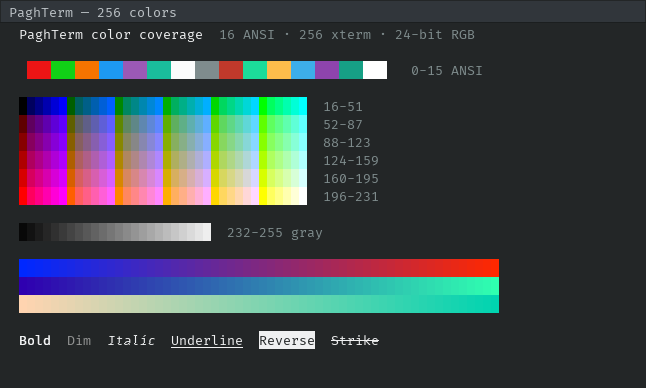
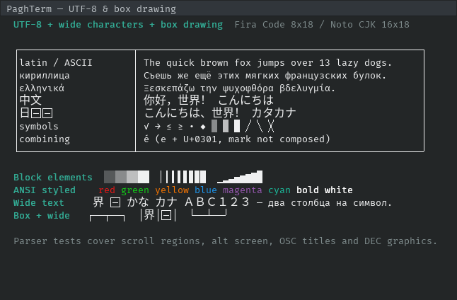
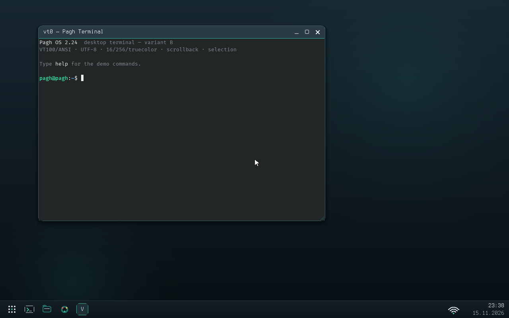

# PaghTerm — терминал для desktop B

`rust-apps/pagh-terminal` — самодостаточный Rust-крейт (без внешних зависимостей):
эмулятор терминала VT100/ANSI, программный RGBA-рендерер, PNG-выгрузка для
headless-тестов и клиент PDP/1 (Pagh Desktop Protocol).  Отдельно описан ABI
разделяемой текстовой поверхности для kernel console (`/dev/vtconsole0`),
реализованный в kernel-side PR; сам этот крейт `kernel/src/**` не меняет.

Статус: вертикальный срез для desktop B.  Парсер, рендерер, PNG, протокол
клиента, ABI-парсер shared surface и host-тесты работают; реальный compositor,
`/dev/fb0`, evdev и kernel-устройство VT ещё не подключены.



## Содержание

1. [Быстрый старт](#быстрый-старт)
2. [Архитектура](#архитектура)
3. [Покрытие парсера](#покрытие-парсера)
4. [Рендерер](#рендерер)
5. [Клиентский протокол PDP/1](#клиентский-протокол-pdp1)
6. [Kernel console shared surface ABI v1](#kernel-console-shared-surface-abi-v1)
7. [Ограничения и остаток](#ограничения-и-остаток)
8. [Проверки](#проверки)

## Быстрый старт

```sh
cd rust-apps/pagh-terminal

# host tests (парсер, рендерер, PNG, протокол, ABI, CLI)
cargo test

# regenerate the committed screenshots
cargo run -- --screenshots screenshots

# one screenshot without a compositor
cargo run -- --headless --demo 01-welcome --out /tmp/welcome.png --print

# arbitrary terminal output (escape sequences allowed)
cargo run -- --headless --script /tmp/session.bin --cols 100 --rows 30 \
  --out /tmp/session.png --print

# static x86_64-musl binary for pagh
tools/build-static.sh          # -> rust-apps/out/pagh-terminal
```

`cargo test` в каталоге крейта работает благодаря локальному
`.cargo/config.toml`: корневой конфиг ядра включает `build-std` для
bare-metal target, поэтому для host-сборки std пересобирается тем же
`build-std` (иначе `core` загружается дважды).  Для статической сборки
`tools/build-static.sh` запускает cargo из нейтрального каталога, чтобы
унаследованный bare-metal-конфиг не применялся.

`pagh-terminal --help` перечисляет режимы:

* `--headless --demo NAME|--script FILE` — отрисовать кадр/текст;
* `--socket PATH` — окно через PDP/1 (hello/create/commit/input/configure);
* `--vt /dev/vtconsole0` — читать shared surface ядра (ABI v1) и писать ввод
  в `/dev/vtinput`;
* `--screenshots DIR` — перегенерировать эталонные PNG.

## Архитектура

```text
              terminal output bytes
                      │
              ┌───────▼────────┐
              │ parser.rs      │  UTF-8 + VT100/ANSI state machine
              │ (Parser)       │  CSI / OSC / ESC / DCS / SGR / modes
              └───────┬────────┘
                      │ semantic calls
              ┌───────▼────────┐
              │ screen.rs      │  cells, cursor, margins, scrollback,
              │ (Screen)       │  selection, alt screen, resize
              └───────┬────────┘
                      │ immutable view
              ┌───────▼────────┐     ┌──────────────┐
              │ render.rs      │────▶│ png.rs       │
              │ (Canvas RGBA)  │     │ stored PNG   │
              └───────┬────────┘     └──────────────┘
                      │ RGBA
              ┌───────▼────────┐     ┌──────────────┐
              │ client.rs      │────▶│ protocol.rs  │  PDP/1 framing
              │ (SurfaceClient)│◀────│ messages     │  create/commit/input
              └───────┬────────┘     └──────────────┘
                      │ AF_UNIX
              ┌───────▼────────┐
              │ pagh-desktop   │  compositor (sibling task)
              └────────────────┘
```

| модуль | назначение |
|---|---|
| `src/parser.rs` | потоковый UTF-8/VT-парсер и обёртка `Terminal` |
| `src/screen.rs` | сетка, курсор, scroll region, scrollback, selection, DEC-режимы, resize |
| `src/cell.rs` | `Cell`, `Color`, `Attrs`, `Pen`, палитра 256 |
| `src/font.rs`, `src/font_index.rs`, `src/unicode_tables.rs` | bitmap-глифы и таблицы ширины Unicode |
| `src/render.rs` | RGBA `Canvas`, тема, сетка, курсор, selection, scrollbar, chrome, box drawing |
| `src/png.rs` | PNG encoder/decoder (RGBA8, stored DEFLATE) |
| `src/protocol.rs` | PDP/1: заголовок `PDS1`, сообщения, кодеки кадров и input |
| `src/client.rs` | Unix-socket клиент, hello/welcome, create/commit, events |
| `src/keys.rs` | evdev → VT-байты: стрелки, F-клавиши, Ctrl/Alt, SGR-мышь, focus, paste |
| `src/vtconsole.rs` | валидатор и reader для ABI v1 `/dev/vtconsole0` |
| `src/demo.rs` | demo shell и детерминированные скриншоты |
| `src/bin/pagh-terminal.rs` | CLI-режимы headless/live/vt/screenshots |

## Покрытие парсера

Парсер байтовый, потоковый, не паникует на мусоре.  Неизвестные
последовательности проглатываются; невалидный UTF-8 заменяется на U+FFFD, не
съедая следующий ASCII-байт.

### C0/C1 и ESC

| группа | поведение |
|---|---|
| C0 | BEL, BS, HT, LF/VT/FF, CR, SO/SI; CAN/SUB отменяют последовательность |
| `ESC 7` / `ESC 8` | DECSC / DECRC: курсор, pen, origin mode, charset |
| `ESC D` / `ESC E` / `ESC M` | IND / NEL / RI |
| `ESC H` / `CSI g` | HTS / TBC (0 = текущая, 3 = все) |
| `ESC c` | RIS: сброс сетки, режимов, scrollback |
| `ESC # 8` | DECALN, заполнение `E` |
| `ESC ( ) * +` | designation G0/G1/G2/G3; поддержаны `0` (DEC Special Graphics), `B` (ASCII), `A` (UK `#`→`£`) |
| `ESC =` / `ESC >` | keypad mode (принимается, не влияет на вывод) |
| `ESC ]` / `ESC P` / `ESC X` / `ESC ^` / `ESC _` | OSC / DCS / SOS / PM / APC; строки до ST не попадают в сетку |

### CSI

* Курсор: `A B C D E F G H f d e a` `` ` `` с учётом origin mode и margins.
* Стирание: `J` (0/1/2/3), `K` (0/1/2), `X`.
* Вставка/удаление: `@`, `P`, `L`, `M`, `S`, `T`.
* Вкладки: `I`, `Z`.
* Scroll region: `r` (DECSTBM), origin mode `?6`.
* Повтор: `b` (REP).
* SGR `m`: 0–9, 21–29, 30–37/40–47, 39/49, 90–97/100–107,
  38/48 c `5;n`, `2;r;g;b` и colon-формами (`38:2::r:g:b`, `4:3`);
  bold/dim/italic/underline/blink/reverse/hidden/strikethrough/overline.
* Режимы `h`/`l`: ANSI (`4` insert, `20` LNM) и DEC private
  (`?1` app cursor, `?6` origin, `?7` autowrap, `?12` blink, `?25` cursor,
  `?47`/`?1047`/`?1049` alt screen, `?1000/1002/1003` mouse, `?1006` SGR
  mouse, `?1004` focus, `?2004` bracketed paste, `?2026` synchronized output).
* `?s` / `?r` — save/restore private modes.
* Запросы/ответы: DA1 (`CSI c`), DA2 (`CSI > c`), XTVERSION (`CSI > q`),
  DSR 5/6, CPR, DECRQM (`CSI Ps $ p`, `CSI ? Ps $ p`), window size
  (`CSI 18 t` → `CSI 8;rows;cols t`), DECREQTPARM, cursor style
  (`CSI Ps SP q`).
* Альтернативный экран: отдельная сетка, primary grid и курсор
  восстанавливаются; scrollback при этом не трогается.

### OSC

* OSC 0/2 — заголовок окна (управляющие символы вырезаются, длина ≤ 1024).
* OSC 10/11 `?` — ответ цветом по умолчанию в форме `rgb:rrrr/gggg/bbbb`.
* OSC 8 (hyperlinks), OSC 4 (palette), OSC 52 (clipboard) и shell-integration
  маркеры разбираются и **игнорируются** (безопасность важнее: терминал не
  пишет в буфер обмена и не меняет палитру по запросу приложения).
* Строка OSC ограничена 8 KiB; переполнение отбрасывается до терминатора.

### UTF-8 и ширина

* Инкрементальный декодер переживает разрезание многобайтовой
  последовательности между `feed()`; invalid/overlong/surrogate → U+FFFD.
* Ширина: `0` для Mn/Me/Cf (комбинирующие, ZWJ, variation selectors),
  `2` для East Asian Wide/Fullwidth (таблица сгенерирована из
  `unicodedata` 16.0), иначе `1`.  Ambiguous = 1.
* Wide-символ занимает две клетки; вторая помечается `CELL_WIDE_CONT`.
  Если wide не влезает в последнюю колонку — перенос (при DECAWM).
* Deferred autowrap: символ в последней колонке оставляет курсор в ней и
  `wrap_pending`; перенос происходит перед следующим printable-символом.
  `?7l` отключает перенос (последняя клетка перезаписывается).
* Комбинирующие метки принимаются (нулевая ширина), но не накладываются на
  глиф предыдущего символа — ограничение v1.

### Тесты

`tests/parser_golden.rs` (28 тестов) покрывает эталонные
escape-последовательности из bash/vim/htop-подобного вывода: deferred wrap,
scroll region, alt screen, DEC graphics, SGR 16/256/truecolor, UTF-8 split,
wide wrap, selection, resize, DECRQM, malformed sequences.  Плюс unit-тесты
в `src/parser.rs`, `src/screen.rs` и остальных модулях.

## Рендерер

* Сетка 8×18 px (Fira Code, em 13 px), wide — 16×18 (Noto Sans Mono CJK SC,
  em 16 px).  Ассеты генерируются `tools/gen_font.py` (нужны Pillow/fontTools
  только на хосте): 1203 узких + 487 широких глифов, coverage 0–255.
  Лицензии шрифтов — `fonts/LICENSES.md`, OFL 1.1.
* `Theme` (Breeze dark, как у Konsole): фон `#232627`, foreground `#eff0f1`,
  блочный курсор, приглушённый `#7f8c8d` для неfocused-курсора и скроллбара,
  `#31363b` для полосы заголовка; ANSI 0–15 — стандартные значения Breeze,
  16–255 — обычный xterm-куб.
* SGR-резолвинг: palette/truecolor, bold (bright + лёгкое усиление),
  dim, reverse, hidden, blink (фаза), underline/strikethrough/overline,
  italic (синтетический наклон), DECSCNM.
* Box drawing U+2500–257F рисуется примитивами (линии не «рвутся» на границах
  клеток), block elements U+2580–259F — прямоугольниками, диагонали
  `╱ ╲ ╳` — прямыми.
* Курсор: block (инверсия), underline, bar; мигание учитывает DECSCEM и
  фокус.  Selection: посимвольная/построчная, multiline, wide-aware; фон и
  foreground берутся из темы.
* Scrollback: до 10 000 строк (настраивается), вытеснение oldest-first,
  абсолютные координаты selection не сдвигаются; view offset и scrollbar.
* Окно для скриншотов: одна тонкая полоса `#31363b` с именем сессии
  `vt0 — Pagh Terminal` приглушённым мелким шрифтом, без индикаторов, кнопок,
  статус-строки и accent-полосы; отступ сетки 2 px, контент на всю площадь.
  В live-режиме decorations рисует compositor (`PROTOCOL.md` §10), поэтому
  клиент коммитит только содержимое (с padding) и оконные кнопки не дублирует.
  Вкладок нет: терминал зеркалит один kernel-VT (`/dev/vtconsole0`).
* PNG: RGBA8, filter 0, zlib stored blocks; валидный PNG без внешних
  зависимостей, decoder проверяет CRC/Adler/LEN и читает только собственный
  подмножество (для golden-тестов).  Размер файла ~1–1.7 MB на кадр — цена
  отсутствия компрессора; для desktop-протокола кадры идут XRGB8888.

Скриншоты (01–04 детерминированные, сравниваются тестом; 05 — артефакт
ручного e2e, не участвует в byte-for-byte проверке):

| файл | содержание |
|---|---|
| `screenshots/01-welcome.png` | neofetch, prompt, UTF-8, курсор |
| `screenshots/02-colors.png` | 16/256/truecolor, атрибуты |
| `screenshots/03-scrollback.png` | 90 строк лога, scroll offset, selection, scrollbar |
| `screenshots/04-unicode.png` | box drawing, кириллица/греческий/CJK/kana, block elements |
| `screenshots/05-live-pdp1.png` | e2e: `pagh-desktop` (dev #101) рисует наше окно через PDP/1 |




E2E с реальным композитором (headless backend, `pagh-desktop` из `origin/dev`
после merge PR #101): окно создано, PDP/1-кадры приняты, сервер отрисовал
терминал и панель.



## Клиентский протокол PDP/1

Клиент реализует **PDP/1** — тот же проводной протокол, что опубликован в
`rust-apps/pagh-desktop/PROTOCOL.md` (server-task, ветка `feat/desktop-server`).
Итоговый документ принадлежит серверу; при расхождении приоритет у него.
Транспорт: `AF_UNIX SOCK_STREAM`, все числа little-endian, строки —
`u16 length` + UTF-8.  По умолчанию кадры передаются in-band; если сервер
объявил `welcome.flags` bit 2, терминал использует `ShmSurface` (memfd через
`SCM_RIGHTS`), а по сокету шлёт только damage-прямоугольники.

### Заголовок (12 байт)

| offset | size | поле |
|---|---|---|
| 0 | 4 | magic `"PDS1"` |
| 4 | 2 | type |
| 6 | 2 | flags (0; bit0 `SHM` допустим только у `commit`/`damage`) |
| 8 | 4 | length payload |

`MAX_PAYLOAD = 4096*4096*4 + 4096`.  Неизвестный type, flags с битами кроме
`SHM`, `SHM` не у `commit`/`damage`, лишние/недостающие байты payload и
неверный magic считаются ошибкой кадра (как в серверном декодере).

### Сообщения

| type | имя | направление | payload |
|---:|---|---|---|
| 1 | `hello` | c→s | `version u32, pid u32, string app` |
| 2 | `welcome` | s→c | `version u32, client_id u64, screen_w u32, screen_h u32, flags u32` |
| 3 | `create` | c→s | `window_id u32, width u32, height u32, format u32, string title` |
| 4 | `configure` | s→c | `window_id u32, x i32, y i32, width u32, height u32, flags u32` |
| 5 | `commit` | c→s | `window_id u32, width u32, height u32, format u32, stride u32, data_len u32, pixels` |
| 6 | `input` | s→c | `window_id u32, kind u8, pressed u8, modifiers u16, code u32, x i32, y i32, dx i32, dy i32, buttons u32` |
| 7 | `focus` | s→c | `window_id u32, focused u8, pad[3]` |
| 8 | `close` | обе | `window_id u32, reason u32` |
| 9 | `damage` | c→s | `window_id u32, count u16, rects[(x i32,y i32,w u16,h u16)]` |
| 10 | `error` | s→c | `code u32, string message` |
| 11 | `ping` | обе | `nonce u32` |
| 12 | `pong` | обе | `nonce u32` |
| 14 | `shm_offer` | c→s | `window_id u32, width u32, height u32, format u32, stride u32, flags u32` + ровно один `SCM_RIGHTS` memfd |
| 15 | `shm_ready` | s→c | `window_id u32, generation u32` |
| 16 | `shm_release` | обе | `window_id u32, generation u32` |

`commit` с `flags=SHM` (bit 0) — без пикселей: `window_id u32, generation u32,
count u32, rects[(x i32,y i32,w u32,h u32)]`; сервер читает повреждённые
области из memfd. Терминал пересоздаёт memfd при `configure`, шлёт новое
поколение и `shm_release` старого; на legacy-сервере (bit 2 = 0) остаётся
полный кадр. `damage` (type 9) — по-прежнему подсказка.

Форматы кадра: `format 1` — XRGB8888 (`0x00RRGGBB`, память `B,G,R,X`),
`format 2` — RGB565 LE.  `welcome.flags`: bit0 XRGB8888, bit1 RGB565, bit2
ShmSurface (0 — fallback на полный кадр).  `configure.flags`: focus 1, maximized 2, minimized 4,
resizable 8.  `input.kind`: 1 motion, 2 button, 3 key, 4 axis.  Кнопки:
`button` 1 left / 2 middle / 3 right, `buttons` — маска 1/2/4.  Модификаторы:
shift 1, ctrl 2, alt 4, super 8.  `close.reason`: client 0, server 1,
disconnect 2, protocol error 3, destroyed 4.

### Поток

```text
client                                   server
  ─── hello(version=1,pid,app) ──────────▶
  ◀──────────── welcome(client_id,flags) ─
  ─── create(window_id,900,600,fmt) ─────▶
  ◀──────────── focus(window_id,true) ────
  ◀──────────── configure(x,y,w,h,flags) ─
  ─── commit(window_id,frame) ───────────▶
  ◀──────────── input(key/button/axis) ───
  ◀──────────── ping(nonce) ──────────────
  ─── pong(nonce) ───────────────────────▶
  ─── close(window_id,reason=0) ─────────▶
```

Клиент:
* инкрементально разбирает поток (частичные кадры сохраняются);
* выбирает XRGB8888, если `welcome.flags` его объявляет, иначе RGB565;
* отвечает на `ping` автоматически;
* реагирует на `configure` (пересчитывает `cols × rows`, перерисовывает кадр)
  и `focus` (курсор/подсветка);
* при `close(reason=1)` завершается — сервер уже удалил окно;
* клавиши кодирует в VT-байты: normal/application cursor, модифицированные
  стрелки `CSI 1;mX`, F1–F12, Ctrl/Alt, SGR-мышь, focus events, bracketed
  paste.  В PDP/1 нет текстового поля клавиши, поэтому printable-символы
  выводятся из evdev-кода по US-QWERTY + Shift (Caps Lock/раскладки — задача
  будущего расширения; IME не поддержан);
* wheel без mouse-reporting листает scrollback; drag левой кнопкой создаёт
  selection.  Выделенный текст доступен `Screen::selection_text()`; запись в
  системный clipboard в v1 не выполняется.

Resize — только серверный: клиент не просит размер, а принимает `configure`.
Декорации и заголовок принадлежат композитору, поэтому `set_title` в PDP/1
нет.  Ошибки: magic/flags/type/payload/stride/pixel-length отклоняются как
`InvalidData`; клиент не паникует на обрезанном потоке.

## Оконная shell-сессия (два pipe, не boot-VT)

Окно терминала в desktop B — **отдельная интерактивная сессия**, а не зеркало
загрузочной консоли. При запуске с `--socket` (и без `--mirror-vt`) клиент
запускает процесс-потомок `pagh-terminal --shell-child` с pipe'ами на
stdin/stdout/stderr; вывод потомка идёт в VT-парсер этого окна, клавиатура окна —
в его stdin. `/dev/vtconsole0` не читается, `/dev/vtinput` не трогается: desktop
(`lxrun`) продолжает владеть boot-VT и его foreground-вводом, но больше не
перехватывает набор в окне.

Почему так, а не переиспользовать kernel-shell: shell ядра — консольная задача
(`fb_println!`/`kprintln!` + PS/2-кольцо), её нельзя перенаправить в pipe без
переписывания всего консольного UI. Спавн потомка ядро уже поддерживает
(`posix_spawn`/`vfork` через `clone(CLONE_VM|CLONE_VFORK)` + `pipe2`); этим же
путём desktop запускает приложения. Внутри того же статического бинаря живёт
минимальный userspace shell: `help`, `ls`, `cd`, `pwd`, `echo`, `cat`, `uname`,
`clear`, `exit` (плюс Backspace/Ctrl+U/Ctrl+C/Ctrl+D в строке). Команды
kernel-shell (`df`, `ps`, `pkg`, `lxrun`, …) в сессии недоступны — `help` говорит
об этом прямо, а `command not found` не делает вид, что команды нет в системе.
`--shell-cmd PATH` подменяет программу-потомка (например, настоящей оболочкой,
если она появится в образе); по умолчанию — этот же бинарь в режиме
`--shell-child`.

Два ограничения ядра, с которыми сессия обязана считаться (и считается):
`SO_RCVTIMEO` принимается и игнорируется (`unix_sock::sys_setsockopt`), поэтому
сокет окна переводится в неблокирующий режим и опрашивается с нулевым
дедлайном; а `write` полного кадра на неблокирующем сокете может вернуть
`EAGAIN` — кадр отправляется блокирующе, с повтором, и рендерится в один
переиспользуемый `Canvas`, а не в свежий `vec![0u8; 2 МиБ]` на каждый кадр.

Старое поведение осталось для диагностики: `--mirror-vt` рисует в окне снимок
boot-VT и пишет ввод в `/dev/vtinput`, а `--vt PATH` без `--socket` печатает
один снимок в stdout (headless).

Ограничения сессии (честно, до PTY-этапа): нет управляющего терминала и
`struct termios`, нет `TIOCGWINSZ`/SIGWINCH (размер знает только окно), нет
job-control/Ctrl+Z, нет `SIGINT` реальному потомку (`Ctrl+C` — байт `0x03` в его
stdin), нет echo-режима ядра (эхо делает сам shell-потомок). Кадры идут полным
кадром, как в `--vt`-режиме, а не damage'ом.

## Kernel console shared surface ABI v1

Реализовано в kernel (`/dev/vtconsole0`, `/dev/vtinput`; см.
`docs/desktop-b.md` §5).  Цель — не переписывать shell на userspace PTY сразу:
kernel VT продолжает владеть сеткой, курсором и scrollback, а
desktop-композитор получает read-only снимок видимой текстовой матрицы и рисует
его своим шрифтом.  Ввод идёт обратно в VT байтами.

### Устройства

| путь | режим | назначение |
|---|---|---|
| `/dev/vtconsole0` | 0600, read-only | mmap/read снимка видимой сетки |
| `/dev/vtinput` | 0600, write-only | VT-байты: UTF-8 + escape-последовательности |

`/dev/vtconsole0` — character device.  v1 поддерживает два способа чтения:

1. **mmap (основной):** `mmap(NULL, total_bytes, PROT_READ, MAP_SHARED, fd, 0)`.
   Отображение когерентно обновлениям ядра; читатель обязан использовать
   seqlock (ниже).
2. **read (fallback):** свежий `open()` + `read(fd, buf, total_bytes)` возвращает
   один целостный снимок; `lseek` не требуется.  Именно этот путь реализует
   `vtconsole::VtConsoleReader`, поэтому клиент тестируется на обычном файле.

Опциональный ioctl:

```c
#define PGVT_IOC_INFO _IOR('V', 0x01, struct pgvt_info)
struct pgvt_info {
    __u32 abi_version;   /* 1 */
    __u32 total_bytes;   /* размер mmap/read snapshot */
    __u32 cols;
    __u32 rows;
    __u32 cell_size;     /* 16 */
    __u32 header_len;    /* 128 */
    __u32 reserved[2];
};                            /* 32 bytes */
```

`poll()` на `/dev/vtconsole0` в v1 не обязателен: композитор опрашивает
`seq`/mmap на 30–60 Hz.  Если понадобится событие обновления, v2 добавит
eventfd или `POLLPRI` при смене `write_seq`.

### Заголовок (128 байт, little-endian)

| offset | size | поле |
|---|---|---|
| 0 | 4 | magic `0x54564750` (`"PGVT"`) |
| 4 | 2 | version = 1 |
| 6 | 2 | header_len = 128 |
| 8 | 4 | `seq` — seqlock; нечётный = идёт запись |
| 12 | 4 | flags (bit0 Unicode, bit1 truecolor, bit2 cursor valid) |
| 16 | 2 | cols (1…1000) |
| 18 | 2 | rows (1…1000) |
| 20 | 2 | cursor_x (0-based) |
| 22 | 2 | cursor_y (0-based) |
| 24 | 1 | cursor_visible (0/1) |
| 25 | 1 | cursor_style (0 block, 1 underline, 2 bar) |
| 26 | 2 | scroll_top (0-based) |
| 28 | 2 | scroll_bot (0-based) |
| 30 | 2 | cell_width (8) |
| 32 | 2 | cell_height (18) |
| 34 | 2 | cell_size (16) |
| 36 | 2 | attrs_flags (зарезервировано, 0) |
| 38 | 2 | reserved |
| 40 | 4 | cells_offset (128) |
| 44 | 4 | cells_bytes = cols*rows*16 |
| 48 | 4 | palette_offset (0 в v1) |
| 52 | 4 | palette_bytes (0 в v1) |
| 56 | 4 | total_bytes = cells_offset + cells_bytes |
| 60 | 4 | write_seq — счётчик завершённых публикаций |
| 64 | 64 | reserved, нули |

Валидация читателем: magic/version/header_len, `1 ≤ cols,rows ≤ 1000`,
курсор и scroll region внутри сетки, `cell_size == 16`,
`cells_offset ≥ header_len`, `cells_bytes == cols*rows*16`,
`total_bytes ≥ cells_offset+cells_bytes`, чётный `seq`.

### Клетка (16 байт)

| offset | size | поле |
|---|---|---|
| 0 | 4 | codepoint (Unicode scalar, 0 трактуется как пробел) |
| 4 | 4 | fg `0x00RRGGBB` |
| 8 | 4 | bg `0x00RRGGBB` |
| 12 | 2 | attrs: bold 1, dim 2, italic 4, underline 8, blink 16, reverse 32, hidden 64, strike 128, overline 256 |
| 14 | 1 | width (1 или 2) |
| 15 | 1 | flags: bit0 wide continuation, bit1 underline continuation (reserved) |

Wide-символ: ведущая клетка `width=2, flags=0`, следующая —
`width=1, flags=bit0`; её codepoint/цвета могут дублироваться, но рендерер
пропускает continuation.  Палитра в v1 не используется: цвета уже RGB, что
совпадает с текущим kernel VT (`Cell { fg: u32, bg: u32 }`).

### Seqlock

Писатель (kernel VT, после любого изменения видимой матрицы/курсора):

```c
hdr->seq++;                 /* becomes odd: writer active */
barrier();
memcpy(cells, shadow_cells, cells_bytes);
update cursor/margins fields;
barrier();
hdr->write_seq++;
hdr->seq++;                 /* even: consistent */
```

Читатель (mmap):

```text
for attempt in 0..4:
    s1 = hdr->seq
    if s1 is odd: continue
    copy header + cells
    s2 = hdr->seq
    if s1 == s2: accept
return EAGAIN
```

`read()`-путь может вернуть `EAGAIN`/короткий read при нечётном `seq`;
клиент повторяет.  Наш парсер отклоняет нечётный `seq` (`VtError::OddSequence`)
и проверяет все размеры до доступа к клеткам.

### Ввод

`write(/dev/vtinput, bytes)` передаёт байты в `Vt::feed` (UTF-8 + escape).
Кольцо ввода — 4 KiB (предложение); при переполнении `EAGAIN`, `poll(POLLOUT)`
сообщает о готовности.  Композитор пишет только когда terminal-поверхность в
фокусе; kernel дополнительно проверяет, что вызывающий — владелец консоли
(0600 root).  Вывод ядра не блокируется на медленном композиторе.

### Отображение на текущий kernel VT

`src/drivers/vt.rs` сегодня хранит `Cell { ch: u8, fg: u32, bg: u32 }`
(по умолчанию `0xAAAAAA` / `0x000000`), сетку `cols × rows`, курсор, saved
cursor, scroll region и рисует клетки сразу во framebuffer.  Минимальный
bridge v1:

1. Добавить рядом с `cells` массив `shared: Box<[SharedCell]>` (16 байт) и
   `shared_header` в page-aligned буфере; буфер создаётся при инициализации VT.
2. В `put`/`paint_all`/`scroll*`/`erase*`/`set cursor` обновлять shadow-клетки
   (`codepoint = ch as u32`, `fg`, `bg`, `attrs = 0`, `width = 1`,
   `continuation = 0`) и выполнять seqlock + `write_seq++`.  Оптимальнее
   бампать `seq` только когда видимая матрица реально изменилась, одним
   обновлением на операцию, а не на каждую клетку `paint_all`.
3. Публиковать `cols/rows/cursor/scroll_top/scroll_bot`, `cursor_style=Block`.
4. Добавить `/dev/vtconsole0` (mmap/read) и `/dev/vtinput` (write → `Vt::feed`)
   в VFS/devfs; выдать их через существующий dev-слой, не менять shell/ABI
   без согласования.
5. UTF-8 не обязателен для v1: текущий VT принимает байты и хранит `u8`;
   `codepoint = byte as u32` даёт ASCII/Latin-1.  Чтобы terminal показывал
   настоящий UTF-8 из shell, kernel VT должен декодировать UTF-8 в `u32`
   (v2/отдельный PR); это явно вне scope.

Ограничения v1: только видимая матрица (scrollback остаётся в kernel и не
экспортируется), одна консоль, нет palette-override, нет hyperlinks и
selection в shared surface (selection делает композитор), нет частичных
damage-обновлений (клиент сравнивает `seq` и перерисовывает весь видимый
экран).

### Безопасность

* mmap read-only; writer — только kernel; userspace не может подменить чужой
  экран.
* никаких kernel-указателей в ABI, только offsets в пределах `total_bytes`.
* жёсткие пределы 1000×1000 и `total_bytes < 64 MiB`; codepoint проверяется
  через `char::from_u32`, управляющие символы заменяются пробелом.
* `/dev/vtconsole0` и `/dev/vtinput` — 0600; экран консоли может содержать
  секреты, поэтому доступ только у владельца консоли.  Clipboard/OSC 52
  намеренно не реализованы.
* input-кольцо ограничено и не даёт userspace заблокировать kernel writer.

### Versioning и тесты

`version` — major; `header_len` позволяет добавлять поля в хвост заголовка,
не ломая v1-читателей.  Неизвестные `flags` игнорируются, неизвестный
`version` → `EINVAL`/`UnsupportedVersion`.  `cells_offset`/`total_bytes` не
позволяют читать за пределами отображения.

Host-тесты ABI: `tests/vtconsole_abi.rs` (8 тестов) конструируют байты
вручную, проверяют смещения полей, цвета/attrs/wide, seqlock, truncation,
переполнение размеров, конвертацию в `Screen` и reader на обычном файле.
Kernel-side проверка (после реализации): boot-тест печатает текст, композитор
читает shared surface и сравнивает; `mmap` stress с писателем и читателем;
`read()` fallback; ввод через `/dev/vtinput` доходит до shell.

## Ограничения и остаток

**Двойной ввод закрыт в ядре (PR #123).** Клавиша доходила до shell двумя
путями: напрямую в PS/2-кольцо и через `event0 → композитор → Terminal →
/dev/vtinput`. Теперь запись в `/dev/vtinput` из userspace защёлкивает владельца
клавиатуры: физические скан-коды идут только в `event0`, пока Terminal жив, и
ввод доставляется ровно один раз. Границы и самовосстановление защёлки —
`docs/desktop-b.md`, §5.4.1.

* **Compositor-интеграция проверена вручную.** Клиент реализует опубликованный
  server-task `PROTOCOL.md` (PDP/1), проходит тест против fake-сервера и был
  прогнан e2e с `pagh-desktop` из `origin/dev` после merge PR #101
  (headless backend, окно 720×460, скриншот `05-live-pdp1.png`).  Этот прогон
  не входит в CI (compositor появился в dev после base этого PR).  Дефолтный
  сокет — `/tmp/pagh-desktop.sock`, переопределяется
  `--socket`/`PAGH_DESKTOP_SOCKET`.
* **Kernel shared surface реализован** (`/dev/vtconsole0` + `/dev/vtinput`),
  но v1 публикует ASCII/Latin-1 `u8`-клетки без attrs/wide, без scrollback и
  без частичных damage; `/dev/vtinput` переводит байты в PS/2-скан-коды shell
  (см. `docs/desktop-b.md` §5.4 — UTF-8 > ASCII пока отбрасывается).
  `kernel/src/**` этим крейтом не тронут.
* **Нет PTY/termios/job-control.** Оконная сессия — процесс-shell за двумя
  pipe'ами: нет управляющего терминала, `TIOCGWINSZ`, SIGWINCH, Ctrl+Z и
  сигналов реальному потомку; `Ctrl+C` доставляется байтом. Shell внутри сессии —
  встроенный минимальный userspace-shell (см. «Оконная shell-сессия»), а не
  kernel-shell и не `/bin/sh` (на demo-образе его нет).
* **Нет real framebuffer/evdev backend.** Клиент рисует в RGBA и отправляет
  кадры по сокету; `/dev/fb0` и `/dev/input/event0` — следующий шаг server/
  desktop-ветки.
* **Нет reflow при resize.** Колонки обрезаются/дополняются, при уменьшении
  rows верхние строки уходят в scrollback (и возвращаются при увеличении).
  Перенос длинных строк не пересчитывается — документированное ограничение.
* **Комбинирующие метки не компонуются**, emoji/CJK без глифа рисуются
  placeholder-боксом (ширина при этом корректна).  Italic синтетический,
  bold — усиление coverage.
* **OSC 4 (palette), OSC 8 (hyperlinks), OSC 52 (clipboard) игнорируются**;
  sixel/kitty graphics/OSC 1337 не поддерживаются.
* **PNG без компрессии** — файлы большие; это тестовый формат, не формат
  протокола.
* **Не проверено на реальном железе/QEMU**: только host-тесты и статическая
  musl-сборка.  Интеграция с `pagh-desktop`/kernel VT требует прогона в
  QEMU/на NVIDIA-хосте после появления device-ов.

## Проверки

Выполнено в этом worktree (см. отчёт `/tmp/pagh-desktop/terminal.md`):

```sh
cd rust-apps/pagh-terminal
cargo fmt --all -- --check
cargo test                 # 120 host tests (60 unit + 60 integration)
python3 tools/gen_font.py --check --allow-clip
tools/build-static.sh      # ELF static-pie x86_64-musl, no INTERP
```

`--allow-clip` нужен генератору для 205 глифов, у которых антиалиасный край
выходит за 8 px (в основном широкие латинские/кириллические буквы); это
осознанно: клип в 1 px лучше, чем потеря покрытия.  `--check` без флага
сообщает об этом и не пишет файлы.

## Ссылки

* Smithay input/text: `/tmp/desktop-refs/smithay/src/input/`
* KDE Konsole UX: https://invent.kde.org/utilities/konsole
* KWin: https://invent.kde.org/plasma/kwin
* Текущий kernel VT: `src/drivers/vt.rs` (в этом worktree)
* Desktop refs notes: `/tmp/desktop-refs/NOTES.md`
* Fira Code: https://github.com/tonsky/FiraCode (OFL 1.1)
* Noto Sans CJK: https://github.com/notofonts/noto-cjk (OFL 1.1)
* PDP/1 server task: `rust-apps/pagh-desktop/PROTOCOL.md` (ветка
  `feat/desktop-server`)