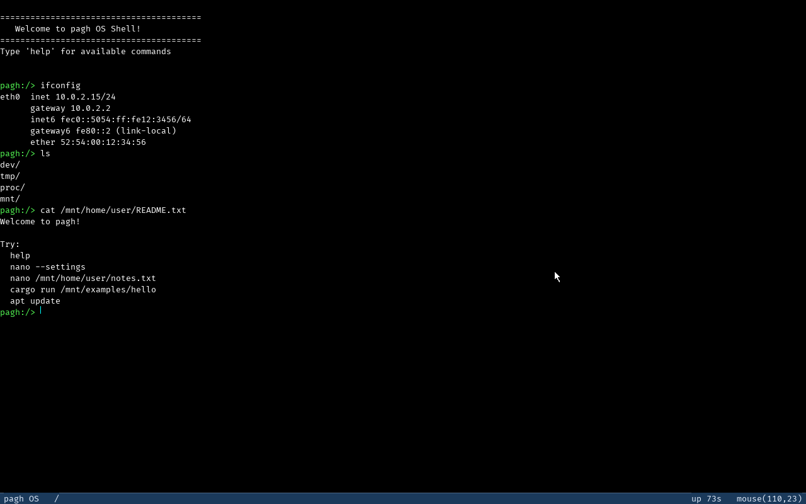

# `src/drivers/` — драйверы и device manager

Все устройства: PCI-энумерация, e1000, virtio-blk, NVMe, xHCI (HID и USB-RNDIS),
PS/2 клавиатура и мышь, framebuffer-консоль, VT-эмулятор, курсор, serial.
Координируются `drivers::mod`.

## Файлы

| Файл | Роль |
|---|---|
| `mod.rs` | Device manager: трейты `Console`/`CharacterDevice`/`BlockDevice`, реестр `DeviceManager` (`register_char/register_block/get_char/get_block`), boot-`init()` (kbd → framebuffer → mouse) |
| `pci/mod.rs` | Legacy PCI config-space через порты 0xCF8/0xCFC; `enumerate()` по всем 256 шинам; `enable_bus_master`; узнаёт virtio (0x1AF4) и Intel (0x8086) |
| `e1000.rs` | Intel 8254x NIC — поллинг, без IRQ; MMIO-регистры, EEPROM MAC, легаси 64-слотовые TX/RX-кольца |
| `virtio/mod.rs` | Корень virtio-обвязки (`blk`, `hal`) |
| `virtio/hal.rs` | `PaghHal` — реализация `virtio_drivers::Hal`: DMA/MMIO через `pmm`/`vmm`; автоматические bounce-буферы для неконтинуальных heap-буферов |
| `virtio/blk.rs` | virtio-blk: `PciTransport` + `VirtIOBlk`, обёрнут в `BlockDevice` «virtio-blk0», секторный кэш 2 MiB (write-through), `flush` = `VIRTIO_BLK_T_FLUSH` |
| `nvme.rs` | NVMe поверх PCIe — поллинг (phase-bit, поиск по CID), BAR0 MMIO, многостраничные PRP (PRP1 + PRP-list), до 4 команд в полёте, FLUSH (opcode 0x00) для дюрабильности WAL (issue #15), RMW для невыровненных записей; регистрируется как `BlockDevice` |
| `nvme_prp.rs` | Чистая (`core` только) арифметика NVMe: PRP1/PRP2/PRP-list, LBA-чанки команд, SQ/CQ phase-tag и зажим CAP.MQES — включается в host-tests как есть |
| `ps2_kbd.rs` | PS/2 клавиатура (IRQ1): 128-байтное кольцо сканкодов **на консольную сессию** (`take_scancode`/`has_scancode` маршрутизируются по задаче через `drivers::session`; физическое кольцо — только у boot-сессии, окно читает своё кольцо `/dev/vtinput1`), трекинг Ctrl+C/Ctrl+Z, защёлки `CTRL_C`/`CTRL_Z`/`FG_PID`; ^C шлёт `SIGINT` foreground-группе терминала (`drivers::tty`), а не записанному pid. IRQ1 только КЛАДЁТ байт в очередь `inputd`; единственная маршрутизация `deliver_physical` (вызывается диспетчером): evdev получает байт всегда, shell-кольцо (по сессии) — только пока клавиатурой не владеет VT-клиент (`vtinput::client_active`), иначе тот же байт пришёл бы в shell дважды |
| `tty.rs` | Управляющий терминал консоли: foreground process group (kernel-side, по умолчанию — группа shell) + `TOSTOP`, `TIOCGPGRP`/`TIOCSPGRP` через чистую модель `linux::tty`, `check_access(kind)` — фоновое чтение/запись JOB-процесса получает `SIGTTIN`/`SIGTTOU` на всю группу и `EINTR` (не-JOB'ы, т.е. служебные spawn'ы ядра, не останавливаются) |
| `ps2_mouse.rs` | PS/2 мышь (IRQ12) через 8042 aux: IntelliMouse-негоциация (3 magic sample rate + id 3), 4-байтовые пакеты с колесом (Z в младшем ниббле 4-го байта), зажатые координаты + кнопки + `wheel` + `seq`; без колеса — 3-байтовый режим. IRQ12 кладёт байт (а USB-путь — готовый пакет) в очередь `inputd`, сборка/`evdev::feed_mouse` идут в диспетчере |
| `scrollback.rs` | Чистое ядро скроллбека консоли: ring прокрученных строк (символы + цвет) и view-offset; `push`/`scroll`/`reset`/`view_row`, тесты в host-tests |
| `usb_desc.rs` | Чистый обход configuration descriptor: HID-интерфейсы и пара RNDIS (communication + CDC Data), эндпоинты и wMaxPacketSize; host-tests |
| `usb_rndis_proto.rs` | Чистый протокол RNDIS: INIT/QUERY/SET/KEEPALIVE, разбор ответов по `RequestId`/статусу, data-конверты с 8-байтным префиксом и батчами; host-tests |
| `usb_rndis.rs` | RNDIS-канал: управляющая последовательность, MAC, packet filter, keepalive, ограниченные RX/TX-очереди и 64-битные счётчики |
| `xhci_hub.rs` | Чистая (`core` только) политика корневого порта xHCI по `hub.c`/`xhci-hub.c`: neutral-запись PORTSC (PED/PR/WPR/change bits не пишутся обратно), `hub_port_debounce` (25 мс шаг, 100 мс стабильного CCS, 2 с бюджет), `hub_port_wait_reset` (10/200 мс, 800 мс на запись, 5 попыток), 100 мс power settle, стабильность PED+U0 200 мс, backoff ≥1 с, без PP power-cycle; включается в host-tests как есть |
| `framebuffer.rs` | Limine framebuffer текстовая консоль + 2D-графика (несколько **экземпляров**: `[0]` — scanout, `i>=1` — offscreen-сессии окон, выбор по текущей задаче через `drivers::session`; `FbTarget::{Mmio, Offscreen}`): шрифт Fira Code 8×18 (`assets/font8x18.bin` — 8-битное **покрытие** на пиксель, генерируется `tools/gen_font.py`), `FbWriter`, скролл + скроллбек (см. `scrollback.rs`), status bar, макросы `fb_print!`; `FbInfo`/`fb_info()` — геометрия для `/dev/fb0`, `takeover_{acquire,active,release}()` — handover экрана userspace-композитору (flush консоли останавливается, serial-логи идут) |
| `fb_abi.rs` | Чистый (`core`) ABI fbdev: `struct fb_var_screeninfo` (160 байт) и `fb_fix_screeninfo` (80 байт), `FBIOGET_VSCREENINFO` 0x4600 / `FBIOGET_FSCREENINFO` 0x4602; host-тесты сверяют размеры/смещения с Linux UAPI |
| `evdev.rs` | evdev-подобная очередь `/dev/input/event0`: кольцо 256 событий, `feed_scancode` из PS/2 IRQ1 и USB HID, `feed_mouse` (BTN_*/REL_X/REL_Y/REL_WHEEL) из PS/2 IRQ12 и USB HID, `read_event`/`has_events`; вызовы идут из `inputd` (единственный диспетчер), композитор читает независимо, shell-stdin не затрагивается (пока клавиатурой владеет VT-клиент, прямой путь IRQ1/USB в shell-кольцо подавлен — см. `vtinput.rs`) |
| `inputd.rs` | Kernel-поток `inputd`: производители (IRQ1/IRQ12, USB-HID) кладут `Raw` в кольцо 256, поток дренирует его в `evdev` и shell-кольцо, а также в сборщик `ps2_mouse`. Дренаж сериализован спинлоком (маскирует `IF`), поэтому элемент доставляется ровно один раз и в порядке поступления; переполнение отвергает новый элемент (`dropped`). Boot-меню зовёт `drain()` синхронно (прерывания/потоки ещё не работают). SMP не заявляется |
| `input_ring.rs` | Чистое (`core`) кольцо фиксированной ёмкости для очереди `inputd`: FIFO, при переполнении отвергается НОВЫЙ элемент (принятый префикс цел), `clear`; включается в host-tests (свойство P66) |
| `input_event.rs` | Чистый (`core`) кодек `struct input_event` (24 байта), set-1 → Linux keycodes (extended-таблица, fake shift/ACK/Pause отбрасываются); включается в host-tests |
| `vt_abi.rs` | Чистый (`core`) ABI `/dev/vtconsole0`: 128-байтный заголовок (magic/version/seqlock/курсор/margins/offsets), 16-байтные клетки, `PGVT_IOC_INFO`; host-тесты сверяют смещения/валидацию/seqlock с `TERMINAL.md` |
| `vtsurface.rs` | Разделяемая VT-поверхность: кадры PMM + seqlock, публикация клеток/курсора из shell (`framebuffer`) и kernel-VT (`vt.rs`), `read_at` fallback, `page()` для read-only `mmap`; публикация включается первым open `vtconsole0` |
| `vt_keys.rs` | Чистый (`core`) перевод VT-байтов в PS/2 set-1: printable/Shift/Ctrl, стрелки/CSI split, lone Esc; host-тесты |
| `vtinput.rs` | `/dev/vtinput`: VT-байты → scancode-кольцо shell (без эха в evdev); запись из userspace защёлкивает **владельца клавиатуры** (`client_active`/`reap_dead_client`), и физические скан-коды перестают дублироваться в shell-кольцо — единственная доставка идёт через этот модуль. `write_session(session, …)` — путь `/dev/vtinput1`: свой `KeyParser` на сессию, кольцо **сессии**, владельца физической клавиатуры НЕ защёлкивает |
| `session.rs` | Реестр консольных сессий: владелец-задача на сессию, привязки compat-детей (`bind`), спавн по первому `open` устройств окна и запрос выхода по последнему `close`, `current()`/`current_try()` — lock-free маршрут текущей задачи |
| `session_route.rs` | Чистая (`core`) маршрутизация «задача → консольная сессия»: владелец сессии сильнее привязки, границы индекса; host-свойство P66 |
| `offscreen.rs` | Пиксельная поверхность терминальной сессии: кадры PMM с pin-ссылкой, `write_rect` раскладывает прямоугольник по страницам (`fb_surface::chunk_at`), `read_at`/`page` для `read`/`mmap`, `generation` на каждый flush — контракт `/dev/vtfb1` |
| `fb_surface.rs` | Чистая (`core`) арифметика поверхности: геометрия (шаг/размер/страницы) и кусок «внутри одной страницы»; host-свойство P66 |
| `vtfb_abi.rs` | Чистый (`core`) ABI `/dev/vtfb1`: 24-байтный `VTFBIOGET_INFO` (0x4700, LE), размер `read`-файла и план «заголовок + пиксели»; host-свойство P66 |
| `vt.rs` | ANSI/VT-100 эмулятор поверх framebuffer (`Vt`: CSI/OSC/DCS, 256 цветов, scroll regions, ответы на запросы) — stdout compat-программ |
| `cursor.rs` | Программный курсор мыши 12×19 (save/restore фона); `text_begin`/`text_end` для курсор-безопасного текста |
| `serial.rs` | COM1 UART консоль (`init`, `write_bytes`, `console()`, макросы `kprint!`/`kprintln!`) |
| `earlyfb.rs` | Аварийная консоль прямо в Limine-фреймбуфер: без аллокатора, без локов, без `format!` — шаги boot печатают себя до/после запуска, а `fatal()` и panic-handler видны на машине без serial. Тот же глиф-ассет (`assets/font8x18.bin`), шаг печатается ДО выполнения, чтобы повисший шаг назвал себя |
| `memdisk.rs` | RAM-диск `ram0`: `BlockDevice` над Limine-модулем `*.img` с загрузочного носителя (образ едет рядом с ядром), секторы 512 B; запись идёт в память и не переживает перезагрузку |

## Ключевые символы

- `mod`: трейт `BlockDevice { name, read_block, write_block, sector_count }` (секторы 512 B);
  `init()`, `get_block(name)`.
- `pci`: `enumerate() -> Vec<PciDevice>`, `config_read_u32/write_u32`, `enable_bus_master`,
  `PciDevice::is_virtio()`.
- `e1000`: `attach(&[PciDevice]) -> Result<[u8;6], ()>`, `send(&[u8]) -> usize`,
  `recv(&mut [u8]) -> Option<usize>`, `mac_address()`, `is_attached()`.
  Ключевые регистры: CTRL 0x0000, EERD 0x0014, ICR 0x00C0, IMC 0x00D8, RCTL 0x0100, TCTL 0x0400,
  RX-кольцо 0x2800.., TX-кольцо 0x3800..; `DESC_COUNT=64`, `BUF_SIZE=2048`.
- `virtio::blk`: `init_blk(&[PciDevice])`, `VirtioBlkDevice` (реализует `BlockDevice`);
  `SECTOR_CACHE_MAX=4096` секторов, write-through.
- `ps2_kbd`: `init()`, `irq_handler()`, `has_pending()`, атомики `CTRL_C`, `CTRL_Z`, `FG_PID`.
- `tty`: `init_shell(pgid)`, `shell_pgid()`, `foreground_pgid()`, `set_foreground_pgid()`,
  `restore_shell_foreground()`, `tostop()`/`set_tostop()`, `check_access(TtyAccess) -> Result<(), Errno>`.
- `ps2_mouse`: `init(screen_w, screen_h) -> bool`, `irq_handler()`, `poll()`,
  `MouseState { x, y, left, right, middle, seq }`.
- `framebuffer`: `init()`, `console()`, `clear_screen()`, `set_fg_color()`, `dimensions()`,
  `with(f)`, `draw_status_bar(left, right)`, `fb_print!/fb_println!`; `fb_info() -> Option<FbInfo>`,
  `takeover_active()/acquire()/release()` (release — только in-QEMU selftest);
  константы `CHAR_WIDTH=8`, `CHAR_HEIGHT=18`, `CHARS_PER_LINE=100`, `MAX_LINES=37`,
  `STATUS_BAR_HEIGHT=18`. Размер глифа экспортируется **намеренно**: VT, маппинг мыши в
  клетку и тулбар `paint` берут его отсюда, а не заводят свою копию (вторая копия —
  молчаливый баг раскладки при смене шрифта).
- `vt`: `init()`, `write(bytes)`, `dimensions()`, `take_input_responses()`;
  публикует клетки/курсор в `vtsurface` (когда `/dev/vtconsole0` открыт).
- `vtsurface`: `init()`, `activate()`/`deactivate()`, `info()`, `page()`,
  `read_at()`, `publish_shell_cell/cursor/full/clear`, `publish_vt_cell/full/
  cursor`; `vt_abi::{Header, Cell, encode_header, encode_cell, parse_header,
  PGVT_IOC_INFO}`; `vtinput::write/reset`.
- `cursor`: `hide()`, `move_to()`, `text_begin()`, `text_end()`.
- `serial`: `init()`, `write_bytes()`, `console()`.

## Как работает

### IRQ
Ровно два device-IRQ подключены в `boot.rs`: вектор 33 = IRQ1 клавиатура, вектор 44 = IRQ12 мышь.
Оба обработчика только читают порт и кладут байт в очередь `inputd`; разбор, сборка пакета
мыши и доставка в потребителей идут в kernel-потоке `inputd`. Всё остальное — **e1000 и
NVMe — поллится, прерывания замаскированы** (`REG_IMC=0xFFFFFFFF` у e1000; phase-bit у NVMe).
Это несущая предпосылка локинга `net::` — сетевой стек вообще не живёт в IRQ-контексте.

### Клавиатура
Сканкод с порта 0x60 → трекинг 0xE0-префикса → Ctrl+C-make ставит `CTRL_C` и, если `FG_PID`
указывает на живой не-raw compat-процесс, шлёт настоящий `SIGINT` **foreground-группе
терминала** (`drivers::tty::foreground_pgid()` + `signal::send_signal_to_pgid_all`, по копии
на каждую thread-группу внутри pgid) прямо из IRQ, а `scheduler::request_exit(fg)` зовёт лишь
как фолбэк, когда у foreground-группы нет живого члена (например, ^C гонится с передачей
терминала в `cmd_lxrun`) → байт в очередь `inputd` (аллокации нет, при переполнении дроп).
Ctrl+Z (`CTRL_Z`) обрабатывает foreground-wait shell'а: останавливает ту же группу `SIGTSTP`.

### Мышь
Байт с 0x60 → очередь `inputd` → сборка 3 байтов → 9-битные знаковые дельты, Y инвертирован,
кламп в экран, инкремент `seq`. Рендерингом не занимается — потребляют `cursor` и `paint`,
а `/dev/input/event0` получает `BTN_*`/`REL_*` для userspace-композитора.

### Диспетчер ввода `inputd`

Один kernel-поток на один CPU (SMP не заявляется), спавнится из `kernel_main` как
`[inputd]` в `ps`. Производители не доставляют события сами:

| производитель | что кладёт в очередь | контекст |
|---|---|---|
| `ps2_kbd::irq_handler` (IRQ1) | `Raw::Scancode` | IRQ, IF замаскирован |
| `usb_hid::feed_iface` (поток `usb`) | `Raw::Scancode` / `Raw::MousePacket` | поток, опрос xHCI |
| `ps2_mouse::irq_handler` (IRQ12) | `Raw::Aux` | IRQ |
| `boot_menu::poll_key` | то же, что `usb_hid` | до планировщика, IF=0 |

`inputd::drain()` берёт `DISPATCH` (маскирует `IF`) и в цикле «pop под `QUEUE` →
доставить» раскладывает элемент: `Scancode` → `ps2_kbd::deliver_physical` (evdev всегда,
shell-кольцо с дедупликацией `vtinput`), `Aux` → сборщик `ps2_mouse`, `MousePacket` →
`ps2_mouse::commit_packet`. Пока `DISPATCH` удержан, тик не может вытеснить диспетчер,
поэтому два дренажа не переупорядочивают элементы; на это опираются и boot-меню, и
in-QEMU-тесты (`inputd::*`), которые зовут `drain()` синхронно.

Переполнение (ёмкость `QUEUE_CAP = 256`) отвергает НОВЫЙ элемент: уже принятый префикс
нельзя вытеснять, иначе быстрый ввод рассогласовал бы make/break. Потеря не молчит —
`inputd::stats()`/`input_summary()` печатают `pending`/`dropped`.

### e1000
`attach` находит 0x8086:0x100E/0x100F → bus master → BAR 0 → `vmm::map_mmio(phys, 0x2_0000)` →
маскирование IRQ → `CTRL_RST` → `CTRL_SLU` (link up) → континуальные кольца и буферные пулы
из `pmm::alloc_frames_contiguous` через HHDM → программирование RDBA/TDBA/LEN →
`RDT = DESC_COUNT` → enable → MAC из EEPROM (фоллбэк `52:54:00:12:34:56`).
RX-поллинг по биту `STATUS.DD`; TX: копия в слот-буфер, дескриптор `EOP|IFCS|RS`, kick `TDT`.
Один кадр = один дескриптор = один буфер 2048; oversized **дропается**, не режется.

### virtio-blk
Ручных virtqueue нет — крейт `virtio-drivers` 0.11. `PciTransport` находит virtio-капабилити
в BAR'ах и мапит через `PaghHal::mmio_phys_to_virt` (`NO_CACHE|NO_EXECUTE`). Буферы запросов
проходят `PaghHal::share`: прямой DMA при физической континуальности, иначе bounce-буфер
+ reconcile на `unshare`. Весь доступ — под одним `Spinlock` на время обмена.

### NVMe
PCI-класс 01h/08h → `enable_bus_master` → BAR0 (`map_mmio(..., 0x4000)`) → disable →
AQA/ASQ/ACQ → enable → Identify Controller → namespace list → Identify Namespace →
Create IOCQ/IOSQ (qid 1) → готово. `CAP.MQES` зажимает размеры очередей, `CAP.DSTRD`
берётся из битов 35:32 (младший ниббл старшего dword), `CAP.MPSMIN` обязан быть 0
(драйвер программирует CC.MPS = 4 KiB). `QSIZE` в Create-командах **zero-based**:
64-энтрийная очередь создаётся значением 63, иначе контроллер заворачивается на запись
позже хоста и читает за пределами кольца.

I/O-путь: до `IO_QUEUE_DEPTH = 4` команд в полёте, у каждой свой физически
континуальный data-slot (≤ 16 страниц / 64 KiB, дополнительно зажатый MDTS) и своя
PRP-list страница. `rw_common` режет запрос на LBA-выровненные чанки и отправляет
батч: все PRP валидируются до записи первого SQ-слота, дверной звонок SQ — один на
батч. PRP1 = первая страница (offset 0), PRP2 = вторая страница для ровно двух
страниц либо адрес PRP-list для трёх и более; entry 0 списка — **вторая** страница.
Завершения поллятся по phase-bit и сопоставляются с командами **по CID** (не по
порядку прихода); при таймауте/неизвестном CID драйвер помечает устройство
отказавшим (`io_failed`) вместо рискованного сопоставления. Невыровненные записи
идут read-modify-write по LBA, чтобы не затирать соседние сектора. `sector_count()`
отдаёт весь namespace в 512-байтных секторах (нужно `ext2::format`).
Не реализовано: IRQ, несколько namespace, разбор партиций *внутри драйвера* (он отдаёт
весь namespace как `nvme0`, а GPT/MBR режет `drivers::partition` — см. «Разделы»),
несколько I/O-очередей, SMART/self-test и shutdown-notification.

### Консоль / VT / курсор

- Текстовая сетка 8×18 (Fira Code; ширина и высота клетки — `CHAR_WIDTH`/`CHAR_HEIGHT`,
  их же используют VT, маппинг мыши в клетку и тулбар `paint`), скролл — `copy` текстовой
  области на строку вверх (status bar не трогается);
  контрольные символы: `\n`, `\r`, `0x08`, печатные 32..=126.
- Шрифт — **данные, а не код**: `tools/gen_font.py` растеризует TTF в
  `assets/font8x18.bin` (95 глифов ASCII 0x20..0x7E, **8 бит покрытия** на пиксель:
  0 — фон, 255 — полная заливка),
  ядро его только блитит (`include_bytes!`) и смешивает (`blend_px`) с фоном и цветом
  текста — отсюда сглаженные края букв; никакого TrueType-парсера в ядре нет. Размер
  em выводится из ширины клетки (у Fira Code advance 0.6154 em → ровно 8.00 px при em 13,
  то есть клетка 8 px подходит без сжатия букв), базовая линия подбирается по реальным
  чернилам, так что descender'ы не липнут к низу клетки. Перегенерация —
  `python3 tools/gen_font.py --font /usr/share/fonts/fira-code/FiraCode-Regular.ttf
  --cell 8 --cell-h 18 --out assets/font8x18.bin` (ассет и константы меняются одним
  коммитом). Прежний `assets/font8x16.bin` (VGA-подобный 8×16) остаётся в дереве только
  как контроль для `tools/font_check.py` и предпросмотра `gen_font.py --png` — ядро на
  него больше не ссылается.
- **Тень экрана, а не MMIO на каждый пиксель.** `FramebufferWriter::back` — копия кадра в
  обычной RAM; рисование идёт туда, а `flush()` копирует всю поверхность на устройство.
  `put_pixel` отмечает прямоугольник `dirty`, и `flush()` без изменений — no-op, поэтому
  простаивающий шелл не копирует 4 МБ каждый тик. Это контракт: **нарисовал в тень —
  вызови `flush()` один раз в конце кадра**; иначе экран останется старым (именно так
  «пропал» курсор: стрелку рисовали после `flush`, а следующий `hide` восстанавливал фон
  раньше следующего flush).
- `FbWriter` = `Spinlock<Option<FramebufferWriter>>`; `init()` строит writer **вне** локa
  (лог внутри `new()` ре-лочит нереентерабельный спинлок — дедлок).
- **Курсор — часть кадра.** `cursor::move_to(x, y)` пишет стрелку в тень (в «тихом»
  режиме `set_quiet(true)`, чтобы 12×19 пикселей не помечали весь кадр грязным) и сразу
  выталкивает свой прямоугольник `flush_rect`; `hide()` так же возвращает фон. Поэтому
  `move_to` вызывается **до** кадрового `flush`, а не после. `move_to` идемпотентен: шелл
  зовёт его на каждом пробуждении, и неподвижная стрелка не должна ничего копировать.
- Каждый текстовый вывод идёт `cursor::text_begin()` → write → `text_end()` — стрелка мыши
  прячется/восстанавливается из любого потока.
- VT-эмулятор: сетка ячеек с fg/bg, scroll regions, 16 ANSI + 256 цветов; отвечает на
  DA1/DSR/DECRQM/OSC через очередь, дренируемую в compat-stdin. `vt::ensure()` зовётся
  перед запуском Linux-процесса (`cmd_lxrun`) и создаёт сетку ОДИН раз.
- **У VT и текстовой консоли одна система координат.** Ячейка `(col, row)` — это пиксель
  `(col*CHAR_WIDTH, row*CHAR_HEIGHT)`; полоса статусбара лежит НИЖЕ текстовых строк
  (`text_rows()` её уже вычитает), поэтому VT не прибавляет `STATUS_BAR_HEIGHT`. Раньше
  прибавлял — каждая строка программы уезжала на строку вниз, накрывала следующую, а
  промпт шелла накрывал вывод программы.
- **Курсоры синхронизируются в обе стороны.** Пустой цвет ячейки VT берётся из темы
  (`framebuffer::colors()`), а не из чёрного: иначе первый же байт compat-процесса
  перекрашивал тематический экран в дефолт. `vt::cursor_from_console()` /
  `vt::cursor_to_console()` передают позицию между VT и текстовым писателем — оба рисуют
  в один фреймбуфер, и рассогласование курсоров выглядело как «промпт уползает вниз с
  каждым запуском». Вызовы идут ВНУТРИ `without_interrupts`-окна `cmd_lxrun`: дочерний
  процесс становится runnable сразу после спавна, и всё, что шелл печатает позже, гонка
  с его первым выводом.

- **USB (xHCI + HID).** `xhci.rs` — опрашиваемый (без прерываний) драйвер
  контроллера: командное кольцо, кольцо событий + ERST, массив device-контекстов
  со scratchpad-страницами, питание и сброс портов, Enable Slot, Address Device,
  control-трансферы на EP0, Configure Endpoint для HID interrupt-IN и сбор
  отчётов. Работает в потоке `usb` (виден в `ps`), как NVMe: прерывания не
  делятся с таймером, а отказ — остановка потока, а не порча кольца из IRQ.

  `usb_hid.rs` переводит boot-отчёты в тот же поток байт, что даёт 8042: set-1
  скан-коды с префиксом `0xE0` для extended-клавиш и break-коды со старшим битом,
  для мыши — трёхбайтный PS/2-пакет. Переведённые байты кладутся в очередь
  `inputd` (тот же диспетчер, что и для PS/2), а декодер shell, защёлки `^C`/`^Z`,
  stdin `lxrun` и compat-процессы читают одно кольцо `ps2_kbd` — USB-клавиатура
  не требует изменений ниже по потоку, и правило дедупликации `vtinput`
  существует в одном месте.

  Запуск контроллера: PCI-энумерация, BIOS→OS handoff через USB Legacy Support
  (если прошивка не отпускает — владение забирается после ограниченного
  ожидания), включение bus mastering (без него DMA-кольца не читаются), HCRST,
  DCBAA/scratchpad/ERST, затем USBCMD.RS. Зависший контроллер (USBSTS.HCH)
  `poll()` замечает, запоминает доказавшие регистры и перезапускает (HCRST +
  переустановка колец), чтобы halt не выглядел как «нет USB-устройства».

  Подъём корневого порта — чистая политика `xhci_hub.rs` (host-tests гоняют её
  против симулированных портов, потому что QEMU включает порты мгновенно):
  * все записи PORTSC идут через neutral-значение: сохраняются RO-биты (CCS,
    speed) и RWS-биты (PLS, PP), а PED/PR/WPR/LWS/change-биты пишутся нулём.
    PED — write-1-to-disable, поэтому запись прочитанного PORTSC отключает порт;
  * подключение должно быть неизменным 100 мс (шаг 25 мс, бюджет 2 с), после
    PP=1 — 100 мс power settle; только затем первый reset;
  * reset (PR для USB2, WPR для USB3) пишется на neutral-значении и ждётся как
    `hub_port_wait_reset`: опрос 10 мс дважды, затем 200 мс, 800 мс на запись,
    успех `!PR && CCS`, затем PED; при отсутствии PED reset повторяется, всего
    до 5 записей;
  * PED+U0 должен продержаться 200 мс, после чего change-биты (PRC/WRC/CSC)
    очищаются (`ClearPortFeature(C_PORT_RESET)`) и порт адресуется;
  * потеря PED — пауза ≥1 с, свежий debounce и только затем новый reset;
  * PP power-cycle не делается: PP только поднимается с readback и повтором,
    поэтому порт не остаётся обесточенным;
  * все ожидания — дедлайны, проверяемые по одному порту за `poll()`, поэтому
    boot-меню не блокируется.

  Устройство перечисляется по xHCI 1.2 §4/§6: Enable Slot → Address Device (EP0
  с 8/64/512 байт по скорости, затем Evaluate Context по bMaxPacketSize0) →
  device/config descriptor → SET_CONFIGURATION → SET_PROTOCOL(0) и SET_IDLE(0)
  на каждый boot-интерфейс → одна Configure Endpoint со всеми DCI. В
  report-режиме (устройство отказало SET_PROTOCOL) остаётся best-effort разбор,
  а не мёртвая клавиатура. `usb_desc.rs` обходит весь configuration descriptor и
  возвращает все HID-интерфейсы; привязываются только boot-клавиатуры/мыши,
  остальные пропускаются с debug-строкой.

  Разбор отчётов (`usb_hid_report.rs`): boot-клавиатура — фиксированные 8 байт,
  boot-мышь — 3 байта. В report-режиме мышь с 7-байтным отчётом разбирается как
  E-Signal/Holtek (buttons + 16-bit X/Y + wheel + pan), дельты клампятся в
  диапазон PS/2-пакета; отчёты 3–6 байт трактуются как 8-битные оси. Wheel/pan
  декодируются, но в PS/2-путь не передаются — там нет wheel-байта (известное
  ограничение). Transfer-буфер равен `wMaxPacketSize` (clamp 8..=64), то есть не
  короче одного пакета, поэтому длинный отчёт не даёт babble. Ошибка передачи
  восстанавливается xHCI Reset Endpoint (до 3 попыток) и переармированием, а не
  отключением ввода.

  Диагностика намеренно тихая: на здоровой загрузке serial получает одну строку
  на интерфейс `xhci: HID device on port N: iface=... mode=boot ...`, а реальные
  отказы (PP не поднялся, reset/перечисление не прошли, эндпоинт выключен,
  контроллер остановлен) — короткий `warn`. Полное состояние — команда `usb`:
  число контроллеров/портов/HID, счётчики отчётов, reset'ов и bad report'ов,
  таблица `PORT PORTSC CONNECT ENABLED POWER SPEED LINK` с `U0/U3/RxDetect/poll`.
  Boot-меню печатает те же per-port строки (`PortRow`) и одну сводку
  `drivers::input_summary()`.

  Ограничения: хабы не поддерживаются (устройство за хабом невидимо); устройства
  только-report-protocol — best effort (клавиатура — boot-подобные 8 байт, мышь —
  7-байтная 16-битная или 8-битные оси); wheel/pan не доставляются; LED output
  report (`SET_REPORT`) не реализован.

  Проверено: host-свойства `xhci_hub`, `usb_hid_report`, `usb_desc` (нейтральная
  маска, debounce/reset/backoff, размеры буфера, раскладки, композитный и
  усечённый дескриптор), in-QEMU selftest (report-режим), `tools/e2e.py usb`
  (клавиатура и мышь в меню и shell, PS/2 не затронут); на реальном железе не
  проверялось — нужен тест пользователя.

- **USB-RNDIS (телефон в режиме USB-тетеринга).** `usb_rndis.rs` +
  `usb_rndis_proto.rs` поднимают Ethernet поверх bulk-пары RNDIS. Устройство
  распознаётся по паре интерфейсов: communication (`EF/04/01`, `E0/01/03` или
  `02/02/FF`) с interrupt-IN статусом и CDC Data (`0A/00/00`) с bulk-IN/OUT;
  VID:PID не используются, поэтому подходит и телефон, и эмулятор. Подъём:
  INITIALIZE 1.0 → QUERY physical medium (необязательно) → QUERY
  permanent/current MAC → SET packet filter (`0x0F`), всё через
  SEND/GET_ENCAPSULATED_COMMAND на EP0. Ненулевой фильтр переводит устройство в
  состояние, в котором оно начинает гонять кадры; без него DHCP молчит.
  Данные идут 44-байтным конвертом: `MessageLength`, `DataOffset` (отсчитывается
  от конца 8-байтного префикса) и `DataLength`; один bulk-IN URB может нести
  несколько конвертов, разбор проверяет каждую длину и батч ограничен 32
  кадрами. TX — один 44-байтный конверт на кадр, без ZLP. Ошибка передачи
  восстанавливается Reset Endpoint (до 3 попыток) и переармированием, как у HID.
  Очереди RX/TX ограничены 64 кадрами и не находятся под локом сетевого стека:
  поток `usb` не ждёт `net`, а `net` не ждёт контроллер. Keepalive уходит каждые
  ~5 с по счётчику poll'ов, а не по тикам планировщика.
  Ограничения: interrupt-IN уведомления не опрашиваются (ответы берутся на EP0);
  хабы не поддерживаются; hot-unplug не разбирается; реальное железо проверяет
  пользователь. Проверено: host-tests `usb_rndis` (QEMU/телефонные дескрипторы,
  любые байты, батчи, усечение) и `tools/e2e.py rndis` — без e1000, на
  `usb-net`: MAC, DHCP `10.0.2.15`, ping `10.0.2.2`, HTTP GET.

- **Разделы.** `partition.rs` разбирает GPT (заголовок LBA 1, массив записей) и,
  как запасной вариант, MBR, и публикует каждый раздел отдельным блочным
  устройством (`nvme0p1`, `virtio-blk0p1`, …). Раньше драйверы забирали диск
  целиком: для QEMU-образа, который и есть файловая система, это работает, но на
  реальной машине означает «pagh хочет весь диск» — а там уже есть таблица
  разделов и другие системы. `PartitionSlice` — это вид на родительское
  устройство со смещением, с проверкой границ: чтение за концом раздела
  возвращает ошибку, а не данные соседа. Логические (extended) разделы не
  разбираются — это записано здесь, а не подразумевается.
  `partition::classify` отвечает, что держит устройство: `PaghVolume` (в томе есть
  WAL-маркер pagh), `ForeignExt2` (структурно валидный ext2/ext4, но не наш),
  `Blank`, `Other`. По этой классификации boot-меню (`src/boot_menu.rs`) рисует
  список, а boot-path выбирает, что монтировать; чужой файловой системы
  автоматический путь не касается, и раздел форматируется только по явной
  команде человека из меню.

## Зависимости

- **От:** `memory::pmm` (континуальные кадры), `memory::vmm` (`phys_to_virt`, `map_mmio`),
  `sync::spinlock`, порт I/O крейта `x86_64`, Limine `FRAMEBUFFER_REQUEST`,
  `virtio-drivers` (только virtio), `task::compat`/`task::scheduler` (^C).
- **На неё:** `net` (e1000), `boot.rs` (storage, IRQ wiring), `vfs`/`fs` (BlockDevice),
  `log.rs` (serial + framebuffer mirror), весь `shell/`, `task/compat` (stdout → vt).

## Грабли

- TX-лимит e1000: `BUF_SIZE - 4 = 2044` байта на кадр.
- `enable_bus_master` пишет назад весь command dword — старшая половина write-1-to-clear,
  не заляпать.
- Всё, на что контроллер ходит по DMA (DCBAA, массив scratchpad'ов, ERST, кольца),
  обязано жить в `Controller`: `DmaFrame` освобождает кадр в `Drop`, и локальная
  переменная отдаёт PMM страницу под работающим контроллером (QEMU этого не замечает,
  железо — замечает как halt).
- Ожидания в `xhci` считаются по TSC-часам (`now_us`/`settle_us`), а не «спинами»:
  спин-счётчик — это разная длительность на каждой машине. Калибровка TSC идёт один
  раз в `init_usb` и только через PIT канал 2 (его же использует boot-меню — окна не
  пересекаются).
- `PaghHal::dma_alloc`/`mmio_phys_to_virt` — `expect` при неудаче (boot-fatal by design).
- Инвариант bounce-буферов: virtually-континуальный heap-буфер может быть физически
  фрагментирован — `share` проверяет континуальность постранично через `virt_to_phys`.
- Секторный кэш когерентен только потому, что весь disk I/O идёт через `read_block`/`write_block`.
- Замыкание `framebuffer::with` НЕ должно логировать (ре-лок той же консоли → дедлок).
- Шрифт покрывает только ASCII 0x20–0x7E; остальное — fallback-бокс.
- `CHARS_PER_LINE=100` — фиксированная ширина переноса независимо от разрешения.
- DMA-буферы e1000/NVMe — PMM-кадры через HHDM; heap-аллокаций на I/O-пути нет.
  NVMe выделяет data-slot'ы и PRP-list страницы на `attach`, не на каждый запрос.
- PRP-list entry 0 — вторая страница, не первая (PRP1 уже назвал первую); `QSIZE`
  zero-based; `CAP.DSTRD` — младший ниббл `cap_hi`, а не `(cap_hi >> 12)`.
- Команда покрывает целые LBA: `plan_chunk` держит `within + data_len` и весь
  LBA-command внутри slot; выровненные записи не содержат padding. Невыровненные
  записи — RMW, иначе байты соседних секторов были бы обнулены.
