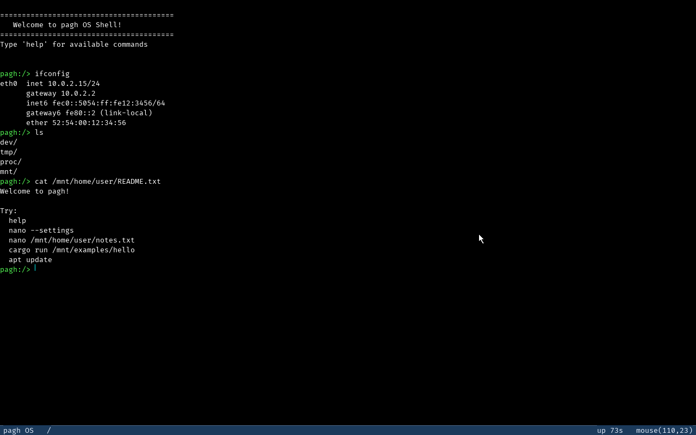

# `src/drivers/` — драйверы и device manager

Все устройства: PCI-энумерация, e1000, virtio-blk, NVMe, PS/2 клавиатура и мышь,
framebuffer-консоль, VT-эмулятор, курсор, serial. Координируются `drivers::mod`.

## Файлы

| Файл | Роль |
|---|---|
| `mod.rs` | Device manager: трейты `Console`/`CharacterDevice`/`BlockDevice`, реестр `DeviceManager` (`register_char/register_block/get_char/get_block`), boot-`init()` (kbd → framebuffer → mouse) |
| `pci/mod.rs` | Legacy PCI config-space через порты 0xCF8/0xCFC; `enumerate()` по всем 256 шинам; `enable_bus_master`; узнаёт virtio (0x1AF4) и Intel (0x8086) |
| `e1000.rs` | Intel 8254x NIC — поллинг, без IRQ; MMIO-регистры, EEPROM MAC, легаси 64-слотовые TX/RX-кольца |
| `virtio/mod.rs` | Корень virtio-обвязки (`blk`, `hal`) |
| `virtio/hal.rs` | `PaghHal` — реализация `virtio_drivers::Hal`: DMA/MMIO через `pmm`/`vmm`; автоматические bounce-буферы для неконтинуальных heap-буферов |
| `virtio/blk.rs` | virtio-blk: `PciTransport` + `VirtIOBlk`, обёрнут в `BlockDevice` «virtio-blk0», секторный кэш 2 MiB (write-through), `flush` = `VIRTIO_BLK_T_FLUSH` |
| `nvme.rs` | NVMe поверх PCIe — поллинг (phase-bit, поиск по CID), BAR0 MMIO, многостраничные PRP (PRP1 + PRP-list), до 4 команд в полёте, FLUSH (opcode 0x00) для дюрабильности WAL (issue #15), RMW для невыровненных записей; регистрируется как `BlockDevice` |
| `nvme_prp.rs` | Чистая (`core` только) арифметика NVMe: PRP1/PRP2/PRP-list, LBA-чанки команд, SQ/CQ phase-tag и зажим CAP.MQES — включается в host-tests как есть |
| `ps2_kbd.rs` | PS/2 клавиатура (IRQ1): 128-байтное кольцо сканкодов, трекинг Ctrl+C/Ctrl+Z, защёлки `CTRL_C`/`CTRL_Z`/`FG_PID`; ^C шлёт `SIGINT` foreground-группе терминала (`drivers::tty`), а не только записанному pid |
| `tty.rs` | Управляющий терминал консоли: foreground process group (kernel-side, по умолчанию — группа shell) + `TOSTOP`, `TIOCGPGRP`/`TIOCSPGRP` через чистую модель `linux::tty`, `check_access(kind)` — фоновое чтение/запись JOB-процесса получает `SIGTTIN`/`SIGTTOU` на всю группу и `EINTR` (не-JOB'ы, т.е. служебные spawn'ы ядра, не останавливаются) |
| `ps2_mouse.rs` | PS/2 мышь (IRQ12) через 8042 aux: сборка 3-байтовых пакетов, зажатые координаты + кнопки + `seq` |
| `framebuffer.rs` | Limine framebuffer текстовая консоль + 2D-графика: шрифт Fira Code 8×18 (`assets/font8x18.bin` — 8-битное **покрытие** на пиксель, генерируется `tools/gen_font.py`), `FbWriter`, скролл, status bar, макросы `fb_print!` |
| `vt.rs` | ANSI/VT-100 эмулятор поверх framebuffer (`Vt`: CSI/OSC/DCS, 256 цветов, scroll regions, ответы на запросы) — stdout compat-программ |
| `cursor.rs` | Программный курсор мыши 12×19 (save/restore фона); `text_begin`/`text_end` для курсор-безопасного текста |
| `serial.rs` | COM1 UART консоль (`init`, `write_bytes`, `console()`, макросы `kprint!`/`kprintln!`) |

## Ключевые символы

- `mod`: трейт `BlockDevice { name, read_block, write_block, sector_count }` (секторы 512 B);
  `init()`, `get_block(name)`.
- `pci`: `enumerate() -> Vec<PciDevice>`, `config_read_u32/write_u32`, `enable_bus_master`,
  `PciDevice::is_virtio()`.
- `e1000`: `attach(&[PciDevice]) -> Result<[u8;6], ()>`, `send(&[u8]) -> usize`,
  `recv(&mut [u8]) -> Option<usize>`, `mac_address()`, `is_attached()`.
  Ключевые регистры: CTRL 0x0000, EERD 0x0014, ICR 0x00C0, IMC 0x00D8, RCTL 0x0100, TCTL 0x0400,
  RX-кольцо 0x2800.., TX-кольцо 0x3800..; `DESC_COUNT=64`, `BUF_SIZE=2048`.
- `virtio::blk`: `init_blk(&[PciDevice])`, `VirtioBlkDevice` (реализует `BlockDevice`);
  `SECTOR_CACHE_MAX=4096` секторов, write-through.
- `ps2_kbd`: `init()`, `irq_handler()`, `has_pending()`, атомики `CTRL_C`, `CTRL_Z`, `FG_PID`.
- `tty`: `init_shell(pgid)`, `shell_pgid()`, `foreground_pgid()`, `set_foreground_pgid()`,
  `restore_shell_foreground()`, `tostop()`/`set_tostop()`, `check_access(TtyAccess) -> Result<(), Errno>`.
- `ps2_mouse`: `init(screen_w, screen_h) -> bool`, `irq_handler()`, `poll()`,
  `MouseState { x, y, left, right, middle, seq }`.
- `framebuffer`: `init()`, `console()`, `clear_screen()`, `set_fg_color()`, `dimensions()`,
  `with(f)`, `draw_status_bar(left, right)`, `fb_print!/fb_println!`;
  константы `CHAR_WIDTH=8`, `CHAR_HEIGHT=18`, `CHARS_PER_LINE=100`, `MAX_LINES=37`,
  `STATUS_BAR_HEIGHT=18`. Размер глифа экспортируется **намеренно**: VT, маппинг мыши в
  клетку и тулбар `paint` берут его отсюда, а не заводят свою копию (вторая копия —
  молчаливый баг раскладки при смене шрифта).
- `vt`: `init()`, `write(bytes)`, `dimensions()`, `take_input_responses()`.
- `cursor`: `hide()`, `move_to()`, `text_begin()`, `text_end()`.
- `serial`: `init()`, `write_bytes()`, `console()`.

## Как работает

### IRQ
Ровно два device-IRQ подключены в `boot.rs`: вектор 33 = IRQ1 клавиатура, вектор 44 = IRQ12 мышь.
Всё остальное — **e1000 и NVMe — поллится, прерывания замаскированы** (`REG_IMC=0xFFFFFFFF`
у e1000; phase-bit у NVMe). Это несущая предпосылка локинга `net::` — сетевой стек вообще
не живёт в IRQ-контексте.

### Клавиатура
Сканкод с порта 0x60 → трекинг 0xE0-префикса → Ctrl+C-make ставит `CTRL_C` и, если `FG_PID`
указывает на живой не-raw compat-процесс, шлёт настоящий `SIGINT` **foreground-группе
терминала** (`drivers::tty::foreground_pgid()` + `signal::send_signal_to_pgid_all`, по копии
на каждую thread-группу внутри pgid) прямо из IRQ, а `scheduler::request_exit(fg)` зовёт лишь
как фолбэк, когда у foreground-группы нет живого члена (например, ^C гонится с передачей
терминала в `cmd_lxrun`) → байт в кольцо (аллокации нет, при переполнении дроп). Ctrl+Z
(`CTRL_Z`) обрабатывает foreground-wait shell'а: останавливает ту же группу `SIGTSTP`.

### Мышь
Байт с 0x60 → ресинк по биту 3 нулевого байта → сборка 3 байтов → 9-битные знаковые дельты,
Y инвертирован, кламп в экран, инкремент `seq`. Рендерингом не занимается — потребляют
`cursor` и `paint`.

### e1000
`attach` находит 0x8086:0x100E/0x100F → bus master → BAR 0 → `vmm::map_mmio(phys, 0x2_0000)` →
маскирование IRQ → `CTRL_RST` → `CTRL_SLU` (link up) → континуальные кольца и буферные пулы
из `pmm::alloc_frames_contiguous` через HHDM → программирование RDBA/TDBA/LEN →
`RDT = DESC_COUNT` → enable → MAC из EEPROM (фоллбэк `52:54:00:12:34:56`).
RX-поллинг по биту `STATUS.DD`; TX: копия в слот-буфер, дескриптор `EOP|IFCS|RS`, kick `TDT`.
Один кадр = один дескриптор = один буфер 2048; oversized **дропается**, не режется.

### virtio-blk
Ручных virtqueue нет — крейт `virtio-drivers` 0.11. `PciTransport` находит virtio-капабилити
в BAR'ах и мапит через `PaghHal::mmio_phys_to_virt` (`NO_CACHE|NO_EXECUTE`). Буферы запросов
проходят `PaghHal::share`: прямой DMA при физической континуальности, иначе bounce-буфер
+ reconcile на `unshare`. Весь доступ — под одним `Spinlock` на время обмена.

### NVMe
PCI-класс 01h/08h → `enable_bus_master` → BAR0 (`map_mmio(..., 0x4000)`) → disable →
AQA/ASQ/ACQ → enable → Identify Controller → namespace list → Identify Namespace →
Create IOCQ/IOSQ (qid 1) → готово. `CAP.MQES` зажимает размеры очередей, `CAP.DSTRD`
берётся из битов 35:32 (младший ниббл старшего dword), `CAP.MPSMIN` обязан быть 0
(драйвер программирует CC.MPS = 4 KiB). `QSIZE` в Create-командах **zero-based**:
64-энтрийная очередь создаётся значением 63, иначе контроллер заворачивается на запись
позже хоста и читает за пределами кольца.

I/O-путь: до `IO_QUEUE_DEPTH = 4` команд в полёте, у каждой свой физически
континуальный data-slot (≤ 16 страниц / 64 KiB, дополнительно зажатый MDTS) и своя
PRP-list страница. `rw_common` режет запрос на LBA-выровненные чанки и отправляет
батч: все PRP валидируются до записи первого SQ-слота, дверной звонок SQ — один на
батч. PRP1 = первая страница (offset 0), PRP2 = вторая страница для ровно двух
страниц либо адрес PRP-list для трёх и более; entry 0 списка — **вторая** страница.
Завершения поллятся по phase-bit и сопоставляются с командами **по CID** (не по
порядку прихода); при таймауте/неизвестном CID драйвер помечает устройство
отказавшим (`io_failed`) вместо рискованного сопоставления. Невыровненные записи
идут read-modify-write по LBA, чтобы не затирать соседние сектора. `sector_count()`
отдаёт весь namespace в 512-байтных секторах (нужно `ext2::format`).
Не реализовано: IRQ, несколько namespace, разбор партиций (берётся весь namespace),
несколько I/O-очередей, SMART/self-test и shutdown-notification.

### Консоль / VT / курсор

- Текстовая сетка 8×18 (Fira Code; ширина и высота клетки — `CHAR_WIDTH`/`CHAR_HEIGHT`,
  их же используют VT, маппинг мыши в клетку и тулбар `paint`), скролл — `copy` текстовой
  области на строку вверх (status bar не трогается);
  контрольные символы: `\n`, `\r`, `0x08`, печатные 32..=126.
- Шрифт — **данные, а не код**: `tools/gen_font.py` растеризует TTF в
  `assets/font8x18.bin` (95 глифов ASCII 0x20..0x7E, **8 бит покрытия** на пиксель:
  0 — фон, 255 — полная заливка),
  ядро его только блитит (`include_bytes!`) и смешивает (`blend_px`) с фоном и цветом
  текста — отсюда сглаженные края букв; никакого TrueType-парсера в ядре нет. Размер
  em выводится из ширины клетки (у Fira Code advance 0.6154 em → ровно 8.00 px при em 13,
  то есть клетка 8 px подходит без сжатия букв), базовая линия подбирается по реальным
  чернилам, так что descender'ы не липнут к низу клетки. Перегенерация —
  `python3 tools/gen_font.py --font /usr/share/fonts/fira-code/FiraCode-Regular.ttf
  --cell 8 --cell-h 18 --out assets/font8x18.bin` (ассет и константы меняются одним
  коммитом). Прежний `assets/font8x16.bin` (VGA-подобный 8×16) остаётся в дереве только
  как контроль для `tools/font_check.py` и предпросмотра `gen_font.py --png` — ядро на
  него больше не ссылается.
- **Тень экрана, а не MMIO на каждый пиксель.** `FramebufferWriter::back` — копия кадра в
  обычной RAM; рисование идёт туда, а `flush()` копирует всю поверхность на устройство.
  `put_pixel` отмечает прямоугольник `dirty`, и `flush()` без изменений — no-op, поэтому
  простаивающий шелл не копирует 4 МБ каждый тик. Это контракт: **нарисовал в тень —
  вызови `flush()` один раз в конце кадра**; иначе экран останется старым (именно так
  «пропал» курсор: стрелку рисовали после `flush`, а следующий `hide` восстанавливал фон
  раньше следующего flush).
- `FbWriter` = `Spinlock<Option<FramebufferWriter>>`; `init()` строит writer **вне** локa
  (лог внутри `new()` ре-лочит нереентерабельный спинлок — дедлок).
- **Курсор — часть кадра.** `cursor::move_to(x, y)` пишет стрелку в тень (в «тихом»
  режиме `set_quiet(true)`, чтобы 12×19 пикселей не помечали весь кадр грязным) и сразу
  выталкивает свой прямоугольник `flush_rect`; `hide()` так же возвращает фон. Поэтому
  `move_to` вызывается **до** кадрового `flush`, а не после. `move_to` идемпотентен: шелл
  зовёт его на каждом пробуждении, и неподвижная стрелка не должна ничего копировать.
- Каждый текстовый вывод идёт `cursor::text_begin()` → write → `text_end()` — стрелка мыши
  прячется/восстанавливается из любого потока.
- VT-эмулятор: сетка ячеек с fg/bg, scroll regions, 16 ANSI + 256 цветов; отвечает на
  DA1/DSR/DECRQM/OSC через очередь, дренируемую в compat-stdin. `vt::init()` зовётся
  перед запуском Linux-процесса (`cmd_lxrun`).

## Зависимости

- **От:** `memory::pmm` (континуальные кадры), `memory::vmm` (`phys_to_virt`, `map_mmio`),
  `sync::spinlock`, порт I/O крейта `x86_64`, Limine `FRAMEBUFFER_REQUEST`,
  `virtio-drivers` (только virtio), `task::compat`/`task::scheduler` (^C).
- **На неё:** `net` (e1000), `boot.rs` (storage, IRQ wiring), `vfs`/`fs` (BlockDevice),
  `log.rs` (serial + framebuffer mirror), весь `shell/`, `task/compat` (stdout → vt).

## Грабли

- TX-лимит e1000: `BUF_SIZE - 4 = 2044` байта на кадр.
- `enable_bus_master` пишет назад весь command dword — старшая половина write-1-to-clear,
  не заляпать.
- `PaghHal::dma_alloc`/`mmio_phys_to_virt` — `expect` при неудаче (boot-fatal by design).
- Инвариант bounce-буферов: virtually-континуальный heap-буфер может быть физически
  фрагментирован — `share` проверяет континуальность постранично через `virt_to_phys`.
- Секторный кэш когерентен только потому, что весь disk I/O идёт через `read_block`/`write_block`.
- Замыкание `framebuffer::with` НЕ должно логировать (ре-лок той же консоли → дедлок).
- Шрифт покрывает только ASCII 0x20–0x7E; остальное — fallback-бокс.
- `CHARS_PER_LINE=100` — фиксированная ширина переноса независимо от разрешения.
- DMA-буферы e1000/NVMe — PMM-кадры через HHDM; heap-аллокаций на I/O-пути нет.
  NVMe выделяет data-slot'ы и PRP-list страницы на `attach`, не на каждый запрос.
- PRP-list entry 0 — вторая страница, не первая (PRP1 уже назвал первую); `QSIZE`
  zero-based; `CAP.DSTRD` — младший ниббл `cap_hi`, а не `(cap_hi >> 12)`.
- Команда покрывает целые LBA: `plan_chunk` держит `within + data_len` и весь
  LBA-command внутри slot; выровненные записи не содержат padding. Невыровненные
  записи — RMW, иначе байты соседних секторов были бы обнулены.
