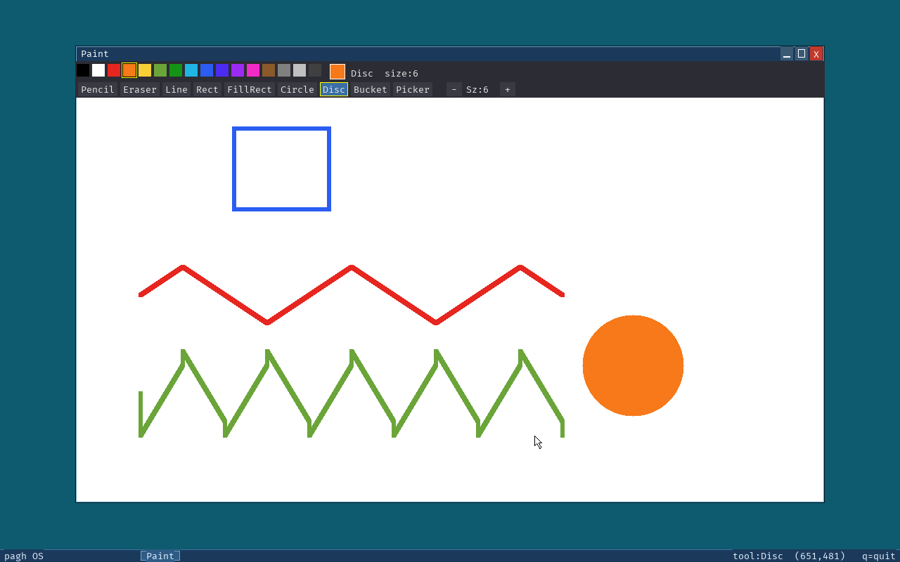
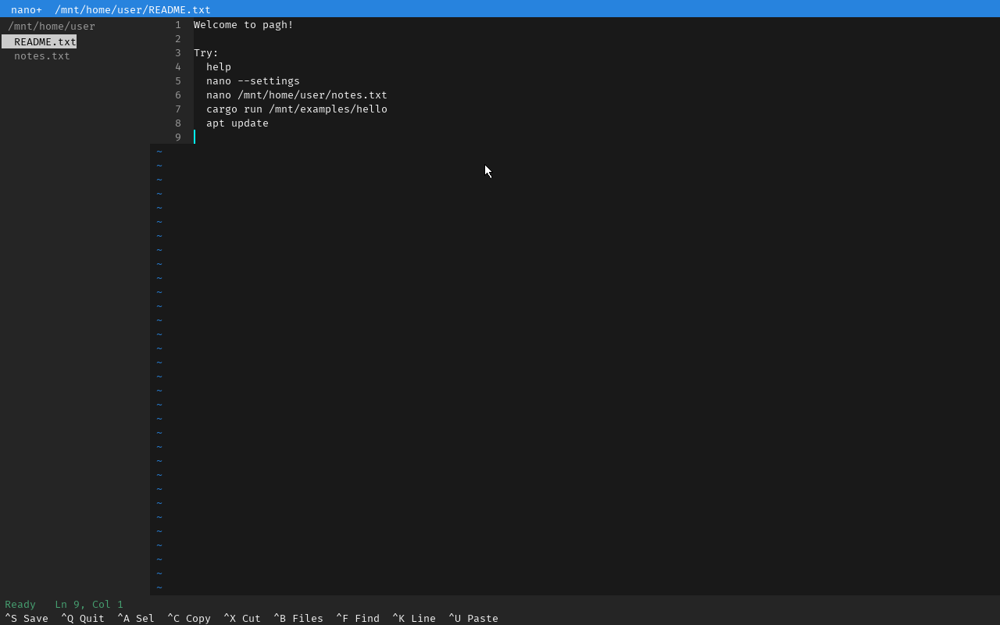

# `src/shell/` — интерактивный shell, paint, nano

Framebuffer-shell с редактированием строки, историей, таб-комплишном, цветным выводом;
оконная рисовалка `paint`; полноэкранный редактор `nano+`. Вход — `shell::shell_main()`, вызывается из `boot.rs` после поднятия ФС/сети.

## Файлы

| Файл | Роль |
|---|---|
| `mod.rs` | I/O-слой REPL: REPL-цикл (`shell_main`), диспетч через реестр, Tab, autorun, dual serial+framebuffer печать, status bar |
| `commands.rs` | Тела всех команд (`cmd_help`, `cmd_ls`, `cmd_apt`, …) + хелперы `shell_println`, `resolve_arg`, `rm_path` и др. |
| `ppkg_progress.rs` | Чистая (core+alloc) модель/рендереры прогресса `ppkg install`: known `[====    ]`, unknown `<=>` (`(elapsed_ms/500)%(width-4)`, `???%`), percent/speed/size/ETA, гейт 10 FPS, ANSI/CR/plain-эмиттеры. Host-тесты: `host-tests/src/properties/ppkg_progress_ui.rs` |
| `progress.rs` | Effectful-драйвер: `InstallObserver` → serial+framebuffer, выбор режима (framebuffer → CR, serial/`--quiet` → plain, `--progress=ansi` → VT100) |
| `cat.rs` | Чистое ядро `cat`: потоковое чтение чанками 256 Б с капом 64 KiB, дословный вывод и завершающий `\n`, если файл не заканчивается переводом строки (иначе следующий промпт приклеивался к последней строке файла — QA F-04) |
| `texttools.rs` | Чистое ядро `head`/`tail`/`wc`/`grep`: один потоковый обход строк (чанки 256 Б, кап 4 MiB), ring на N строк для `tail`, счётчики для `wc`, ASCII case-fold подмножество для `grep -i`; сюда же тонкий VFS-слой этих четырёх команд |
| `registry.rs` | Статическая таблица `COMMANDS: &[CommandSpec]`; `lookup()`, `command_names()` |
| `identity.rs` | Сессионная идентичность shell для фазы 1 «группы отдельно от root»: `current`/`set_session` (креденшелы, с которыми `lxrun` запускает Linux-программы), чтение `/mnt/etc/passwd` + `/mnt/etc/group`, метки uid/gid для `id`/`groups`/`su`; обработчики команд — в `commands.rs` |
| `identity_db.rs` | Чистый (core+alloc) разбор `/etc/passwd` (7 полей) и `/etc/group` (4 поля), first-match lookups, `groups_for_user`/`supplementary_groups_for_user`; host-свойство P58 |
| `editor.rs` | `LineEditor` — чистая буфер+курсор модель (курсор в чар-юнитах, cap 256) |
| `history.rs` | `History` — bounded ring (CAP=64), recall вверх/вниз, stash текущей строки, дедуп подряд идущих |
| `complete.rs` | Чистое таб-дополнение: `longest_common_prefix`, `Completion::{None, Single, Multiple}`, `complete_command`, `complete_path` |
| `keys.rs` | Декодер PS/2 Set 1: `KeyEvent`, `Decoder` (0xE0-префикс, Shift/Ctrl/CapsLock), таблица ASCII, `CTRL_C_LATCH`, `CTRL_Z_LATCH` |
| `jobs.rs` | Таблица заданий shell'а: `Job { pid, pgid, command, stopped }` под `Spinlock`, `record`/`remove`/`snapshot`/`last`/`set_stopped`; наполняется `lxrun`/`fg`/`bg` |
| `render.rs` | `Style`, цветовые константы, `with_style`, `prompt`, `error_line`, `success_line` (framebuffer — цвет, serial — plain) |
| `selection.rs` | Выделение мышью: диапазон клеток, подсветка инверсией, копирование текста из модели экрана; `Ctrl+A` — выделить строку, `Ctrl+X` — вырезать, `Ctrl+Y`/`Ctrl+V` — вставить |
| `caret.rs` | Мигающая каретка: клетка из позиции консоли и логического курсора (`Caret::cell_for`), отрисовка/стирание вертикальной черты (`paint_caret`), фаза мигания по тикам |
| `path.rs` | Глобальный CWD под `Spinlock<String>`; чистые `normalize` (фолдинг `.`/`..`, кламп в корень), `resolve`, `cwd`, `set_cwd` |
| `suggest.rs` | Bounded Levenshtein `edit_distance`, `nearest_command` для «did you mean» |
| `paint.rs` | Оконная рисовалка (~1470 строк): title bar, toolbar, taskbar, canvas `Vec<u32>` |
| `nano.rs` | `nano+` полноэкранный редактор: `Editor`, undo/redo, поиск/замена/goto, clipboard, мигающая каретка, сайдбар с деревом файлов (`^B`) |
| `tree.rs` | Дерево файлов для сайдбара редактора: плоский список видимых строк с отступами, раскрытие/сворачивание каталогов, навигация с клавиатуры; обход VFS с ограничением глубины и числа записей |
| `nano_config.rs` | Персист `NanoConfig` в `/mnt/.nanorc`; темы Dark/Light/Blue; CLI `nano --settings` |

## Ключевые символы

- `shell::shell_main() -> !`
- `registry::{CommandSpec, ShellCtx, COMMANDS, lookup, command_names}`
- `editor::LineEditor::{insert, delete_back, delete_fwd, move_left/right/home/end, buffer, cursor}`
- `history::History::{push, recall_prev, recall_next, reset_nav, saved_line}`
- `complete::{longest_common_prefix, complete_command, complete_path}`
- `keys::{KeyEvent, Decoder::{new, feed}, CTRL_C_LATCH, CTRL_Z_LATCH}`
- `jobs::{Job, record, remove, snapshot, last, set_stopped}`
- `identity::{current, set_session, load_users, load_groups, display_groups_for_user, supplementary_groups_for_user, session_groups}`
- `identity_db::{parse_passwd, parse_group, user_by_name, groups_for_user, supplementary_groups_for_user}`
- `path::{normalize, resolve, cwd, set_cwd}`
- `suggest::{edit_distance, nearest_command}`
- `paint::run()`, `nano::run(path)`; `rust` = алиас `lxrun`, `cargo`/`rustc` = установленные бинарники через Linux-слой

## Как работает REPL

1. Баннер на обе консоли (`kprintln!` = serial, `fb_println!` = framebuffer).
2. `run_autorun()`: исполняет непустые не-`#` строки `/mnt/etc/autorun` (cap 512 байт), `&&`-чейны.
3. Сессио-персистентные `keys::Decoder` и `History`; на промпт — свежий `LineEditor`.
4. Внешний цикл — промпт; внутренний — `cpu::halt()` до прерываний. Таймер будит поток
   каждый миллисекунд, но **проход выполняется только если что-то изменилось**: пришёл
   сканкод, сдвинулась мышь (`MouseState.seq`, кнопки тоже бампают seq), сменилась
   секунда status bar или фаза мигания каретки. Иначе `continue` — иначе каждый тик
   заканчивался бы кадровым `flush()` (копия всей тени), и «простаивающий» шелл жёг бы
   ядро. На проходе: `ps2_mouse::poll()`, `cursor::hide()`, перерисовка status bar
   (OS, CWD, uptime, координаты мыши), дренаж сканкодов и в конце `cursor::move_to()` +
   ровно один `framebuffer::flush()`.
5. События: вставка, Backspace/Delete, стрелки/Home/End, Up/Down история, Tab, Enter →
   `execute_command`.
6. `execute_command`: split по `&&`, токенизация, `registry::lookup` → вызов хендлера;
   неизвестное → `error_line` + `nearest_command` «did you mean».

**Выделение и буфер обмена**: левая кнопка мыши с протяжкой выделяет текст консоли
(подсветка — инверсия клеток), при отпускании текст уходит в буфер обмена сессии;
`Ctrl+A` выделяет всю строку ввода, `Ctrl+X` вырезает выделенное (сначала скопировав),
`Ctrl+Y` и `Ctrl+V` вставляют. Копирование ничего не печатает в консоль: это жест
мышью, и вывод сдвинул бы с экрана тот самый текст, который выделили. Диапазон
строится от **фактической строки консоли** (`line_cells`), а не от нулевой строки
сетки: до промпта уже есть вывод и скролл, и координаты «от нуля» копировали чужой
текст — это был реальный баг (см. коммит `fix: selection built its range from grid
row 0`).

**Модель рендера**: редактируемая строка по-прежнему перерисовывается деструктивно —
`erase_visible(n)` даёт `"\x08 \x08"` на обеих консолях, `redraw_line` стирает `shown`
символов и перепечатывает буфер. Но **каретка от этого больше не зависит**: консоль ведёт
модель экранных клеток (`FramebufferWriter::grid`), умеет перерисовывать одну клетку, не
двигая собственный курсор (`paint_cell`), и сообщает, где стоит (`cursor_cell`). Поэтому
`caret.rs` ставит мигающую голубую черту (`0x00FFFF`) ровно в клетку логического курсора —
включая середину строки, перенос и скролл; раньше она всегда стояла в конце строки.
Каретка — наложение: её стирают перед любой перепечаткой текста и переставляют после.
Программный курсор мыши рисуется в ту же тень **до** кадрового `flush` (`cursor::move_to`
стоит прямо перед ним); `move_to` идемпотентен, `hide`/`move_to` выталкивают только
свой 12×19 прямоугольник. Так стрелка видна всё время между кадрами, а не мигает между
`hide` и `flush`.

**Клавиатура**: `keys::Decoder` применяет Shift в таблице `scancode_to_ascii`, а
CapsLock — уже поверх результата (`caps` инвертирует регистр буквы, поэтому
caps+shift = строчная). Старая формула `caps != shift` учитывала Shift дважды и делала
Shift+букву строчной при выключенном CapsLock. Пока клавиатурой владеет VT-клиент
(`/dev/vtinput`), физические скан-коды в это кольцо не кладутся — shell получает их
один раз через vtinput (`drivers::vtinput::client_active`); когда клиент завершился,
цикл shell снимает защёлку (`reap_dead_client`) и прямой путь возвращается.

### Tab-комплишн
Без whitespace → `complete_command`; иначе `readdir()` родителя токена через VFS →
чистая `complete_path`. `Single` заменяет токен; `Multiple` расширяет до LCP и листит кандидатов.

## Консоль: скроллбек

Колесо PS/2-мыши и `PageUp`/`PageDown` листают историю консоли (3 строки на щелчок
колеса, экран на клавишу); любая обычная клавиша или клик возвращают вниз, `clear`
историю забывает, status bar показывает `scroll N/M`. Модель — `drivers::scrollback`
(ring строк), отрисовка — `drivers::framebuffer::render_view`; live-сетка, каретка и
выделение при этом не двигаются.

## Команды (полный список)

`help`, `clear`, `echo`, `uptime`, `date` (RTC в UTC: ISO-время, день недели, unix-секунды),
`ls [-l]`, `tree [-L N]` (рекурсивный ASCII-листинг с итогами), `cat` (cap 64 KiB; если файл не заканчивается
`\n`, вывод завершается переводом строки, чтобы промпт не приклеился к последней строке),
`head`/`tail` (`-n N`), `wc` (`-l -w -c`), `grep` (`-i -v -n -c`), `free [-h]` (RAM + kernel heap
в busybox-раскладке, честные нули shared/buffers/swap; `-h` — человеческие единицы),
`df [-h]` (ёмкость точек монтирования; `-h` — то же в KiB/MiB/GiB),
`mkdir`, `touch`, `write`
(заменяет содержимое: `truncate(0)` + запись, поэтому короткий текст не оставляет хвоста),
`rm` (`-r`/`-rf`, post-order, depth cap 24), `sync`, `fscrash` (демо journal replay:
запись, ремоунт ext2, `journal.recover()`, верификация), `pci`, `exec` (встроенный
тестовый ring-3 процесс), `ifconfig`, `ping`, `nc`, `selftest` (`test::run_all()`),
`cd`, `pwd`, `cp` (cap 16 MiB), `mv` (только файлы), `stat`, `chmod` (октальный режим),
`chown` (числовой `uid[:gid]`), `sleep`, `nano`, `lua`,
`python`/`python3`, `pythonc`, `cargo`, `rustc`, `rust`, `paint`,
`pkg <host> <path> [port]` (HTTP GET .deb → ar → decompress → tar → install в /mnt),
`ppkg <update|install|show|list|setmirror>` (`install` принимает `--quiet` и
`--progress=ansi|cr|plain`, рисуя DNF-style прогресс), `lxrun <path> [args]` (Linux ELF в ring 3,
fixed env `TERM=xterm`, `PATH=/mnt/usr/bin`; забирает терминал у shell'а на время
работы — см. «Job control»), `jobs`, `fg`, `bg`, `warn <on|off>` (тумблер fb-зеркала
warn-логов), `usb` (состояние xHCI и PORTSC каждого порта), `disk`
(`list`/`setup`/`mount <n>`/`format <n> [--force]`/`cancel` — блочные устройства и
явное форматирование), `settings`/`theme`/`wallpaper` (тема, фон, статус-бар, каретка),
`exit` (завершить терминальную сессию окна; в boot-shell — объясняет, почему
нельзя).

## Команды `ps` и `df`: что они честно показывают

- `ps` печатает и Linux-compat процессы (строки собираются из `/proc/<pid>/stat`
  и `/proc/<pid>/cmdline`), и **kernel-потоки** из таблицы имён планировщика
  (`task::scheduler::task_names_snapshot`) как `[shell]`, `[net]`, … До этого в
  сессии без запущенной программы выводился один заголовок — то есть «в системе
  нет процессов», ровно наоборот к смыслу команды. Состояние `T` — задача
  припаркована в `STOPPED_TASKS`, иначе `R`; PPID kernel-потока — 0, как у
  kthread в Linux.
- `df` показывает реальную ёмкость только у ext2 (`fs_stat()`); `-` в остальных
  строках — это контракт VFS (`fs_stat() == None` = «ФС не ведёт учёт ёмкости»),
  а не отсутствие данных. Для `rootfs`/`ramfs` команда дополнительно считает
  занятые байты обходом дерева (`Used`), потому что сколько ФС ДЕРЖИТ — известно,
  а сколько ей осталось — нет (она ограничена только физической памятью).

## Вторая сессия: терминальное окно desktop'а

Один и тот же REPL обслуживает **две** консоли: boot-shell (сессия 0, Limine
scanout) и терминальное окно desktop'а (сессия 1, offscreen-поверхность
`/dev/vtfb1`). Копии кода нет — есть маршрутизация по задаче:

* вход в окно — `shell_main_session(1)`; `shell_main()` — тонкая обёртка для
  сессии 0, поэтому поведение загрузки не менялось;
* `fb_print!`/`framebuffer::with`/`flush`/`dimensions`/`console()`,
  `ps2_kbd::take_scancode`/`has_scancode`, `path::cwd`/`set_cwd` и состояние
  курсора разрешают **экземпляр текущей задачи** через `drivers::session`
  (чистая `session_route::route` над атомиками: владелец сессии сильнее
  привязки compat-ребёнка);
* окно не зовёт `tty::init_shell` (управляющий терминал один — boot-shell),
  не печатает баннер в serial и не исполняет `autorun`; вывод команд окна в
  serial тоже подавлен (`serial::_kprint`), потому что serial — общий лог ядра;
* `nano`/`paint` работают без изменений логики: они рисуют через общий
  framebuffer-API, а `nano` уже читал клавишу общим helper'ом; единственная
  механическая правка — та же строка чтения клавиши в `paint.rs`, переведённая
  на `super::try_read_scancode` (маршрутизация I/O, не поведение редактора);
* `exit` завершает задачу сессии; последний `close` устройств окна ставит
  запрос выхода, и задача выходит сама на границе цикла.

Дизайн, ABI (`VTFBIOGET_INFO`, mmap/read, `vtinput1`), тесты и честные границы
(нет PTY/termios и per-window job control, два окна делят одну сессию,
глобальная идентичность `su`/`login`) — `docs/terminal-session.md`.

## Job control

Терминал консоли — управляющий, и у него ровно одна foreground-группа
(`drivers::tty`, чистые правила — `linux::tty`, хост-свойство `tty_job`).

1. `lxrun` (и команды, которые его переиспользуют) спавнит процесс и **в той же
   `without_interrupts`-секции** помечает его JOB'ом (`compat::mark_tty_job`),
   отдаёт ему терминал (`tty::set_foreground_pgid(child_pgid)`), печатает строку
   `lxrun: started …` и выравнивает курсор VT по курсору консоли
   (`vt::cursor_from_console`). Один критический участок на всё: дочерний процесс
   становится runnable сразу по возврате interrupts, поэтому и «фоновое окно»
   (`SIGTTIN` на первом чтении), и гонка «первый вывод программы против строки
   шелла» закрываются только так.
2. `foreground_wait(pid, pgid, command)` ждёт, опрашивая защёлки ^C/^Z:
   - ^C → `SIGINT` **foreground-группе** (`signal::send_signal_to_pgid_all`), а не
     записанному pid; для не-raw процесса fallback — `scheduler::request_exit`;
   - ^Z → `SIGTSTP` той же группе: останавливаются ВСЕ thread-группы задания
     (групповая остановка в планировщике per-thread-group, лидеру её мало), запись
     попадает в `jobs` как `Stopped`;
   - на любом выходе (exit или stop) shell возвращает себе терминал
     (`tty::restore_shell_foreground()`).
3. `jobs` печатает таблицу, `bg` шлёт `SIGCONT` всей группе и оставляет её в фоне
   (следующее чтение терминала снова её остановит — `SIGTTIN`), `fg` **сначала**
   отдаёт терминал заданию, потом шлёт `SIGCONT`, и ждёт его тем же
   `foreground_wait` (иначе задание, пишущее сразу после `SIGCONT`, было бы
   остановлено как фоновое).

JOB-статус (`CompatState::tty_job`) наследуется `fork`/`clone`, поэтому подпроцессы
задания остаются под управлением терминала. Процессы, которых shell терминалу не
передавал (проверочные бинарники apt, harness `selftest_lx`), — не JOB'ы и
терминалом не останавливаются: иначе фоновый запуск при живом shell'е подвесил бы
boot/E2E, который их ждёт.

## paint — архитектура

- Одиночное модальное приложение, общего window manager нет: `PaintApp` держит свой chrome —
  `WinMode::{Windowed, Maximized}`, кнопки Minimize/Maximize/Close, драг титлбара (кламп
  в десктоп), фон десктопа, taskbar с кнопкой «Paint».
- Общие layout-хелперы `tool_buttons()`/`brush_ui()` — рендер и hit-test физически не могут разойтись.
- Canvas: `Vec<u32>` (1 пиксель = u32, белый) + one-level undo (второй undo = redo).
  Windowed-режим = 5/6 экрана по центру; maximize/restore сохраняет перекрывающиеся пиксели.
- Инструменты (клавиши p/e/l/r/f/c/d/b/i): Pencil, Eraser, Line, Rect, FilledRect, Circle,
  Disc, Fill (scanline flood fill), Picker. Brush 1..=64. ЛКМ = рисовать, ПКМ = белый (только Pencil/Eraser).
- Shape-preview: rubber-band прямо в framebuffer, откат через `blit_canvas_rect`.
- Геометрия: Bresenham, brush-thick midpoint circle, локальный `isqrt` (Ньютон).
- Сохранение: магия `PAGHIMG1` + LE u32 размеры + LE u32/пиксель в `/mnt/paint.img`.
- Цикл: halt на idle; Esc — выход; события мыши по изменению `MouseState.seq`;
  taskbar репейнтится не чаще раза в 6 тиков. Кадр заканчивается одним
  `framebuffer::flush()` (тень консоли — см. `drivers/README.md`), поэтому canvas,
  toolbar и taskbar действительно доходят до устройства; `flush` без изменений — no-op.

## nano

Сайдбар с деревом файлов — `^B`. Дерево строится от каталога редактируемого файла,
каталоги раскрываются `→`/Enter, сворачиваются `←`, `Esc`/`Tab` возвращают фокус в
текст. Открытие файла из дерева запрещено при несохранённых правках (`^S`): статус
объясняет почему, а подсветка дерева **возвращается на реально открытый файл** — иначе
сайдбар показывал бы файл, который вы не редактируете. Каретка — такая же мигающая
вертикальная черта, как в shell; раньше это было статичное подчёркивание, из-за чего
её было не видно.

**Фокус и «изменён»**: открытие файла (Enter по строке дерева или клик по ней) возвращает
клавиатуру в текст — иначе после пары переключений все клавиши уходили в дерево и редактор
выглядел мёртвым. `dirty` вычисляется сравнением буфера со снимком на момент
открытия/сохранения (`Editor::refresh_dirty`), поэтому «набрал символ и стёр его» больше не
помечает файл изменённым.

**Мышь**: `move_to`/`hide_deferred` — часть кадра; клик в тексте ставит каретку и
начинает выделение, протяжка выделяет (подсветка инверсией, каретка едет за
указателем), клик по строке сайдбара открывает файл, клик по каталогу переносит
фокус. Кнопки читаются по фронту (`left && !prev_left`), потому что драйвер отдаёт
уровень, а не событие.

## nano (детали)

`MAX_FILE=64KiB`, `MAX_LINE=4096`, `UNDO_LIMIT=32`; 3 темы через `NanoConfig::palette()`.
Клавиши: `^S` save (опц. `.bak`), `^Q`/Esc — двухнажатный quit guard, `^F` find, `^R` replace,
`^G` goto, `^Z`/`^Y` undo/redo, `^A` выделить всё, `^C` копировать, `^X`/`^K` вырезать,
`^U`/`^V` вставить (без выделения `^C`/`^K`/`^U` работают построчно, как в nano).
Любая стрелка/Home/End снимает выделение — иначе следующая же Delete стёрла бы
невидимый диапазон. Перерисовка **инкрементальная**: строка под курсором, футер и
каретка; полный кадр — только при скролле, смене файла, промпте и т.п. (полный кадр
на каждую клавишу давал лаги и полунарисованные кадры). Не-ASCII → `?` (дисплей
лосси, ввод ASCII); каретка — такая же голубая черта, как в shell.

## Зависимости

- **От:** `drivers` (framebuffer, cursor, ps2_mouse, ps2_kbd), `vfs`, `net`, `pkg`,
  `task::{process, compat, scheduler}`, `arch::cpu`, `apic::TICK_HZ`, `log`, `sync::spinlock`.
- **На неё:** `boot.rs` (вызов `shell_main`), `test.rs` (свойства P21–P29 + unit-проверки
  гоняют чистые модули `complete/editor/history/keys/path/render/suggest/registry/cat`
  напрямую).

## Грабли

- Всё в `shell` — `pub(crate)`; наружу крейта ничего не экспортируется.
- `execute_command` игнорирует коды ошибок отдельных команд `&&`-чейна и выполняет чейн до
  конца: неизвестная команда тоже его НЕ останавливает — печатает ошибку и продолжает
  следующий сегмент (для настоящего `&&` это неверно, но так устроен код).
- `cmd_mv` работает только с файлами (каталоги отклоняются).
- Дедуп истории — только подряд идущих.
- Контракт cursor/framebuffer: `hide()` до любого ренда под курсором, потом `move_to`;
  замыкания `framebuffer::with` не логируют (дедлок на нереентерабельном спинлоке).
